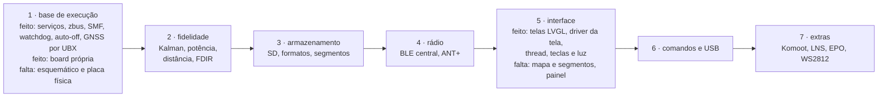

# Estado e próximos passos

Registro que saiu do [`CLAUDE.md`](../../CLAUDE.md) em 2026-10-16 (era a seção 5); lá ficou o resumo. Atualize este arquivo quando o estado mudar.

- **Port:** compila no NCS v3.3.0 e passa nos testes de host; **nunca rodou em placa nem no DK**. Matriz completa em [`docs/10-status-do-port.md`](../../docs/10-status-do-port.md).
- **Feito em 2026-09-18:** revisão completa do legacy e do port (7 análises), build com sysbuild, scripts novos, testes de host, documentação, e 13 correções críticas: pilha da `main_loop` (4 KB), GPS fora da ISR (ring buffer + processamento na thread), um callback de fix por época, checksum NMEA, parser NMEA, estouro do `sd_logger`, botões, polaridades do GPS e do FXOS, nós do DK desligados, reset em erro fatal, símbolo do SoC. Depois, da fase 1: a `main_loop` como única escritora do modelo, com `model_lock()` para a tela; `task_wdt` com um canal de 4 s por thread; auto-off de 15 min e desligamento pelo STC3100 (`power_scheduler`).
- **Feito em 2026-09-19:** a base da arquitetura nova ([`docs/05`](../../docs/05-arquitetura-zephyr.md)): oito serviços com thread e caixa de entrada, eventos no zbus, máquinas de sistema e de modo no SMF, watchdog por serviço, hardware pelas APIs do Zephyr por aliases do devicetree; saíram o HAL próprio, os drivers da V3, a interface em paisagem e a USB antiga. E a interface da placa nova em LVGL (`src/ui`, `include/ui`): as telas em retrato, nos temas de 8 cores e preto e branco, com os arranjos e formatos do legacy, testadas no PC pelo renderizador de host (`tests/ui`). Depois, a interface no firmware: driver próprio da tela em `zephyr_app/modules/gnss_drivers` (JDI LPM027M128B/C e Sharp LS027B7DH01, retrato, só as linhas que mudaram), thread `ui` com o LVGL (6 KB de pilha), teclas por `zephyr,input-longpress`, máquina da luz; nada visto num painel. E o medidor MAX17262 por driver próprio (`adi,max17262`, API de fuel gauge), com bateria fraca e crítica no serviço de energia, o nPM1300 (trilhos travados, limite do VBUS pela fonte USB-C, eventos, máquina de carga) e o AEM10900 por driver próprio (`e-peas,aem10900`, API de carregadores; a potência em mW espera o fator da e-peas). E o GNSS: driver próprio do u-blox por UBX (`modem_ubx` sobre a UART, configuração por `CFG-VALSET` nas camadas RAM e BBR, `UBX-NAV-PVT` e `UBX-NAV-SAT` a 1 Hz, standby por `UBX-RXM-PMREQ` e reinício por silêncio) com a máquina de energia do receptor em `gnss_power.c`; não testado com nenhum desses componentes.
- **Feito em 2026-09-20:** oito itens, todos verificados no build e nos testes, nenhum em placa.
  1. **Segmentos** de ponta a ponta: pool de 3 × 256 pontos com decimação, janela do histórico que anda, alocador a cada época no serviço do modelo, constantes do legacy.
  2. **Atualização por BLE**: MCUboot pelo sysbuild e mcumgr SMP, só no alvo nRF54LM20A, com recusa em atividade ou bateria fraca, tela de progresso e confirmação da imagem; ainda com a chave de desenvolvimento do MCUboot ([07](../../docs/07-radio-ant-ble.md#atualização-por-ble-dfu)).
  3. **BLE central**: o rádio passou a anunciar e varrer (nada começava), a inscrição GATT ganhou `disc_params` e `end_handle` (escrevia em ponteiro nulo) e a referência de conexão é liberada (o pool esgotava).
  4. **Percursos**: formato do legacy (`lat lon [alt]`, CRLF, metadados), `.PAR` aceito, saída do estado fora do percurso e carga do percurso escolhido na tela.
  5. **Mapa e segmentos na tela**: projeção pura em `map_project.c`, zoom do legacy em cinco passos e barra de escala.
  6. **Comandos do legacy** pelo NUS, com os destrutivos recusados pelo rádio.
  7. **Memória soldada** no lugar do cartão na placa nova (decisão do dono): FatFs sobre `zephyr,flash-disk`, com `/SD:` de sempre.
  8. **USB**: serviço novo com porta serial dos comandos e o disco do ciclista no PC no modo USB.
- **Feito em 2026-09-26 (hardware, nada fabricado):** as pendências elétricas fechadas com o dono — receptor GNSS no **3V0** (sai o tradutor de nível e o LDO de 1,8 V; BUCK1 montado e sem carga, `regulator-boot-off`), corte térmico da carga solar por comparador TLV7031 alimentado pelo painel (só o lado quente: o frio ficou em aberto), tecla central isolada do `SHPHLD` por Schottky, pinagem do `J102` em cobre igual à de 06, D105 e FB301 trocados; as três teclas abaixo do display (y = 66, passo 8,5); dois furos M2; o par USB roteado à mão pelo diodo de proteção; o roteador e as regras honestos (RT1 conta os desconectados do DRC completo, ME2 mede sombras de display e célula, ME4 lê o corpo do STEP do fabricante, `check_pcb` para de acusar o USB-C na borda e conta os dois furos); a reserva dos furos igual ao courtyard do footprint (2,45 mm). Relatório em [`hardware_gnssbike/10-dry-run-2026-09-26.md`](../../hardware_gnssbike/10-dry-run-2026-09-26.md). Depois, no mesmo dia: o esquemático desenhado por bloco funcional e espalhado para ser legível; o **conector SWD de 10 vias `J202`** (Cortex Debug, 2 × 5 a 1,27 mm) ao lado do Tag-Connect, em (11,3; 72,2), abaixo das teclas; e a **proposta de caixa em volta da placa** (`hardware_gnssbike/caixa/make_caixa.py`: 62 × 104 × 16, célula no fundo entre nervuras, display num bolso da tampa, teclas com capa e membrana, seis módulos solares em bolsos sob coberturas transparentes, STL para a primeira prova; o LED e o sensor de luz estão sob o display na placa e precisam mudar de lugar, e um dos furos M2 da placa fica sobre a célula).
- **Feito em 2026-09-26 à tarde (caixa medida, nada impresso):** as três chaves da placa no passo de 13,4 mm (x 3,6, 17 e 30,4), exatamente sob as capas da caixa, o que levou a placa a **34 × 95** (a área da antena do módulo desce com ele); o **dry run da caixa** (`hardware_gnssbike/caixa/dry_run_caixa.py`, 13 regras sobre a mesma `Caixa` que desenha PDF, vistas e STL) e o que ele mudou: caixa de **62 × 106 × 17** (2 mm para o berço da antena GNSS externa), chanfro de **7,5** com a rampa de 10,6 segurando o módulo de 8 com paredes e tira transparente de ponta a ponta, fendas de fio, placa da tampa dentro do sólido do chanfro, entalhe do USB-C com **porta** por fora, teto de **3,0 mm** sob o display (o receptor tem 2,7), display 1,6 mm mais alto na placa (`make_dxf.DISPLAY_Y1`) para o furo das capas sair do vidro, `J102` como **JST SH na frente** em pé (o GH de 4,25 não cabe sob a tampa: perde a trava), `J103` **no verso** em pé na borda esquerda, buzzer e barômetro no verso fora da célula, furos M2 em (3,2; 7,0) e (14,4; 91,7) com bossa nos dois e quatro pilares. Regras corrigidas: `OP1` (só a mesma face, só peças mais altas que o sensor), `ME6` (corpos `.wrl` separados por face), `ME4` (deslocamento do modelo no verso medido: `MODELO_GIRADO_VERSO`); o colocador desiste da peça que não cabe em vez de girar para sempre; o par USB tem corredor reservado. Resultado: DRC com 0 erros, `dry_run_pcb` 25/4/4, `dry_run_caixa` 12/0/1. O manual de montagem, o chicote e os docs 02, 04, 05, 06, 14, 19 acompanham.
- **Feito em 2026-10-18: revisão do esquemático da placa nova antes da fábrica** (pedido do dono; no fim do dia ele reduziu o escopo a duas perguntas: o esquemático está certo para fabricar? alguma peça está em fim de vida?). Relatório em [`hardware_gnssbike/11-revisao-do-esquematico.md`](../../hardware_gnssbike/11-revisao-do-esquematico.md). Resultado: **não vai para a fábrica sem correções**. São 6 bloqueios (footprints do BMP585 e do LED RGB, pinagem do TLV7031, `JP301` que nunca liga a antena de chip, `J401` e `J402` com o lado de contato e a posição errados), a tela JDI LPM027M128C fora de venda, o buzzer Murata em *Last Time Buy* (substituto no mesmo land: Same Sky CPT-12123-81-SMT-TR) e 15 graves. O mapa de pads do ME54BS13 está certo (fecha `docs-k1`), e também a árvore de energia, os pinos do nRF54LM20A, o GNSS e a gravação pela SWD. O dono aprovou a lista e as decisões D1 a D4 no mesmo dia, e pediu os conectores das duas telas na placa. O material de trabalho (cartões, vereditos, o registro com 210 achados e a tabela de fornecimento com os códigos da LCSC propostos para os passivos) fica em `.claude/reviews/2026-10-18-esquematico/`, fora do git; `python -I tools/review/finding.py <pasta> <id>` imprime um achado. A etapa 1 passou de 100 agentes (daí a regra dos 15) e o fechamento gastou 15, contando 6 de rodadas paradas.
- **Feito em 2026-10-18 e 2026-10-19 (hardware, nada fabricado):** as correções da revisão no gerador (commits do firmware `8516aa0` e `d284af7`, e o do hardware); a placa aceita a JDI ou a Sharp no mesmo `J401` (Molex 503480 de contato dos dois lados, com a fita entrando pelo lado dos pregos, achado da segunda conferência cega), o boost de 5 V só com `TELA=sharp`; códigos da LCSC em toda peça montada; a caixa revista parte por parte em [`hardware_gnssbike/12`](../../hardware_gnssbike/12-revisao-da-caixa.md) (64 × 106 × 18,2, bolsos dos módulos pela ficha, teclas com 0,15 de folga, janela do sensor vedada; **três decisões do dono**: USB-C, furos do fundo e junta da partição). O roteador ganhou saída de terra dobrada e conferida na geometria, vias de terra para fora dos CIs densos, o keep-out da antena aceitando a rede dela e a ordem com os trilhos primeiro; o arquivo deixou de repetir UUIDs (o DRC culpava as peças erradas). **Roteamento fechado na noite de 2026-10-19:** DRC completo com 0 desconectados, 0 erros e nenhuma trilha ou via solta (de manhã eram 48 desconectados). Pedido do dono no meio do caminho: começar da melhor placa roteada e fechar uma trilha de cada vez, mudando a regra até 100 %, sem rotear tudo de novo. O `route.py` faz a base (redes curtas e *rip-up* com trocas de lado: 26 → 11 falhas) e o `acabar.py`, novo, fecha o resto; três ligações com guia e quatro trechos à mão (I²C do MAX17262, `VSYS` e `VBUS` do lado direito do nPM1300) estão no próprio `acabar.py`, presos às coordenadas desta placa. Mudaram com o roteamento: o `ALRT` do MAX17262 ao GND (sai o `R110`), o par USB trocado de canal no `D102`, o `C305` e o `C306` na borda com os valores da figura 8-1, as larguras pela corrente (IPC-2221), as 9 vias térmicas do nPM1300, o corredor de sinais na borda esquerda, o ADP5091 afastado e o `RT101` atrás do `U103`. O dry run cumpre 24 regras e viola as 2 de antes (`RF9` e `AL1`). Commits `daebe2f` (esquemático) e `ffb5d7a` (roteamento); sem push.
- **Em aberto da fase 6:** o teste com cabo (o `$QRY` foi respondido em 2026-09-23).
- **Ordem proposta do que falta:**

- **Decidido em 2026-09-26:** o receptor GNSS roda a **3,0 V no trilho do MCU** (`VCC` e `V_IO` juntos, `VIO_SEL` aberto: opção 1 da tabela 35 do manual de integração), sem tradutor de nível. O BUCK1 é de ±5 % e o projeto de 1,8 V pede ±2 %; o LDO de ±1 % custava 35 mW na bateria, a opção 1 custa 11 (57 mW no receptor em vez de 46,8; autonomia sem sol de cerca de 115 h para cerca de 97 h). O receptor deixa de ter trilho que se desliga: só dorme por `UBX-RXM-PMREQ`. Detalhes em [`hardware_gnssbike/02`](../../hardware_gnssbike/02-calculos.md#o-receptor-no-3v0-e-o-1v8-sem-carga).
- **Decidido em 2026-09-20:** o GNSS passa a ser o **u-blox MAX-F10S**, de banda dupla L1 + L5 (1 m de CEP contra 1,5 m), no mesmo encapsulamento MAX e com o mesmo driver UBX do MAX-M10N-10B, que fica como alternativa econômica no mesmo footprint. Custa autonomia: o aparelho vai de cerca de 21 mW para cerca de 58 mW e de cerca de 310 h para cerca de 115 h sem sol, e o painel solar deixa de cobrir o consumo. O F10S **não tem modo econômico** (a firmware do F10 não tem o grupo `CFG-PM`), não faz banda única e é ROM, sem o AssistNow Live Orbits. Detalhes em [`docs/15`](../../docs/15-avaliacao-componentes.md#escolha-max-f10s).
- **Decidido em 2026-09-19:** a tela é o **JDI LPM027M128B** (AliExpress; peças do AliExpress têm preferência), com a Sharp LS027B7DH01A de reserva; a lista de compras não muda.
- **Decidido em 2026-09-18:** ANT+ **e** BLE (os equipamentos externos são ANT+), pelo add-on `sdk-ant` v2.1.1 **sobre o NCS v3.3.0** (obrigatório; build com `ANT=1`); **board própria** com o **nRF54LM20A** e esquemático próprio (GNSS, bateria e display melhores, painel solar pequeno na caixa); tela retangular no formato do legacy (2,7", em retrato); CI desligado; um commit por item verificado, na `develop`. Detalhes em [`docs/10-status-do-port.md`](../../docs/10-status-do-port.md#decisões-do-dono).
- **Em aberto:** aprovação dos componentes da placa nova (proposta em [`docs/13-placa-nova.md`](../../docs/13-placa-nova.md), especificação em [`docs/14-hardware-placa-nova.md`](../../docs/14-hardware-placa-nova.md), avaliação em [`docs/15-avaliacao-componentes.md`](../../docs/15-avaliacao-componentes.md) e lista de compras validada em [`docs/19-lista-de-compras.md`](../../docs/19-lista-de-compras.md): carga dupla com o USB bloqueando o solar, e o isolamento entre as antenas do GNSS e do rádio, a confirmar na bancada), hardware de teste (nRF54LM20 DK e placas de avaliação), formatos no SD.
- **Decidido em 2026-09-26:** o projeto é **CC BY-NC 4.0** (`LICENSE` na raiz, com o texto legal): código aberto **sem uso comercial**, a mesma licença do stravaV10, do qual o port deriva. Não é licença OSI (a OSI não admite restrição de uso), e foi escolhida por isso. Todo arquivo novo do projeto nasce sob ela; o que é de terceiros entra com a licença de origem registrada em [`docs/12`](../../docs/12-ferramentas-testes.md#bibliotecas-e-licenças); nunca aceite código cuja licença proíba derivados não comerciais ou exija relicenciar (GPL) misturado ao do projeto sem o dono decidir.

## Memória e avisos do build (referência de 2026-09-23)

Referência de 2026-09-23, com a **tela JDI LPM027M128C** (decisão do dono nesse dia: peça única com luz integrada, no lugar da Sharp com filme, o que custou **24.000 B de RAM** a mais pelo quadro de 8 cores), a interface, a energia, o GNSS, os segmentos, a atualização por BLE, o USB, o percurso pelo telefone (RTE, GPX e o texto do legacy), o perfil, as voltas e o arquivo FIT: nRF54LM20 DK FLASH 636.144 B de 921.456 B do slot (69,04 %), RAM 393.080 B (75,12 %); placa própria FLASH 636.376 B (69,06 %), RAM 393.120 B (75,13 %), mais o MCUboot com 45.676 B de FLASH e 22.880 B de RAM no DK e 45.880 B e 22.888 B na placa; **0 avisos de compilador** (o CMake dá quatro, todos esperados: ver as armadilhas).
