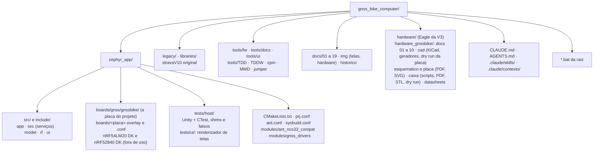

# Mapa do repositório e comandos

Saiu do [`CLAUDE.md`](../../CLAUDE.md) em 2026-10-16 (eram as seções 3 e 4); os comandos do dia a dia continuam lá.

## Mapa do repositório

## Comandos

| Tarefa | Comando (Git Bash, na raiz) |
|---|---|
| Build incremental / do zero (nRF54LM20 DK, o alvo) | `bash tools/fw/fw.sh build` / `bash tools/fw/fw.sh build pristine` |
| Build para a placa própria | `BOARD=gnssbike/nrf54lm20a/cpuapp BUILD_DIR=zephyr_app/build_custom bash tools/fw/fw.sh build` |
| Conferir o mapa de pinos da placa própria | `python tools/fw/board_check.py` |
| Build para o nRF52840 DK (não é mais usado) | `BOARD=nrf52840dk/nrf52840 bash tools/fw/fw.sh build` |
| Build da placa própria para a tela Sharp | `TELA=sharp BOARD=gnssbike/nrf54lm20a/cpuapp BUILD_DIR=zephyr_app/build_custom bash tools/fw/fw.sh build pristine` |
| Build com ANT (add-on em `C:\ncs\sdk-ant`) | `ANT=1 bash tools/fw/fw.sh build pristine` |
| Gravar no DK (apaga tudo / mantém settings) | `bash tools/fw/fw.sh flash` / `bash tools/fw/fw.sh flash keep` |
| Desbloquear chip | `bash tools/fw/fw.sh recover` |
| Placas conectadas | `bash tools/fw/fw.sh devices` |
| Memória e maiores símbolos | `bash tools/fw/fw.sh size` |
| Testes de host | `bash tools/fw/host_tests.sh` (53 conjuntos, 714 casos) |
| Telas da interface no PC (LVGL) | `python tools/ui/render_screens.py` (44 quadros, 2 temas cada, gera `docs/img/telas-lvgl/` e `docs/telas/`) |
| Converter um percurso do Strava para o formato do projeto | `python tools/route_convert.py entrada.gpx saida.RTE` (e `--selftest`) |
| Cadeia da placa nova (ordem e intérpretes nas armadilhas) | `python hardware_gnssbike/cad/make_pcb.py` → `route.py` → `acabar.py` → `"D:/KiCAD/bin/python.exe" hardware_gnssbike/cad/fill_zones.py` → `check_pcb.py --como-esta` → `dry_run_pcb.py` → `make_3d.py` → `make_2d.py` → `montagem.py`; a impedância das linhas na pilha do fabricante: `python hardware_gnssbike/cad/impedancia.py`; os arquivos da JLCPCB (Gerber, furação, BOM e CPL por tela, em `hardware_gnssbike/fabricacao/`, fora do git): `python hardware_gnssbike/cad/make_fab.py`; o pedido na Mouser e as planilhas da LCSC e da DigiKey (chave em `.claude/local/mouser_api_key`, fora do git); um modelo 3D novo (STEP em `cad/3d/real/`) entra na placa roteada por `python hardware_gnssbike/cad/aplicar_modelos.py`, nunca pelo `make_pcb.py`, que desfaria o roteamento: `python hardware_gnssbike/cad/mouser.py jdi 2` |
| Dry run e desenho da caixa (depois da cadeia da placa) | `python hardware_gnssbike/caixa/dry_run_caixa.py` e `python hardware_gnssbike/caixa/make_caixa.py` (PDF e STL em `caixa/`, vistas em `docs/img/hardware/`) |
| Material da revisão do esquemático (cópia do projeto, netlist, PDF, ERC completo, DRC com paridade, resumos) | `python tools/review/prepare.py` (em `.claude/reviews/<data>-esquematico/`, fora do git) |
| Diagramas e links da documentação | `python tools/docs/mermaid_check.py` e `python tools/docs/links_check.py` |
| Ambiente do NCS no shell | `source tools/fw/ncs_env.sh` |

Equivalentes no `cmd`: `build.bat [pristine]`, `flash.bat [keep]`, `recover.bat`, `serial.bat COMx`. Variáveis: `BUILD_DIR`, `NRF_SERIAL`, `NCS_VERSION`, `NCS_TOOLCHAIN`, `NOPAUSE`.
