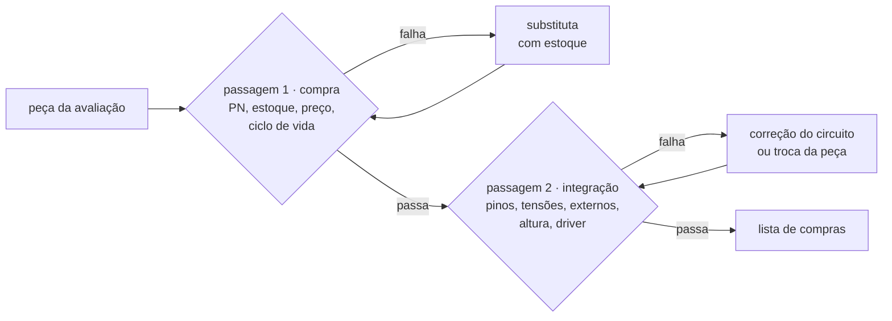
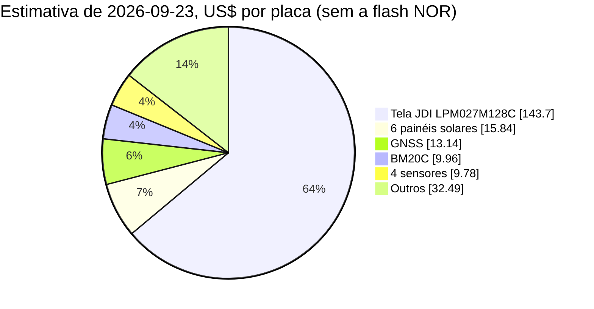

# Lista de compras da placa nova

Lista de materiais do protótipo da placa nova, com cada peça validada em duas passagens: a **compra** (a peça existe, está ativa e tem estoque num distribuidor autorizado) e a **integração** (a peça funciona no circuito da [especificação](14-hardware-placa-nova.md): pinos, tensões, componentes externos, altura, driver e firmware). Onde uma peça falhou, a lista já traz a substituta, e a especificação, a [avaliação](15-avaliacao-componentes.md) e a [arquitetura do firmware](16-arquitetura-firmware.md) seguem as correções. As peças de cada folha do esquemático, com o designador, estão em [materiais por folha](../hardware_gnssbike/05-materiais.md).

> [!IMPORTANT]
> Estoque e preço da DigiKey são de 2026-09-18, em US$ por unidade para 1 e 10 peças; os da LCSC, da JLCPCB e da DigiKey marcados com 2026-10-18 vêm da [revisão do esquemático](../hardware_gnssbike/11-revisao-do-esquematico.md#fim-de-vida-e-fornecimento). Tudo muda rápido: confira no dia do pedido. Onde a célula diz **preço e estoque não conferidos**, ninguém leu o distribuidor para aquela peça. A Mouser bloqueia acesso automático, então **nenhum dado da Mouser foi conferido**. Nenhuma peça foi montada nem medida: a validação é sobre datasheets, desenhos e o código do NCS v3.3.0.

> [!NOTE]
> **Desde 2026-10-19 esta lista segue o CAD** ([`cad/parts.py`](../hardware_gnssbike/cad/parts.py)).
> A placa é montada na **JLCPCB** (regra do dono de 2026-09-24), então o
> código que vale para o pedido é o da **LCSC**, e cada linha o traz quando o
> gerador o tem. As peças que a validação de 2026-09-18 aprovou e que saíram
> do desenho depois dela estão em [Trocas](#trocas); as que entraram têm a
> situação de hoje. O que mudou em 2026-10-18, com a revisão do esquemático:
> a placa aceita **a JDI LPM027M128C ou a Sharp LS027B7DH01A** (nua ou como
> o módulo Azumo 11103-06) no mesmo conector, com um boost de 5 V para a
> Sharp; os conectores do display passaram a ser Molex 503480; o TVS do
> `VBUS` passou a ser o PESD24VS1UL; o buzzer, o Same Sky CPT-12123; e os
> capacitores ganharam código da LCSC.

**Nesta página:** [Como a lista foi validada](#como-a-lista-foi-validada) · [Resultado](#resultado) · [Trocas](#trocas) · [Correções de integração](#correções-de-integração) · [Lista por bloco](#lista-por-bloco) · [Passivos](#passivos) · [Placas de avaliação e ferramentas](#placas-de-avaliação-e-ferramentas) · [Custo](#custo) · [Compras fora da DigiKey](#compras-fora-da-digikey) · [Antes de fechar o pedido](#antes-de-fechar-o-pedido) · [Referências](#referências)

## Como a lista foi validada



- **Passagem 1, compra:** o PN que se encomenda, a página da DigiKey (estoque, preço, situação, prazo de fábrica) e, quando a DigiKey não vende, a página do fabricante ou de outro distribuidor. Passa a peça ativa, com ficha pública e estoque que cubra 5 placas.
- **Passagem 2, integração:** a peça contra o circuito, pino a pino com a ficha; os máximos absolutos contra os trilhos; os componentes externos que a ficha exige; a altura contra o [empilhamento](14-hardware-placa-nova.md#empilhamento-mecânico); o driver no NCS v3.3.0 local; e o que o firmware precisa fazer.
- **Fornecimento de 2026-10-18:** a [revisão do esquemático](../hardware_gnssbike/11-revisao-do-esquematico.md#fim-de-vida-e-fornecimento) conferiu 69 peças e grupos de passivos na LCSC, na JLCPCB e na DigiKey, com o ciclo de vida de cada uma. Dela saíram as duas peças fora de venda ou em fim de vida (a tela JDI e o buzzer da Murata) e as peças consignadas.
- **Protótipo:** 5 placas. Os CIs têm uma peça de reserva; os passivos saem em múltiplos de 10.

## Resultado

O resultado das duas passagens de 2026-09-18, como ficou registrado:

| Bloco | Peças conferidas | Trocadas na compra | Correções de integração |
|---|---|---|---|
| MCU e rádio | 1 | — | tamanho real do módulo, regras da antena, refusões |
| Energia | 14 | NTC, conector da bateria | trilhos dos bucks, pinos do AEM10900, indutor, configuração do MAX17262, luz pela LDSW2 |
| GNSS | 6 | módulo, do MAX-M10N-10B para o MAX-F10S | V_IO travado em 1,8 V, 0 dBm no RF_IN sem exceção fora da banda |
| Sensores | 5 | IMU, magnetômetro | pinos comuns do IMU, CSB do barômetro, nada de varredura no I2C |
| Display | 7 | tela, conectores, REG710 — e a tela **de volta ao JDI** em 2026-09-23 | tela de 8 cores com luz integrada em 3,0 V; o REG710 e os 5 V saíram da montagem |
| Armazenamento | 2 | preço e estoque da NOR ainda não conferidos | MX25R6435F de 8 MB, pull-ups de WP e HOLD, pinos com o trilho desligado |
| USB | 4 | TVS do VBUS, receptáculo | placa de 0,8 mm |
| Interface | 4 | botões sem vedação | LEDs no VSYS, buzzer em alta corrente |
| Passivos | 18 | três capacitores sem estoque ou obsoletos | capacitância efetiva pelo DC bias |

Na compra, as pendências de hoje são outras ([revisão](../hardware_gnssbike/11-revisao-do-esquematico.md#fim-de-vida-e-fornecimento)):

- **A tela JDI LPM027M128C está fora de venda**: nenhum distribuidor autorizado a vende, e a Switch Science, o último listado, encerrou a venda. Só se compra no mercado paralelo, sem garantia. A decisão D1 do dono manda comprar agora todas as telas do lote, mais duas de reserva; a placa aceita também a Sharp, que está ativa ([Display](#display)).
- **Duas peças vão consignadas na JLCPCB**: o módulo ME54BS13, que a LCSC não vende, e a flash MX25R6435F, com 2 peças na JLCPCB em 2026-10-18. O nPM1300 vai também, se as 51 peças que a LCSC tinha naquele dia acabarem.
- **Faltam códigos da LCSC** em 48 resistores, em seis jumpers de 0 Ω, nos LEDs de carga, nos conectores `J102` e `J103` e nas três chaves do LED RGB; e o conector SWD `J202` ainda não foi escolhido ([Passivos](#passivos)).
- **Preço e estoque não conferidos** em todas as peças que entraram depois de 2026-09-18 e que a revisão não leu: as linhas dizem quais.

## Trocas

As trocas da validação de 2026-09-18:

| Peça da avaliação | Problema | Substituta | Consequência |
|---|---|---|---|
| ~~JDI LPM027M128C (tela de 8 cores)~~ | nenhum canal autorizado: a DigiKey não tem a peça e marca como obsoletos os módulos da Azumo com ela; a Switch Science encerrou as vendas; a Data Modul não lista JDI; o site da JDI não tem mais MIP | ~~Sharp **LS027B7DH01A** com o filme de luz frontal **Azumo 11103-06_A1**~~ | **Troca desfeita em 2026-09-23**, por decisão do dono: volta o JDI LPM027M128C, e o risco de compra é aceito. Desde 2026-10-18 a placa aceita as duas telas no mesmo conector ([Display](#display)) |
| Sharp LS027B7DH01 | sem estoque (400 previstos para 10/11/2026) | Sharp LS027B7DH01A | mesma pinagem; polarizador novo e 1,625 mm de espessura |
| SMK CFP-4610-0150F e Molex 51441-1093 (conectores da ficha antiga da Sharp) | o primeiro sem venda encontrada, o segundo obsoleto | Hirose FH28-10S-0.5SH(05) | as fichas do JDI e da Sharp atual citam o FH28, com contato por baixo. Saiu depois (abaixo) |
| TI REG710NA-5/250 | sem estoque | TI REG710NA-5/3K | a mesma peça em rolo maior, vendida em fita cortada. Saiu em 2026-10-18 (abaixo) |
| ST LSM6DSV16X | sem estoque, como todas as IMUs da ST na DigiKey | Bosch BMI270 no mesmo footprint | sem a fusão interna (vetor de gravidade); driver `bosch,bmi270` |
| ST LIS2MDL | sem estoque | Memsic MMC5633NJL | WLP de 0,85 mm; driver `memsic,mmc56x3`; o barramento não pode ser varrido. Saiu em 2026-09-24 (abaixo) |
| Murata NCP15XH103J03RC | não recomendado para projetos novos | TDK NTCG103JF103FT1 | o mesmo B3380 e 10 kΩ ±1 % |
| TI ESD751DYAR | sem estoque até 27/11/2026 | TI ESD761DPYR | a mesma família em X1SON de 1,0 × 0,6 mm. Saiu em 2026-09-24 (abaixo) |
| JST SH de 4 vias | 1 A por contato e trava por atrito | JST GH de 6 vias | VBAT e GND em dois contatos; trava positiva; 4,25 mm de altura |
| JST GH de 6 vias (SM06B-GHS-TB) | 4,25 mm de altura: a caixa desenhada em 2026-09-26 deixa 4,2 mm entre a face da placa e a tampa fora do display, e no verso a faixa livre não o segura ([04](../hardware_gnssbike/04-pcb-e-caixa.md#a-placa-de-hoje-dentro-da-caixa-do-conceito)) | JST SH de 6 vias (SM06B-SRSS-TB, 2,9 mm), carcaça SHR-06V-S-B e terminais SSH-003T-P0.2 | volta a trava por atrito: o cabo da célula é preso à caixa com fita. A alternativa é a caixa 0,5 mm mais alta com o GH; **decisão do dono** |
| Indutor de 6,8 µH do AEM10900 | a tabela 6 da ficha dá 65,5 mA de entrada, abaixo dos 88 mA do painel ao meio-dia | TDK VLS252012HBX-4R7M-1 (4,7 µH) | de 95 a 123 mA; o de 6,8 µH ia para a bancada. Os dois saíram com o AEM10900 (abaixo) |
| Amphenol 12402484E512A | o desenho não abriu (403): o anel de vedação incluso não foi confirmado | Molex 2036150003 | o desenho confirma o anel e o IPX8; pede placa de 0,8 mm. Saiu em 2026-09-24 (abaixo) |
| Chaves táteis comuns (E-Switch TL3340, Panasonic EVP-AA, Omron B3FS) | sem grau IP | Omron B3S-1002P | IP67 pela ficha. Saiu em 2026-09-24 (abaixo) |
| Tag-Connect TC2030-IDC-NL | termina num conector IDC de 6 vias com passo de 0,1", e não no conector Cortex do J-Link | TC2030-CTX-NL e TC2030-CLIP | conector Cortex de 10 vias do J-Link |
| Molex 503480-0400 (sugerido pela Azumo para o filme) | obsoleto | Molex 5034800440 | é o 503480-0440 que hoje é o `J403` |
| Murata GRM188R61E106KA73D, GRM158R60J226ME01D e GRM155R61A105KE15D | os dois primeiros sem estoque, o terceiro obsoleto | ver [Passivos](#passivos) | — |

As trocas depois da validação, pela data em que entraram no CAD:

| Data | Saiu | Entrou | Por quê |
|---|---|---|---|
| 2026-09-20 | SD NAND XTX de 8 Gbit, e o soquete microSD do protótipo | Macronix MX25R6435F soldada (`U501`) | decisão do dono: o SD NAND custava mais do que o armazenamento inteiro vale. O soquete Hirose DM3AT-SF-PEJM5, que nenhuma folha usa, saiu desta lista em 2026-10-19 |
| 2026-09-23 | Fanstel BM20C | MinewSemi ME54BS13 (`U201`) | é o módulo que o esquemático e o CAD montam desde o primeiro desenho; o BM20C fica como alternativa de outro footprint ([MCU e rádio](#mcu-e-rádio)) |
| 2026-09-24 | e-peas AEM10900 e o indutor de 4,7 µH | Analog Devices ADP5091 (`U103`) com o Sunlord SPH252012H220MT de 22 µH (`L103`) | a linha e-peas inteira estava com estoque zero na LCSC, e a placa passou a ser montada na JLCPCB. O ADP5091 não tem I²C nem entrada de temperatura: o corte térmico virou o comparador `U105` |
| 2026-09-24 | Molex 2036150003 | HRO TYPE-C-31-M-12 (`J101`) | 309 peças a US$ 5,69 na LCSC, contra o USB-C mais usado do catálogo da JLCPCB |
| 2026-09-24 | TI ESD761DPYR | TI TPD1E05U06DPYR | estoque zero na LCSC e na JLCPCB. Saiu em 2026-10-18 (abaixo) |
| 2026-09-24 | TE L000670-01 | Unictron H2UJ4U1H2Q0100 (`E301`), com o u.FL `J302` como alternativa | estoque zero na LCSC e área livre de 40,5 × 14,5 mm, mais larga que a placa |
| 2026-09-24 | Omron B3S-1002P | XunPu TS-1088R-02026 (`SW601` a `SW603`) | uma das quatro peças que o estoque da LCSC tirou; dois terminais e 3,90 × 3,00 × 2,00 mm, mas o êmbolo sobe 0,50 mm, contra 0,7, e a mecânica da tecla na caixa mudou |
| 2026-09-24 | Kingbright APTF1616SEEZGKQBKC | TUOZHAN S4-3528RGBTA-A (`D601`) | o sufixo não existe mais, e o que existe tinha 305 peças na LCSC; o novo é muito mais brilhante, e os resistores pedem conta nova |
| 2026-09-24 | Memsic MMC5633NJL | Memsic MMC5603NJ (`U504`) | a LCSC não tem o MMC5633NJL; mesmo endereço e mesmo ID, outro land |
| 2026-09-24 | Same Sky CPT-1117-83-SMT-TR | Murata PKLCS1212E4001-R1 | uma peça só na LCSC; o Murata era o único substituto com os 84 dB. Saiu em 2026-10-18 (abaixo) |
| 2026-09-24 | Hirose FH28-10S-0.5SH(05) | Hirose FH12-10S-0.5SH(55) | o FH28 tem 2,55 mm fechado contra 2,6 mm de teto sob o display. Saiu em 2026-10-18 (abaixo) |
| 2026-09-25 | conector da luz da JDI "a definir" | HCTL HC-FPC-05-10-5RLTAG | o Molex 503480-0500 que a JDI nomeia não está na LCSC. Saiu em 2026-10-18 (abaixo) |
| 2026-09-25 | Murata BLM15PX601SN1D | Murata BLM18KG601SN1D (`FB301`) | 230 mΩ passava dos 0,2 Ω que o manual do MAX-F10S permite no `VCC` |
| 2026-10-18 | TI TPD1E05U06DPYR | Nexperia PESD24VS1UL (`D101`) | decisão D2 do dono: rompia entre 6,5 e 8,5 V, e um carregador fora da norma que o nPM1300 aguenta (22 V) o queimava |
| 2026-10-18 | Hirose FH12-10S-0.5SH(55) | Molex 503480-1000 (`J401`) | contato por baixo, e a fita chega com os contatos para cima; o Molex tem contato dos dois lados e serve às duas telas |
| 2026-10-18 | HCTL HC-FPC-05-10-5RLTAG | Molex 503480-0540 (`J402`) | pedia 3,0 mm de condutor exposto, e a fita da luz tem 2,2 a 2,8 |
| 2026-10-18 | Murata PKLCS1212E4001-R1 | Same Sky CPT-12123-81-SMT-TR (`LS601`) | *Last Time Buy* até 31/03/2027 em toda a linha de sounders piezo da Murata |
| 2026-10-18 | TI REG710NA-5/3K (plano B) | TI TPS610997 (`U402`) | o REG710 dá 4,7 V no mínimo, abaixo dos 4,8 V da Sharp |
| 2026-10-19 | Murata BLM18KG601SN1D | Murata BLM18KG221SN1D (`FB301`) | medido na placa roteada: 75 mΩ de cobre do indutor do BUCK2 ao pino, mais até 50 mΩ do `JP103`, deixam no máximo 75 mΩ para a ferrite nos 0,2 Ω do manual do MAX-F10S; a de 150 mΩ somava 275 |

## Correções de integração

Achados da segunda passagem que mudam o circuito ou o firmware. A especificação já traz todos; as ligações fixas de cada CI estão em [14](14-hardware-placa-nova.md#ligações-fixas-dos-cis).

> [!NOTE]
> A lista abaixo é a de 2026-09-18 e fica como registro. Parte dela foi
> superada pelas [trocas](#trocas) seguintes: os itens 4 e 5 (o AEM10900
> saiu), o 8 (o módulo montado é o ME54BS13), o 11 (o magnetômetro é o
> MMC5603NJ, com o mesmo endereço e o mesmo ID), o 13 (a flash está no
> `3V0` desde 2026-10-18 e dorme em deep power-down), o 14 (o USB-C é o
> HRO), o 15 (a placa aceita a JDI ou a Sharp, com o 5 V do TPS610997, e a
> luz da JDI tem conector próprio, o `J402`) e o 18 (o LED RGB é o
> S4-3528RGBTA-A). O estado de cada bloco está em
> [materiais por folha](../hardware_gnssbike/05-materiais.md).

1. **Trilhos dos bucks trocados.** O resistor do VSET1 só escolhe de 1,0 a 2,7 V e o do VSET2, de 1,8 a 3,3 V (tabelas 18 e 19 do nPM1300): o 3,0 V, de que o MCU depende para ligar, só sai do BUCK2. Fica BUCK2 em 3,0 V com 150 kΩ e BUCK1 em 1,8 V com 47 kΩ, a mesma configuração 1 da referência da Nordic (tabela 39). Nenhum VSET pode ficar aberto.
2. **1V8 travado — superado em 2026-09-26.** Com o VIO_SEL em GND, o V_IO do MAX-F10S tem máximo absoluto de 1,98 V (tabela 12 da UBXDOC-963802114-12732 R03, igual à do M10N-10B), e o registrador do BUCK1 aceita até 3,3 V: o devicetree fixava o mínimo e o máximo do BUCK1 em 1,8 V. Desde 2026-09-26 o receptor está no 3V0 com o VIO_SEL **aberto** (opção 1 da tabela 35 do manual de integração), o BUCK1 ficou sem carga e o tradutor de nível saiu ([hardware_gnssbike/02](../hardware_gnssbike/02-calculos.md#o-receptor-no-3v0-e-o-1v8-sem-carga)).
3. **Luz da tela pela LDSW2.** A LDSW2 do nPM1300 vira LDO de 3,3 V alimentado pelo VSYS (até 50 mA, entrada de 2,6 V ao VSYS), com resistor e N-MOSFET no PWM. O 3,0 V deixaria só 0,33 V para o resistor do LED de 2,67 V do JDI.
4. **Pinos do AEM10900:** STO_CFG[2] e STO_CFG[0] no VINT e STO_CFG[1] no GND (carga até 3,90 V, corte em 3,01 V); R_MPP[2:0] e T_MPP[1:0] no VINT; KEEP_ALIVE no VINT; I2C_ADDR no I2C_VDD (0x41); DIS_STO_CH pelo divisor de 100 kΩ e 1 MΩ do VBUSOUT.
5. **Indutor do AEM10900 em 4,7 µH.** A tabela 6 e a fórmula da seção 6.7.2 da ficha discordam (65,5 contra 85 mA com 6,8 µH); a pergunta vai para a e-peas, e a bancada compara 4,7 e 6,8 µH.
6. **MAX17262:** a configuração de fábrica (0x2210) já deixa o COMMSH e o THSH em 0; com o TH ligado ao BATT, o firmware grava ETHRM = 0 e mantém TSel = 0 (temperatura interna).
7. **Botão de ligar:** só o botão central vai ao SHPHLD, que tem pull-up interno de 50 kΩ; o nPM1300 avisa o MCU pelo GPIO3 (`NPM13XX_EVENT_SHIPHOLD_PRESS` e `RELEASE`). Segurar mais de 10 s religa o sistema inteiro, recurso ligado de fábrica que serve de reset de emergência.
8. **BM20C:** 10,0 × 16,2 mm, e não 14,8 mm; os últimos 5,5 mm são a área da antena, que fica fora da placa ou sem terra e sem trilhas em todas as camadas, com o módulo na borda. No máximo duas passagens pelo forno, com o lado do módulo por último. USB em G6 (D−), G7 (D+) e H7 (VBUS de 4,4 a 5,5 V). A ficha não dá a tolerância do cristal de 32,768 kHz, que o ANT pede em ±50 ppm.
9. **Entrada de RF do GNSS:** a tabela 12 da ficha do **MAX-F10S** dá um único máximo absoluto de **0 dBm** no RF_IN, sem a exceção de +15 dBm fora da banda que a ficha do 10B traz. Com o BLE a +8 dBm na mesma placa, quem segura o nível é o isolamento entre as antenas: meça o S21 em 2,44 GHz antes de ligar o rádio na potência cheia, e o bloqueio pelo C/N0 com o rádio transmitindo ([14](14-hardware-placa-nova.md#gnss)).
10. **IMU com dois fabricantes no mesmo footprint:** pinos 2 e 3 no VDDIO (a Bosch proíbe GND), 10 e 11 abertos, 12 no VDDIO, 1 no GND; o BMI270 responde em 0x68 e o LSM6DSV16X, em 0x6A. O devicetree declara os dois, e o firmware usa o que responder. O despertar por movimento do BMI270 pede a configuração `base` do driver (8 KB, com o compatível extra `bosch,bmi270-base`), sem exemplo no NCS: a testar.
11. **MMC5633NJL:** o endereço 0x7E no barramento o põe em I3C até faltar energia, então o firmware nunca varre o I2C; o VDD pede pelo menos 2,2 µF junto do pino. O ID 0x10 e o mapa de registradores conferem com o driver `memsic,mmc56x3`.
12. **BMP585:** o CSB precisa estar no VDDIO na partida, ou o I2C fica desligado até o próximo reset de energia; o SDO no VDDIO dá o endereço 0x47.
13. **Flash NOR soldada:** o SD NAND XTX saiu em 2026-09-20 e no lugar dele vai a Macronix **MX25R6435F** de 64 Mbit (8 Mbyte), a mesma peça do nRF54LM20 DK, sozinha no `spi00` com CS em P2.05 e `spi-max-frequency = 8000000`. Ela entra no devicetree como `jedec,spi-nor`, e uma partição que toma a peça inteira vira disco por `zephyr,flash-disk`, montado em `/SD:` com FatFs (`CONFIG_DISK_DRIVER_FLASH=y` e `CONFIG_DISK_DRIVER_SDMMC=n`); **não há cartão nem SD NAND na placa**. WP e HOLD levam pull-up; com o trilho da flash desligado, os pinos do `spi00` ficam em nível baixo ou em alta impedância, para não alimentar o chip pelos pinos. Nada disso foi testado em placa.
14. **USB-C da Molex:** o desenho recomenda placa de 0,8 mm, e a especificação passa de 1,0 para 0,8 mm; o anel de vedação passa da borda da placa (a borda fica 2,73 mm atrás da frente do conector); furo de 9,54 × 3,76 mm numa parede de pelo menos 1,2 mm.
15. **Tela.** Com o **JDI LPM027M128C**, decidido em 2026-09-23: VDD e VDDA em 3,0 V do BUCK2 (máximo absoluto de 3,6 V), EXTMODE no VDD da tela, luz de 16 mA a 2,67 V com o resistor de 39 Ω pela LDSW2, e **o REG710 e o trilho de 5 V deixam de ser montados** — com eles o `DISP_PWR_EN` (P3.07) volta a ficar livre. **Falta uma coisa que nenhum documento do projeto tem:** o FPC de 10 vias não traz par para o LED, de modo que **não se sabe por onde a luz do C se liga**; sai da ficha do C ou de uma amostra, **antes do layout**. No **plano B**, com a Sharp: 5 V do REG710 com o EN num pino do MCU, para a sequência de ligar e para cortar os 65 µA do conversor; entradas com VIH a partir de 2,7 V, que a lógica de 3,0 V atende; e o filme de luz com um LED de 10 mA típicos (25 mA no máximo), no Molex 5034800440.
16. **TPS7A02:** pelo menos 0,5 µF efetivos na saída, EN ligado ao IN.
17. **Capacitância efetiva:** pelas curvas da Taiyo Yuden, o 10 µF de 25 V em 0603 fica com cerca de 4,9 µF a 5 V e 7,2 µF a 3 V, e o 22 µF de 10 V, com cerca de 9,0 µF a 4 V, acima dos 5 µF efetivos que o AEM10900 pede no STO.
18. **LEDs e buzzer:** o LED RGB tem anodo comum no VSYS e um N-MOSFET por cor, porque um pino do MCU em 3,0 V não segura um catodo cujo anodo vai a até 5,5 V (com o USB, o VSYS acompanha o VBUS); o brilho varia com a tensão do VSYS. O buzzer usa dois pinos em alta corrente.

## Lista por bloco

Colunas: função (com o designador), peça, código da LCSC, código da DigiKey, estoque, preço em US$ para 1 e 10 peças, quantidade por placa, compra sugerida para 5 placas e situação. "Sem código" quer dizer que o CAD ainda não traz o código da LCSC; "não conferido", que ninguém leu aquele distribuidor para a peça.

### MCU e rádio

| Função | Peça | LCSC | DigiKey | Estoque | US$ 1 / 10 | Por placa | Compra | Situação |
|---|---|---|---|---|---|---|---|---|
| Módulo com o nRF54LM20A (`U201`) | MinewSemi ME54BS13-1Y20TI | não vende | 6024-ME54BS13-1Y20TITR-ND | DigiKey: 45 (2026-10-18) | 9,00 / — no Marketplace da DigiKey (2026-09-18); US$ 6,00 na loja da MinewSemi | 1 | 6 | **o módulo do esquemático e do CAD**; vai como peça consignada na JLCPCB. Certificação e tolerância do cristal de 32,768 kHz por confirmar ([hardware](../hardware_gnssbike/README.md#fichas-que-precisam-ser-lidas)) |
| Alternativa, com outro footprint | Fanstel BM20C | não conferido | 1914-BM20CCT-ND | 0 em 2026-09-18; 1.000 previstos para 12/11/2026 | 11,47 / 9,96 | — | — | aprovada na validação de 2026-09-18, e a [avaliação](15-avaliacao-componentes.md#módulo-do-mcu) guarda essa escolha; trocar de módulo é refazer a folha 2 e o layout. A Fanstel vende por e-mail a US$ 6,50 |

### Energia

| Função | Peça | LCSC | DigiKey | Estoque | US$ 1 / 10 | Por placa | Compra | Situação |
|---|---|---|---|---|---|---|---|---|
| PMIC (`U101`) | Nordic nPM1300-QEAA-R (QFN32) | C7466043 | 4823-NPM1300-QEAA-RCT-ND | LCSC: 51 (2026-10-18); DigiKey: 10.710 | 2,95 / 2,21 | 1 | 6 | aprovada; vai consignada se a LCSC não tiver. O WLCSP-35 (C25346894) tem estoque e não serve: pede via no pad na placa inteira e é sensível à luz |
| Indutores dos bucks e do boost de 5 V (`L101`, `L102`, `L401`) | Murata DFE201610E-2R2M=P2 | C337891 | 490-17728-1-ND | 90.749 | 0,25 / 0,206 | 3 | 18 | aprovada; 140 mΩ, 2,4 A; no land da DFE201610 desde 2026-10-18 (era 0805); alternativa TDK TFM201610ALM-2R2MTAA (445-174186-1-ND, 54.319) |
| Colhedor solar com MPPT (`U103`) | Analog Devices ADP5091ACPZ-2-R7 (LFCSP-24) | C579259 | não conferido | preço e estoque não conferidos | — | 1 | 6 | no lugar do AEM10900 desde 2026-09-24 ([Trocas](#trocas)); sem I²C e sem NTC, tudo por resistor |
| Indutor do ADP5091 (`L103`) | Sunlord SPH252012H220MT (22 µH, Isat 0,45 A, 1008) | C98385 | não conferido | preço e estoque não conferidos | — | 1 | 6 | a ficha fixa 22 µH ± 20 % e Isat de pelo menos 390 mA |
| Medidor de carga (`U102`) | Analog Devices MAX17262REWL+T | C5328777 | 175-MAX17262REWL+TCT-ND | 20.109 | 4,10 / 3,10 | 1 | 6 | aprovada; WLP, montagem por estêncil e forno |
| LDO do backup do GNSS (`U104`) | TI TPS7A0218PDQNR | C2862166 | 296-TPS7A0218PDQNRCT-ND | 5.793 | 0,84 / 0,601 | 1 | 6 | aprovada |
| Comparador do corte térmico (`U105`) | TI TLV7031DCKR (SC-70-5) | C2863637 | não conferido | com estoque na LCSC em 2026-10-18, sem a quantidade registrada | preço não conferido | 1 | 6 | alimentado pelo `VBAT_SYS` desde 2026-10-18; o C2869832 de antes era a versão SOT-23-5, que não cabe no land |
| NTC do corte térmico (`RT101`) | 10 kΩ B3380; a validação de 2026-09-18 aprovou o TDK NTCG103JF103FT1 | C209959 | 445-2550-1-ND (o TDK) | 1.668.979 (o TDK) | 0,11 / 0,075 | 1 | 10 | aprovada; na face de trás, sob a célula. Que o C209959 seja o TDK não foi conferido |
| Schottky do `DIS_SW` e da tecla central (`D106`, `D107`) | Diodes BAT54WS-7-F (SOD-323) | C124205 | não conferido | preço e estoque não conferidos | — | 2 | 12 | catodo no terminal 1, conferido na revisão de 2026-10-18 |
| Painéis solares (`PV101` a `PV106`) | ANYSOLAR KXOB25-05X3F-TR | não vende | KXOB25-05X3FCT-ND | 5.038 | 3,23 / 2,64 | 6 | 36 | aprovada; a outra exceção da regra da JLCPCB, junto com o módulo |
| Grampo da entrada solar (`D105`) | Nexperia PESD3V3S1UB-N | C920299 | — | LCSC: 14.270 (2026-09-25) | 0,023 | 1 | 10 | **escolhido em 2026-09-25**: ESD unidirecional 3,3 V em SOD-523, 1 µA de fuga máx., grampeia polaridade trocada em −0,7 V; não protege de fonte errada sustentada. Junto do `J103`, no verso, desde 2026-10-18 |
| Conector do painel (`J103`) | JST S4B-ZR-SM4A-TF | C485354 | não conferido | preço e estoque não conferidos | — | 1 | 6 | **a conferir na LCSC**; ZH de 1,5 mm, 4 vias, SMD lateral ([J103](../hardware_gnssbike/06-conectores-e-pontos-de-teste.md#j103--painel-solar)) |
| Carcaça do cabo do painel | JST ZHR-4 | — | não conferido | preço e estoque não conferidos | — | 1 | 6 | a contraparte do `J103` |
| Terminais do cabo do painel | JST SZH-002T-P0.5 | — | não conferido | preço e estoque não conferidos | — | 4 | 50 | AWG 32 a 28, crimpagem com o alicate da JST |
| Fio do chicote do painel | AWG 28 flexível, siliconado, 4 cores | — | — | — | — | ~1 m | 10 m | 110 mA no arranjo inteiro, 37 mA por face |
| LEDs de carga e de erro (`D103`, `D104`) | Kingbright APT1608SURCK | C5875723 | 754-1123-1-ND | 1.084.493 | 0,21 / 0,144 | **2** | 12 | aprovada; 1,82 V a 5 mA; o `LED1` do nPM1300 é o de carga e o `LED0`, o de erro. Na fileira das teclas desde 2026-10-18 |
| Conector da bateria (`J102`) | JST SM06B-SRSS-TB | C160405 (o GH de antes era o C133065) | não conferido | preço e estoque não conferidos | — | 1 | 6 | no lugar do GH SM06B-GHS-TB desde 2026-09-26 ([Trocas](#trocas)) |
| Carcaça do cabo | JST SHR-06V-S-B | — | não conferido | preço e estoque não conferidos | — | 1 | 6 | série SH |
| Terminais do cabo | JST SSH-003T-P0.2 | — | não conferido | preço e estoque não conferidos | — | 6 | 50 | a crimpagem pede o alicate da JST; conferir o terminal no catálogo da série SH |
| Bateria | LiPo de 1 célula, 2000 mAh, 60 × 36 × 7 mm, com PCM e NTC de 10 kΩ B3380 | — | — | — | — | 1 | 6 | sob encomenda a um fabricante de packs, com UN38.3 |

### GNSS

| Função | Peça | LCSC | DigiKey | Estoque | US$ 1 / 10 | Por placa | Compra | Situação |
|---|---|---|---|---|---|---|---|---|
| Módulo GNSS (`U301`) | u-blox MAX-F10S-00B | C30005563 | 672-MAX-F10S-00BCT-ND | LCSC: 159 (2026-10-18); DigiKey: 10.818 | 13,14 / — | 1 | 6 | aprovada; L1 + L5; MSL 4: secar antes do forno se a embalagem ficou aberta. Sai de fábrica a 9.600 Bd, e o firmware abre a UART assim desde 2026-10-18 |
| Módulo do teste A/B | u-blox MAX-M10N-10B | não conferido | 672-MAX-M10N-10BCT-ND | 1.571 | 14,52 / — | — | 2 | mesmo footprint; a alternativa econômica, só L1 |
| Antena de chip (`E301`) | Unictron H2UJ4U1H2Q0100 (L1 + L5, 5,0 × 3,0 × 0,5 mm) | C6569550 | não conferido | preço e estoque não conferidos | — | 1 | 6 | no lugar da TE L000670-01 desde 2026-09-24; 70 % de eficiência típica em L1 e L5 numa placa de 80 × 40 mm, e esta tem 34 mm de largura: só a bancada diz |
| Conector da antena externa (`J302`) | Hirose U.FL-R-SMT-1 | C88374 | não conferido | preço e estoque não conferidos | — | 1 | 6 | a outra posição do `JP301`, para uma antena de 50 Ω por cabo |
| Ferrite do `3V0` do receptor (`FB301`) | Murata BLM18KG221SN1D | C88980 | — | estoque não conferido | preço não conferido | 1 | 10 | **trocada em 2026-10-19**: 220 Ω a 100 MHz, 2,2 A, **DCR máximo 50 mΩ**. O manual do MAX-F10S (4.1.1) permite 0,2 Ω em série no VCC, e a placa roteada já tem 75 mΩ de cobre e até 50 mΩ do `JP103` nesse caminho: com a BLM18KG601SN1D (150 mΩ, a de 2026-09-25) dava 275 mΩ, com esta dá 175; 0603 |
| Rede de casamento e sintonia (`C301`, `L301`, `C305`, `C306`) | Murata GJM15 C0G de 50 V: 1,5, 6,8 e 2,7 pF; e o 3,6 pF ± 0,1 pF C0G do `L301`, que é capacitor | C76900, C88896, C76904 e C161320 | não conferido | preço e estoque não conferidos | — | 1 de cada | 10 de cada | valores de partida da Unictron; com o u.FL, o `C301` fica sem peça e o `L301` vira 0 Ω. O VNA decide os valores finais |

### Sensores

| Função | Peça | LCSC | DigiKey | Estoque | US$ 1 / 10 | Por placa | Compra | Situação |
|---|---|---|---|---|---|---|---|---|
| Barômetro (`U502`) | Bosch BMP585 | C18184976 | 828-BMP585CT-ND | 11.559 | 4,54 / 3,893 | 1 | 6 | aprovada; footprint pela figura 29 da ficha desde 2026-10-18 |
| IMU (`U503`) | Bosch BMI270 | C2836813 | 828-1091-1-ND | 54.091 | 4,23 / 3,624 | 1 | 6 | aprovada |
| Magnetômetro (`U504`) | Memsic MMC5603NJ | C404328 | não conferido | preço e estoque não conferidos | — | 1 | 6 | no lugar do MMC5633NJL desde 2026-09-24: mesmo endereço 0x30 e mesmo ID 0x10, WLP de 0,82 mm; pede 2,2 µF no `VDD` |
| Luz ambiente (`U505`) | TI OPT3001DNPR | C90462 | 296-40474-1-ND | 985 | 1,57 / 1,32 | 1 | 6 | aprovada; o pad térmico vai ao `GND` desde 2026-10-18 |
| Respiro do barômetro (`MP501`) | Amphenol LTW VENT-PS2NBK-O8001 | — | 1754-1549-ND | 6.437 | 4,20 / 3,35 | 1 | 6 | aprovada com ressalva: rosca M6 que pede parede de 4,5 mm, ou seja, um ressalto na tampa; o adesivo da Gore (PE130205) só sai em amostra |

### Display

A placa aceita **duas telas no mesmo conector de sinal** desde 2026-10-18 ([revisão](../hardware_gnssbike/11-revisao-do-esquematico.md#as-duas-telas-na-mesma-placa)): a JDI LPM027M128C, que é a padrão, ou a Sharp LS027B7DH01A, nua ou como o módulo Azumo 11103-06. O boost de 5 V, os três conectores e as peças da luz do Azumo vão montados em toda placa; a diferença de pedido é a tela que vai no conector ([05](../hardware_gnssbike/05-materiais.md#folha-4--display)).

| Função | Peça | LCSC | DigiKey | Estoque | US$ 1 / 10 | Por placa | Compra | Situação |
|---|---|---|---|---|---|---|---|---|
| **Tela padrão** (`DS401`) | **JDI LPM027M128C** (2,7", 400 × 240, 8 cores, 3,0 V, **com luz integrada**) | não vende | — | **fora de venda** | R$ 776 no [anúncio de 2026-09-23](https://pt.aliexpress.com/item/1005011938384752.html), cerca de US$ 144 | 1 | todas as do lote, mais 2 de reserva (decisão D1) | **sem canal autorizado e sem garantia**: a Switch Science encerrou a venda, e a DigiKey, a LCSC e a JLCPCB não a listam. Anúncios confundem o B e o C — conferir a peça que chegar ([15](15-avaliacao-componentes.md#a-luz-da-tela-procurada-em-2026-09-23)) |
| Tela alternativa (`DS402`) | Sharp LS027B7DH01A (monocromática, 400 × 240, 5 V) | não conferido | 425-2908-ND | 3.180 (2026-09-18) | 29,29 / 23,61 | 0 com a JDI | — | ativa; vai no mesmo `J401`, com o `JP401` na posição do `5V0` e o firmware `TELA=sharp` |
| Tela alternativa com luz (`DS402`) | Azumo 11103-06: a Sharp com luz frontal, um módulo só pelo desenho T7 | não conferido | 2004-11103-06_A1-ND | 1.909 (2026-09-18) | 79,06 / 66,45 | 0 com a JDI | — | esta lista tratava o 11103-06_A1 como filme a laminar sobre uma Sharp comprada à parte; o desenho T7 de 2022-01-10 põe a LS027B7DH01A na lista de peças do módulo. Conferir com a Azumo o que o código entrega antes de pedir |
| Conector de sinal das duas telas (`J401`) | Molex 503480-1000 (10 vias, 0,5 mm, contato dos dois lados) | C127355 | não conferido | preço e estoque não conferidos | — | 1 | 6 | desde 2026-10-18 ([Trocas](#trocas)); o pino 1 das telas cai no circuito 10 ([J401](../hardware_gnssbike/06-conectores-e-pontos-de-teste.md#j401--display)) |
| Conector da luz da JDI (`J402`) | Molex 503480-0540 (5 vias) | C5527934 | não conferido | preço e estoque não conferidos | — | 1 | 6 | desde 2026-10-18: a série que a JDI nomeia no desenho de contorno ([J402](../hardware_gnssbike/06-conectores-e-pontos-de-teste.md#j402--luz-da-jdi)) |
| Conector da luz do Azumo (`J403`) | Molex 503480-0440 (4 vias), no verso | C3170007 | não conferido | 55.126 (2026-09-18, como 5034800440) | 0,68 / — | 1 | 6 | entrou em 2026-10-18 ([J403](../hardware_gnssbike/06-conectores-e-pontos-de-teste.md#j403--luz-do-azumo-no-verso)) |
| Boost de 5 V da Sharp (`U402`) | TI TPS610997YFFR (5,0 V fixos, de 4,90 a 5,10 V) | C2072359 | não conferido | preço e estoque não conferidos | — | 1 | 6 | entrou em 2026-10-18 no lugar do REG710 do plano B; só o firmware da Sharp o liga ([JP401](../hardware_gnssbike/06-conectores-e-pontos-de-teste.md#jp401--tensão-do-display)) |
| Chave da luz (`Q401`) | Diodes DMG1012T-7 | C20512 | DMG1012T-7DICT-ND | 150.305 | 1,17 / 0,733 | 1 | ver [Interface](#interface) | aprovada; 0,5 Ω a 2,5 V de porta; serve às duas luzes |

### Armazenamento

| Função | Peça | LCSC | DigiKey | Estoque | US$ 1 / 10 | Por placa | Compra | Situação |
|---|---|---|---|---|---|---|---|---|
| Flash NOR soldada (`U501`) | **Macronix MX25R6435F** (64 Mbit); alternativa pino a pino: Winbond W25Q128JV (128 Mbit) | C2802844 | não conferido | JLCPCB: 2; DigiKey: 2.480 (2026-10-18) | preço não conferido | 1 | 6 | vai consignada na JLCPCB; no `3V0` desde 2026-10-18, em deep power-down quando parada |

### USB

| Função | Peça | LCSC | DigiKey | Estoque | US$ 1 / 10 | Por placa | Compra | Situação |
|---|---|---|---|---|---|---|---|---|
| Receptáculo USB-C (`J101`) | HRO TYPE-C-31-M-12 (16 contatos, USB 2.0, SMD de borda) | C165948 | não conferido | preço e estoque não conferidos | — | 1 | 6 | no lugar do Molex 2036150003 desde 2026-09-24; land próprio e, desde 2026-10-18, na linha "PCB EDGE" do desenho da HRO. A abertura da caixa leva uma porta articulada ([caixa](../hardware_gnssbike/caixa/README.md)) |
| TVS do VBUS (`D101`) | Nexperia PESD24VS1UL (SOD-882, 24 V de trabalho, unidirecional) | C477994 | não conferido | preço e estoque não conferidos | — | 1 | 10 | decisão D2 de 2026-10-18 ([Trocas](#trocas)); o catodo, com a barra, vai ao `VBUS` |
| ESD de D+, D−, CC1 e CC2 (`D102`) | TI TPD4E05U06DQAR | C138714 | 296-35765-1-ND | 213.253 | 0,82 / 0,509 | 1 | 6 | aprovada |

### Interface

| Função | Peça | LCSC | DigiKey | Estoque | US$ 1 / 10 | Por placa | Compra | Situação |
|---|---|---|---|---|---|---|---|---|
| LED RGB (`D601`) | TUOZHAN S4-3528RGBTA-A (anodo comum, 3,5 × 2,8 × 1,9 mm) | C2827321 | não conferido | preço e estoque não conferidos | — | 1 | 6 | no lugar do Kingbright APTF1616SEEZGKQBKC desde 2026-09-24; muito mais brilhante, e `R601` a `R603` pedem conta nova; MSL 4 |
| Chaves do LED RGB e da luz (`Q601` a `Q603`, `Q401`) | Diodes DMG1012T-7 | C20512 (o CAD o traz só no `Q401`) | DMG1012T-7DICT-ND | 150.305 | 1,17 / 0,733 | 4 | 25 | aprovada |
| Buzzer (`LS601`) | Same Sky CPT-12123-81-SMT-TR (12 × 12 × 3,0 mm, 81 dB a 4 kHz, furo de som lateral) | C3812179 | não conferido | LCSC: 240; DigiKey: 1.804 (2026-10-18) | preço não conferido | 1 | 6 | no lugar do Murata PKLCS1212E4001-R1 desde 2026-10-18; cabe no land de 12 × 12. Conferir o lado do furo de som contra a abertura da caixa |
| Teclas (`SW601` a `SW603`) | XunPu TS-1088R-02026 (SPST-NO, 3,90 × 3,00 × 2,00 mm, 260 gf) | C455280 | não conferido | preço e estoque não conferidos | — | 3 | 18 | no lugar da Omron B3S-1002P desde 2026-09-24; o grau IP dela não está registrado no CAD, e a caixa cobre as teclas com uma membrana de TPU ([04](../hardware_gnssbike/04-pcb-e-caixa.md#a-placa-de-hoje-dentro-da-caixa-do-conceito)) |

## Passivos

As quantidades por placa saem do esquemático. Os resistores são de filme espesso, 0402 e ±1 %, salvo onde a linha diz outra coisa. Os códigos da LCSC vêm de [`cad/parts.py`](../hardware_gnssbike/cad/parts.py): os capacitores têm todos (menos o `C302`, que não é montado); dos resistores, só `R116`, `R123` e `R410`.

> [!NOTE]
> Desde 2026-10-18 toda peça montada tem código da LCSC no gerador, menos o
> módulo `U201`, que vai consignado; o estoque se confere no dia do pedido.
> O fabricante e o código de fabricante de cada peça, para comprar fora da
> LCSC, estão em [`cad/mpn.py`](../hardware_gnssbike/cad/mpn.py).

Capacitores:

| Valor | Posições | Peça | LCSC | DigiKey | Estoque | US$ 1 / 10 | Por placa | Compra |
|---|---|---|---|---|---|---|---|---|
| 10 µF, 25 V, X5R, 0603 | `C101` a `C109`, `C303`, `C405` a `C407` | Taiyo Yuden TMK107BBJ106MA-T (PN novo MSAST168BB5106MTNA01) | C386081 | 587-6023-1-ND | 673.507 | 0,45 / 0,269 | 13 | 100 |
| 22 µF, 6,3 V, X5R, 0402 | `C115`, `C116` | Samsung CL05A226MQ5N6J8 | C7423886 | 1276-7090-1-ND | 812.238 | 0,60 / 0,367 | 2 | 20 |
| 22 µF, 10 V, X5R, 0603 | `C117`, `C501` | Taiyo Yuden MSASL168BB5226MTNA01 | C6600230 | 587-MSASL168BB5226MTNA01CT-ND | 5.446 | 0,50 / 0,301 | 2 | 20 |
| 1 µF, 25 V, X5R, 0402 | `C110`, `C111`, `C113`, `C114` | Samsung CL05A105KA5NQNC | C52923 | 1276-1445-1-ND | 2.380.423 | 0,19 / 0,109 | 4 | 50 |
| 4,7 µF, 16 V, X5R, 0603 | `C210`, `C502` | Samsung CL10A475KO8NNNC | C19666 | 1276-1784-1-ND | 113.878 | 0,14 / 0,079 | 2 | 20 |
| 4,7 µF, 10 V, 0402 | `C121`, que pode ficar sem peça | Samsung CL05A475MP5NRNC | C23733 | não conferido | preço e estoque não conferidos | — | 1 | 10 |
| 0,47 µF, 10 V, X5R, 0402 | `C118` | Murata GRM155R61A474KE15D | C77003 | 490-3264-1-ND | 1.773.664 | 0,12 / 0,068 | 1 | 10 |
| 100 nF, 10 V, X7R, 0402 | `C120`, `C201`, `C304`, `C404`, `C503` | Murata GRM155R71A104KA01D | C71687 | 490-6321-1-ND | 809.747 | 0,10 / 0,025 | 5 | 50 |
| 100 nF, 50 V, X7R, 0603 | `C122` a `C126`, `C129` | Samsung CL10B104KB8NNNC | C1591 | não conferido | preço e estoque não conferidos | — | 6 | 50 |
| 10 nF, 50 V, X7R, 0402 | `C119` | Samsung CL05B103KB5NNNC | C15195 | não conferido | preço e estoque não conferidos | — | 1 | 10 |
| 1 nF, 50 V, X7R, 0603 | `C601` a `C603` | Samsung CL10B102KB8NNNC | C1588 | não conferido | preço e estoque não conferidos | — | 3 | 20 |
| 1,5 pF, 6,8 pF e 2,7 pF, C0G, 50 V | `C301`, `C305`, `C306` | Murata GJM15 | C76900, C88896 e C76904 | não conferido | preço e estoque não conferidos | — | 1 de cada | 10 de cada |
| 3,6 pF ± 0,1 pF, C0G, 0402 | `L301`, que é capacitor apesar do nome | — | C161320 | não conferido | preço e estoque não conferidos | — | 1 | 10 |

Resistores e jumpers:

| Valor | Posições | Peça | LCSC | DigiKey | Estoque | US$ 1 / 10 | Por placa | Compra |
|---|---|---|---|---|---|---|---|---|
| 100 kΩ | `R104`, `R124`, `R125`, `R402` a `R405`, `R501`, `R609` a `R611` | Yageo RC0402FR-07100KL | C25741 | 311-100KLRCT-ND | 6.812.165 | 0,10 / 0,021 | 11 | 100 |
| 47 kΩ | `R102`, `R502`, `R503` | Yageo RC0402FR-0747KL | C25792 | 311-47.0KLRCT-ND | 2.038.082 | 0,10 / 0,021 | 3 | 50 |
| 150 kΩ | `R103` | Yageo RC0402FR-07150KL | C25755 | 311-150KLRCT-ND | 219.429 | 0,10 / 0,021 | 1 | 10 |
| 180 kΩ | `R105` | — | C25760 | não conferido | preço e estoque não conferidos | — | 1 | 10 |
| 10 kΩ | `R109`, `R112` | Yageo RC0402FR-0710KL | C25744 | 311-10.0KLRCT-ND | 11.449.482 | 0,10 / 0,021 | 2 | 50 |
| 4,87 kΩ | `R106` | — | C25902 | não conferido | preço e estoque não conferidos | — | 1 | 10 |
| 4,7 kΩ | `R107`, `R108`, `R504`, `R505` | Panasonic ERJ-2RKF4701X | C25900 | P4.70KLCT-ND | 685.748 | 0,10 / 0,031 | 4 | 50 |
| 1 kΩ | `R601` a `R603` (a recalcular para o S4-3528), `R607`, `R608` | Yageo RC0402FR-071KL | C11702 | 311-1.00KLRTR-ND (fita cortada na mesma página) | 5.428.413 | 0,10 / 0,021 | 5 | 50 |
| 150 Ω | `R406` a `R409`, um por catodo da luz da JDI | — | C25082 | não conferido | preço e estoque não conferidos | — | 4 | 50 |
| 100 Ω | `R604` a `R606` | — | C25076 | não conferido | preço e estoque não conferidos | — | 3 | 20 |
| 39,2 Ω | `R410`, a luz do Azumo | — | C45323 | não conferido | preço e estoque não conferidos | — | 1 | 10 |
| 33 Ω | `R506` a `R508` | — | C25105 | não conferido | preço e estoque não conferidos | — | 3 | 20 |
| 18 MΩ | `R116` | — | C423222 | não conferido | preço e estoque não conferidos | — | 1 | 10 |
| 110 kΩ | `R123` (os 111 kΩ da ficha não têm estoque) | — | C25745 | não conferido | preço e estoque não conferidos | — | 1 | 10 |
| 4,3 MΩ, 4,32 MΩ, 2,67 MΩ, 6,65 MΩ, 3,32 MΩ e 402 kΩ | `R117` a `R122`, a rede do ADP5091 | — | C227115, C423169, C477658, C172116, C2998090 e C25785 | não conferido | preço e estoque não conferidos | — | 1 de cada | 10 de cada |
| 0 Ω, 0402 | `R113` a `R115`, `JP102` a `JP106`, `JP301` | Panasonic ERJ-2GE0R00X | C17168 | P0.0JCT-ND | 10.407.240 | 0,10 / 0,015 | 9 | 100 |
| 0 Ω | `JP401` a `JP403` | — | C17168 | não conferido | preço e estoque não conferidos | — | 3 | 20 |
| 0 Ω, 1206, ≥ 2 A, ≤ 50 mΩ | `JP101`, o jumper de medição da célula | Vishay CRCW12060000Z0EA | C190124 | não conferido | preço e estoque não conferidos | — | 1 | 10 |

Não se compram: o `C302` (a Unictron manda não montar), o `JP404` e o `JP405` (a outra polaridade da luz do Azumo, que só se monta no lugar do `JP402` e do `JP403`). Saíram desta tabela com as peças que os pediam: o 2,2 µF do `C112`, o 0,22 µF e os 10 µF do REG710, o 22 kΩ do AEM10900, o divisor de 100 kΩ e 1 MΩ do `DIS_STO_CH` (hoje 100 kΩ e 180 kΩ no `DIS_SW`) e o 39 Ω único da luz.

## Placas de avaliação e ferramentas

| Item | Para quê | DigiKey | Estoque | US$ |
|---|---|---|---|---|
| Nordic nRF54LM20-DK | firmware antes da placa | 1490-NRF54LM20-DK-ND | 678 | 45,00 |
| Nordic nPM1300-EK | carga, bucks e ship mode na bancada | 1490-NPM1300-EK-ND | 118 | 64,35 |
| Analog Devices MAX17262XEVKIT# | medidor na célula | MAX17262XEVKIT#-ND | 13 | 117,03 |
| u-blox EVK-F101-00 | MAX-F10S, a peça escolhida | — | 11 | 187,50 |
| u-blox EVK-M102-00 | MAX-M10N-10B, o A/B de autonomia (LEAP e potência plena) | — | 9 | 183,75 |
| Tag-Connect TC2030-CTX-NL e TC2030-CLIP | SWD pelo footprint TC2030-NL | na loja da Tag-Connect | — | 42,95 (cabo) |
| SEGGER J-Link 9-pin Cortex-M Adapter (ou um cabo IDC de 10 vias a 1,27 mm) | SWD pelo `J202`, o conector Cortex de 10 vias que o dono pediu em 2026-09-26; o J-Link já está na máquina | SEGGER, DigiKey ou Mouser | — | a cotar |

O J-Link da SEGGER já está na máquina de desenvolvimento ([armadilhas do firmware](../.claude/contexto/armadilhas-firmware.md)). Um Nordic PPK2, para medir consumo por trilho, não foi conferido. A placa de avaliação da e-peas (2AAEM10900C002) e o plano de referência da antena da TE (L000670-80) saíram da lista com as peças deles; placas de avaliação do ADP5091 e da antena da Unictron não foram procuradas.

## Custo

**Não há total de hoje.** A estimativa abaixo é de 2026-09-23, com os preços da DigiKey de 2026-09-18, e desde então entraram peças com **preço e estoque não conferidos** — o ADP5091 e o seu indutor, o comparador, a antena da Unictron e o u.FL, o USB-C da HRO, as teclas, o LED, o buzzer, os três Molex 503480 e o boost de 5 V —; o ME54BS13 tomou o lugar do BM20C (US$ 9,00 na DigiKey ou US$ 6,00 na loja da MinewSemi, contra US$ 9,96); e a placa passou a ser montada na JLCPCB com os preços da LCSC. O total volta quando todas as linhas tiverem preço.

A estimativa de 2026-09-23, das peças de uma placa com os preços de 10 unidades, **sem** o AEM10900, a bateria, a placa de circuito impresso, a montagem e a flash NOR: cerca de **US$ 225**. A troca da tela daquele dia explicava o salto de US$ 173 para US$ 225 (**conta**, a R$ 5,40 por dólar):

```
saem:  Sharp 23,61 + filme Azumo 66,45        =  90,06
       REG710 1,296 + conector do filme 0,68  =   1,98
entra: JDI LPM027M128C, R$ 776 ÷ 5,40         = 143,70
total: 173,25 − 90,06 − 1,98 + 143,70         = 224,91
```

Eram **US$ 54 a mais só na tela** (143,70 contra 90,06) e cerca de **US$ 52 a mais na placa**. O SD NAND de 8 Gbit, que sozinho respondia por US$ 40,43, tinha saído em 2026-09-20; o total anterior à troca da tela, de US$ 173,25, era a soma de 66,45 + 23,61 + 15,84 + 13,14 + 9,96 + 9,78 + 34,47, e antes do SD NAND sair era US$ 213,68.



A fatia "Outros" de então juntava o resto das tabelas por bloco e os passivos, e ainda incluía o soquete microSD do protótipo (US$ 3,02), que saiu desta lista em 2026-10-19.

## Compras fora da DigiKey

O que não sai do estoque da LCSC para a montagem na JLCPCB, e onde comprar:

| Item | Onde | Observação |
|---|---|---|
| **JDI LPM027M128C** | AliExpress, [anúncio de 2026-09-23](https://pt.aliexpress.com/item/1005011938384752.html) a **R$ 776**, ou outro revendedor | **fora de venda**, sem canal autorizado: sem garantia e sem procedência. A decisão D1 manda comprar agora todas as telas do lote, mais duas de reserva. Dois dos quatro anúncios achados nomeiam o B e o C no mesmo título, e **o B não tem luz** — conferir a peça que chegar ([15](15-avaliacao-componentes.md#a-luz-da-tela-procurada-em-2026-09-23)) |
| MinewSemi ME54BS13 | DigiKey (45 em 2026-10-18) ou a loja da MinewSemi (US$ 6,00) | a LCSC não vende: vai como peça consignada na JLCPCB |
| Flash NOR Macronix MX25R6435F | DigiKey (2.480 em 2026-10-18) | a JLCPCB tinha 2: vai consignada. Preço não conferido |
| Módulos solares ANYSOLAR | DigiKey | a outra exceção da regra da JLCPCB; vão na caixa, pelo chicote do `J103` |
| Sharp LS027B7DH01A ou Azumo 11103-06 | DigiKey | só se a montagem for a da Sharp |
| Bateria | fabricante de packs | 60 × 36 × 7 mm, PCM, NTC de 10 kΩ B3380, cabo com a JST SHR-06V-S-B, UN38.3 |
| Tag-Connect | loja da Tag-Connect | a DigiKey tem só as versões com pernas, que pedem outro footprint |
| BM20C direto | Fanstel, por e-mail | só se a alternativa for usada: US$ 6,50 (US$ 5,94 no lote de mil) |

## Compra na Mouser

Para fazer a placa na JLCPCB e comprar as peças na Mouser (pedido do dono em
2026-10-19), o [`cad/mouser.py`](../hardware_gnssbike/cad/mouser.py) monta o
pedido da BOM de cada tela: o código de fabricante de cada linha vem do
[`cad/mpn.py`](../hardware_gnssbike/cad/mpn.py), e a API de busca da Mouser dá
o código dela, o estoque, o prazo e o preço na quantidade. A chave da API é
pessoal: fica em `.claude/local/mouser_api_key` ou em `MOUSER_API_KEY`, fora
do git.

```sh
python hardware_gnssbike/cad/make_fab.py              # as BOMs
python hardware_gnssbike/cad/mouser.py jdi 2          # tela e numero de placas
```

O resultado vai para `hardware_gnssbike/fabricacao/mouser-<tela>.csv`, no
formato que a ferramenta de BOM da Mouser aceita. Os passivos levam cinco de
sobra, com mínimo de dez. Medido em 2026-10-19, para duas placas:

| Tela | Linhas na Mouser | Total no preço da quantidade |
|---|---|---|
| JDI | 63 | US$ 148,03 |
| Sharp com a luz do Azumo | 65 | US$ 153,19 |

Trocado só na Mouser, com o mesmo valor, tamanho e tolerância, porque o
fabricante da peça da LCSC estava sem estoque lá: o 4,87 kΩ (Panasonic
ERJ-2RKF4871X), o 2,67 MΩ (Vishay CRCW04022M67FKED), o NTC (Murata
NCP15XH103F03RC, 10 kΩ e B 3380 a 1 %), o 4,7 µF de 0402 (TDK
C1005X5R1A475M050BC) e o 100 nF de 0603 (TDK C1608X7R1H104K080AA).

Sem estoque na Mouser em 2026-10-19, com o prazo dela: o TPD4E05U06 (`D102`,
84 dias), o OPT3001 (`U505`, 84), o conector da bateria JST SM06B-SRSS-TB
(`J102`, 112), o TLV7031 (`U105`, 140), a MX25R6435F (`U501`, 364) e o
PESD3V3S1UB (`D105`, 365). Esses valem a DigiKey ou a LCSC.

A Mouser não vende, e vêm da LCSC: o LED RGB TUOZHAN (`D601`), as chaves
XunPu (`SW601` a `SW603`), o USB-C HRO (`J101`), o indutor Sunlord (`L103`),
a antena de chip Unictron (`E301`) e o 18 MΩ (`R116`), que não existe em
0402 a 1 % em marca nenhuma dela. Os footprints são dessas peças, e por isso
elas não foram trocadas. O módulo `U201` vem da DigiKey ou da MinewSemi.

## Antes de fechar o pedido

1. **Conferir o dia:** estoque e preço na LCSC e na JLCPCB para o que a montadora solda, e na DigiKey para as peças consignadas; a Mouser à mão para as mesmas peças.
2. **Códigos:** dar código da LCSC aos 48 resistores e aos seis jumpers de 0 Ω que não têm, aos LEDs `D103` e `D104` e às chaves `Q601` a `Q603`; conferir o `J102` e o `J103` na LCSC; escolher o `J202` (2 × 5, 1,27 mm, SMD, sem carcaça, até 2,5 mm).
3. **Consignadas:** comprar e mandar à JLCPCB o ME54BS13 e a MX25R6435F, e o nPM1300 se o estoque da LCSC tiver acabado.
4. **Tela:** a JDI LPM027M128C está fora de venda, e a decisão D1 manda comprar agora todas as telas do lote, mais duas de reserva. Testar uma ao chegar, conferir que é o **C** e não o B (o B não tem luz), e medir com ela a dobra das duas fitas até a boca do `J401` e do `J402`: o alcance calculado tem cerca de 0,6 mm de folga. A pinagem da luz já está na ficha (spec 1.4.2: 1 a 4 catodos, 5 anodo comum) e no `J402`. Se a montagem for a da Sharp ou do Azumo: o `JP401` no `5V0`, o firmware `TELA=sharp` e, com o Azumo, teste de diodo no LED antes de escolher os jumpers de polaridade ([J403](../hardware_gnssbike/06-conectores-e-pontos-de-teste.md#j403--luz-do-azumo-no-verso)).
5. **Buzzer:** conferir o lado do furo de som do CPT-12123 contra a abertura da caixa.
6. **Módulo:** perguntar à MinewSemi a certificação do ME54BS13 e a tolerância do cristal de 32,768 kHz; sem ela, o ANT fica em risco até a medida do LFCLK contra o 1 PPS do GNSS. Com o F10S a medida fica mais simples: sem LEAP, o TIMEPULSE não tem a limitação da SPG 5.30.
7. **Placa de circuito impresso:** 0,8 mm e 4 camadas, com controle de impedância, como está no CAD.
8. **Bateria:** especificação com o fabricante do pack.
9. **Umidade:** o MAX-F10S é MSL 4 (o MAX-M10N-10B também), o LED S4-3528RGBTA-A também, e o BMP585, MSL 3; montar logo depois de abrir a embalagem ou secar antes.

## Referências

- DigiKey, páginas de produto e de busca de cada PN da lista, lidas em 2026-09-18; LCSC, página do C25836657 e a API de peças da JLCPCB para as outras capacidades do SD NAND (peça descartada em 2026-09-20).
- LCSC, JLCPCB e DigiKey, ciclo de vida e estoque de 69 peças e grupos de passivos lidos em 2026-10-18 pela [revisão do esquemático](../hardware_gnssbike/11-revisao-do-esquematico.md#método); os códigos da LCSC de cada peça estão em [`cad/parts.py`](../hardware_gnssbike/cad/parts.py).
- Fanstel, BM20C Product Specifications Draft 0.99 (pinagem, p. 11; montagem, p. 17) e biblioteca Eagle BM20C-V7.
- MinewSemi, ficha do ME54BS13 V1.0.0 de 2026-06-23 ([fichas técnicas](../hardware_gnssbike/datasheets/README.md)).
- Nordic, nPM1300 Product Specification v1.1: VSET (tabelas 18 e 19), LDSW (tabelas 23 e 24), ship mode (tabela 33), LPRESETCONFIG, configurações e lista de referência (tabelas 39 e 40).
- Analog Devices, ADP5091 Rev. A (D14145-0-5/17(A)): pinagem (tabela 5 e figura 3), divisores (figura 42 e tabela 8), MPPT (figura 45).
- e-peas, AEM1090x datasheet v2.4.0: corrente de entrada (tabela 6 e seção 6.7.2), pinos e lista de materiais (tabela 43), da peça que saiu em 2026-09-24.
- TI, TLV7031 (SLVSE13J), TPS610997 (SLVSD88M), REG710, TPS7A02, ESD761 e TPD4E05U06; Nexperia, PESD24VS1UL e PESD3V3S1UB.
- u-blox, MAX-F10S Data sheet R03, UBXDOC-963802114-12732 (tabelas 10, 12, 13, 15, 16 e 17) e F10 SPG 6.00 Interface description, UBX-23002975 R02; MAX-M10N-10B Data sheet R05 (tabelas 12, 13, 15 e 16), para a alternativa. Unictron, ficha da H2UJ4U1H2Q0100 (circuito da p. 11).
- Bosch, BMI270 (BST-BMI270-DS000-08, tabela 22) e BMP585 (BST-BMP585-DS003-02, figura 29); ST, LSM6DSV16X (tabela 2); Memsic, MMC5633NJL Rev A e MMC5603NJ Rev. B.
- XTX, SD NAND Rev 1.0 (pinos, comandos dos modos SD e SPI, CSD): leitura da avaliação de 2026-09-18, da peça descartada em 2026-09-20.
- JDI, LPM027M128C specification ver.02 (FPC de sinal em 1.4.1, FPC da luz em 1.4.2, desenho na p. 34) e LPM027M128B Ver.01; Sharp, LS027B7DH01A (LCP-2110015A e LD-28305A); Azumo, desenho T7 do 11103-06 (2022-01-10) e 2.7" Front Light Panel 11103-xx (12369-01_T4); Molex, desenho SD-503480-001 da série 503480.
- Molex, desenho do 2036150003 (rev. A); Amphenol, folheto "Waterproof USB Type C"; HRO, desenho do TYPE-C-31-M-12.
- Same Sky, CPT-12123-81-SMT-TR e CPT-1117-83-SMT-TR; Murata, PKLCS1212E4001-R1 (JGB40-1584B) e o aviso PTNMUR08491; TUOZHAN, S4-3528RGBTA-A (S35210052); Kingbright, APTF1616SEEZGKQBKC e APT1608SURCK; Omron, B3S; E-Switch, TL3780; Diodes, DMG1012T (DS31783) e BAT54WS.
- Taiyo Yuden, curvas de DC bias do TMK107BBJ106MA, LMK107BBJ226MA, EMK107BB7225KA e EMK105BJ105KV.
- NCS v3.3.0 local: `zephyr/drivers/sensor/bosch/bmi270/`, `zephyr/drivers/sensor/memsic/mmc56x3/mmc56x3.h` e `zephyr/subsys/sd/sdmmc.c`.
