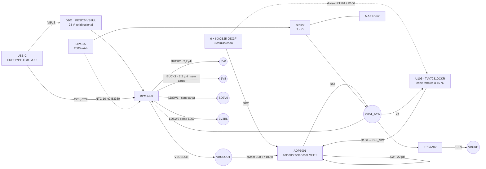
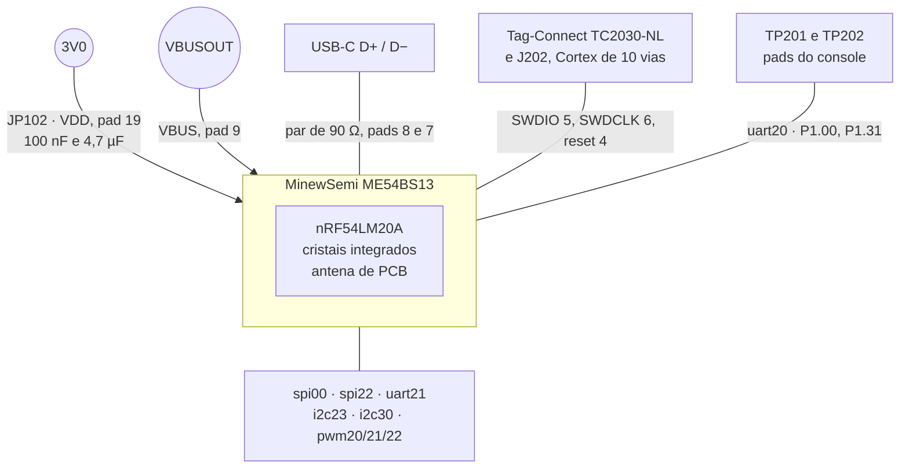
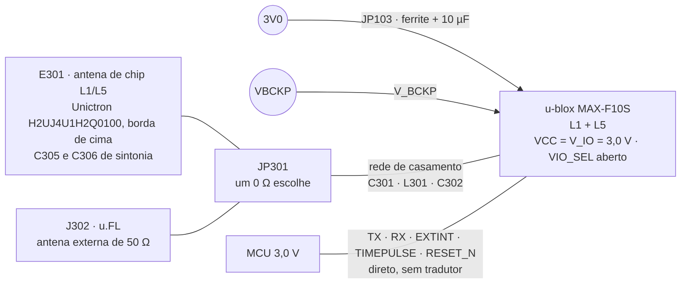
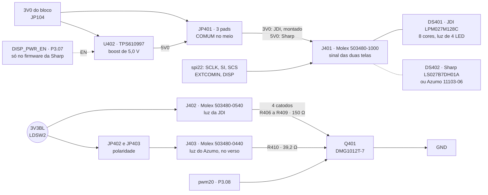
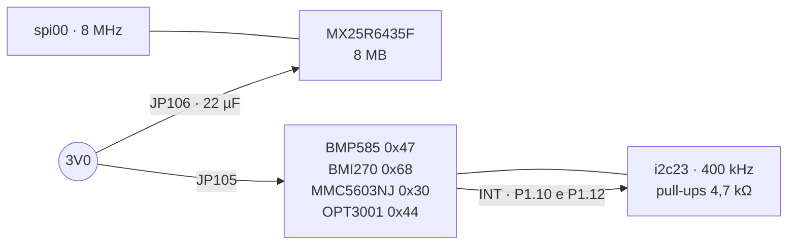
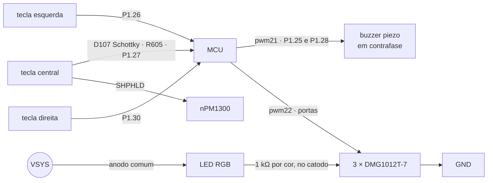

# Folhas do esquemático

As seis folhas, bloco a bloco. Cada uma traz o circuito, as decisões que
não aparecem no desenho e o que fica em aberto. As ligações completas
estão na [lista de nós](03-netlist.md) e os valores, nos
[cálculos](02-calculos.md).

**Nesta página:** [Folha 1 · Energia](#folha-1--energia) · [Folha 2 · MCU](#folha-2--mcu) · [Folha 3 · GNSS](#folha-3--gnss) · [Folha 4 · Display](#folha-4--display) · [Folha 5 · Memória e sensores](#folha-5--memória-e-sensores) · [Folha 6 · Interface](#folha-6--interface)

> [!WARNING]
> Nada aqui foi montado. A placa existe como arquivo de CAD
> ([09](09-dry-run-da-pcb.md)), nenhuma foi fabricada e nenhum
> componente passou por bancada.

## Como as folhas são desenhadas

Desde 2026-09-26 o gerador (`cad/make_sch.py` com `cad/blocos.py`) desenha
cada folha no padrão que o dono pediu, e as regras e a origem de cada uma
estão em [`cad/README.md`](cad/README.md#desenhado-por-bloco-funcional-desde-2026-09-26):

- **blocos funcionais** na ordem em que o sinal flui, cada um numa caixa
  tracejada com título — na folha 1: USB-C e proteção, nPM1300, medidor e
  célula, backup do receptor, colheita solar, corte térmico;
- dentro do bloco, o **passivo ao lado do pino que serve**, do lado para
  onde o pino aponta, e o desacoplamento numa prateleira sob o CI;
- **alimentação e terra por símbolo**; pinos vizinhos do mesmo trilho no
  mesmo lado do CI ganham um fio pelas pontas e um símbolo só;
- sinal que sai do bloco vira **rótulo local**; sinal que sai da folha,
  **rótulo hierárquico**, os dois num toco curto saído do pino — nenhum fio
  atravessa a página;
- folha 1 em **A3**, as outras em **A4**, o tamanho medido pelo próprio
  desenho; grade de 50 mil em tudo.

O `check_sch.py` confere o resultado contra a [lista de nós](03-netlist.md)
pino a pino, pelo ERC do KiCad e pela geometria (fio sobre componente, peça
fora da folha). Três coisas foram **medidas** no KiCad no caminho e valem
para quem mexer no gerador: numa instância cuja biblioteca é o desenho
base, `(mirror y)` troca esquerda por direita e `(at x y 90)` manda o pino
da esquerda para baixo (a primeira medição, feita através do gerador com a
biblioteca já espelhada, saiu invertida); a justificação do texto de um
campo é transformada junto com a instância; e um rótulo local com o nome de
um trilho é outra rede, não o trilho. A tabela completa está no
[`cad/README.md`](cad/README.md).

## Folha 1 · Energia

Três fontes entram (USB, painel solar e célula), quatro trilhos saem.

### As decisões desta folha

**O USB bloqueia o painel em hardware.** O `R104` de 100 kΩ leva o
`VBUSOUT` ao `DIS_SW` do ADP5091, com o `R105` de 180 kΩ ao `AGND`: com o
cabo o pino vê 3,5 V (**conta**), acima do 1 V de nível alto, e enquanto
houver cabo o colhedor não carrega. Não passa por pino do MCU nem por firmware: se o
firmware travar com as duas fontes ativas, as duas disputariam a mesma
célula. É a decisão de [15](../docs/15-avaliacao-componentes.md#convivência-das-duas-cargas).

**O `VSET` é resistor, não registrador.** O BUCK2 sai em 3,0 V pelo
`RVSET2` de 150 kΩ e o BUCK1 em 1,8 V pelo `RVSET1` de 47 kΩ. Isso importa
porque **é o BUCK2 que alimenta o MCU**: sem ele o aparelho não liga, e
nenhum firmware conserta um resistor errado. A tabela do VSET1 nem tem
3,0 V; a do VSET2 tem — foi por isso que o trilho do MCU foi para o BUCK2.

**O medidor fica entre a célula e tudo.** O sensor de 7 mΩ do MAX17262 vai
entre `BATT` e `SYS`, e não entre o nPM1300 e o resto: assim ele mede a
corrente líquida de **todas** as fontes, inclusive a do painel com o
aparelho desligado. Sem isso o ciclista veria a bateria subir sozinha sem
que nada contasse quanto.

**Nenhuma fonte externa alimenta o `VSYS`**, que a ficha do nPM1300
proíbe: ele é saída do power path e parece uma entrada, o que torna o
engano fácil.

No `VBAT_SYS`, o nó do lado do sistema do medidor, a regra é outra e mais
estreita do que "nada pendura nele". Ali estão, além do `VBAT` do nPM1300,
o `BAT` e o `SYS` do ADP5091, o `IN` do TPS7A02, o `SYS` do medidor e,
desde 2026-10-18, o `V+` do comparador `U105` — e é assim de propósito: o colhedor **carrega** a
célula por esse nó e o LDO do `V_BCKP` precisa da célula direto, para
sobreviver ao ship mode. O que não pode é carga da aplicação pendurada
ali, desviando do caminho de medição.

> [!NOTE]
> **Falta conferir de que lado do sensor interno fica cada pino do
> MAX17262.** A [especificação](../docs/14-hardware-placa-nova.md#carga)
> diz "sensor entre `BATT` e `SYS`", e esta lista de nós põe o `BATT` no
> lado da célula e o `SYS` no nó do sistema. Trocar os dois inverte o sinal
> da corrente medida, e é erro que sai do layout sem aparecer na bancada,
> porque o medidor continua respondendo. Fechar contra a ficha.

**O LED de carga não precisa de firmware.** O `LED1` do nPM1300 sai de
fábrica como indicador de carga e o `LED0` como indicador de erro. Com o
anodo no `VSYS`, o LED acende com o aparelho desligado — que é justamente
quando alguém quer saber se está carregando. Os dois (`D103` e `D104`,
Kingbright APT1608SURCK) ficam **na fileira das teclas, entre a primeira e
a segunda, cada um com a sua janela na caixa**, desde 2026-10-18: sob o
display, onde estavam, ninguém os via (achado G8 da
[revisão](11-revisao-do-esquematico.md#correções-aplicadas); junto do
`D601`, como a revisão sugeria, eles caíam perto demais da antena do
módulo ou no corredor do par USB).

**A tecla central liga o aparelho.** Ela vai ao `SHPHLD`, que tem pull-up
interno de 50 kΩ, e **também** a um GPIO, porque o firmware precisa ler a
mesma tecla enquanto o aparelho está ligado. Segurar por mais de 10 s
religa o sistema inteiro, e isso vem ligado de fábrica. As duas ligações
não se falam diretamente: o `D107` (BAT54WS) fica entre a tecla e o
P1.27, decisão do dono em 2026-09-26, porque o pull-up do `SHPHLD` vai ao
maior entre `VBAT` e `VBUS` — até 5,5 V com o cabo — e um pino de 3,0 V
amarrado a esse nó ficaria com o diodo de proteção polarizado. Com o
Schottky, a tecla apertada puxa os dois nós para baixo e, solta, o P1.27
sobe pelo pull-up interno do MCU e nunca vê o nó do PMIC
([folha 6](#folha-6--interface)).

**O corte térmico da carga solar é um comparador, porque o ADP5091 não
tem entrada de temperatura.** O AEM10900 que ele substituiu cortava
sozinho fora de 0 a 45 °C; o ADP5091 só tem o `DIS_SW`, que desliga o
boost quando puxado para cima. Decisão do dono em 2026-09-26: o divisor
`RT101` (NTC 10 kΩ, B3380, na face de trás, sob a célula) sobre `R106`
(4,87 kΩ) é alimentado pelo **próprio painel** (`SRC`), o `U105`
(TLV7031DCKR, 315 nA, saída push-pull) o compara com a metade do `SRC`
(`R124`/`R125`, 100 kΩ cada) e, quente, leva o `DIS_SW` para cima pelo
`D106` (BAT54WS): o mesmo
pino que o divisor do `VBUSOUT` (`R104`/`R105`) já usa para bloquear a
carga solar com o cabo ligado, agora em OU de diodos. A conta do limiar
(**conta**, B = 3380): a 45 °C o NTC vale
10 kΩ × e^(3380 × (1/318,15 − 1/298,15)) = 4,90 kΩ, e
4,87 ÷ (4,90 + 4,87) = 0,498 do `SRC` — o comparador vira exatamente
onde a metade está. Alimentar os dois divisores pelo painel, e não pela
célula, é o que faz eles não gastarem nada sem sol; o painel em vazio dá
2,07 V ([04](04-pcb-e-caixa.md)), dentro do que o `DIS_SW` aceita (6,0 V
de máximo absoluto) e do `VIN` do ADP5091 (3,6 V).

**O comparador fica no `VBAT_SYS`, que o ship mode não corta** (desde
2026-10-18, achado G3 da [revisão](11-revisao-do-esquematico.md#correções-aplicadas)).
Até então o `V+` do `U105` estava no `VSYS`, que o nPM1300 desliga em ship
mode, enquanto o ADP5091 continuava carregando a célula: o aparelho
desligado ao sol ficava sem corte térmico. O `VBAT_SYS` existe sempre que
existe célula, de 3,0 a 4,45 V, dentro dos 1,6 a 6,5 V da ficha (SLVSE13J),
e o preço são os 315 nA do comparador, o tempo todo. Na mesma revisão o
símbolo foi renumerado para a pinagem da TLV7031DCKR, a peça pedida (1
`OUT`, 2 `V−`, 3 `IN+`, 4 `IN−`, 5 `V+`), e o código da LCSC passou a ser o
C2863637: o desenho tinha a pinagem da TLV7031**S** e o código da versão
SOT-23-5 (achado B3).

> [!CAUTION]
> **Um termistor para o corte, nunca dois.** O conector da célula tem a
> via 4 reservada ao NTC do pack (`TH_MON`, [06](06-conectores-e-pontos-de-teste.md#j102--bateria)),
> mas ela fica **sem montar**: o NTC do corte é o `RT101` da placa. Montar
> os dois põe 10 kΩ em paralelo com 10 kΩ no mesmo nó, e a conta é feia
> (**conta**, B = 3380): 5 kΩ a 25 °C, e o comparador vira quando o
> paralelo cai abaixo de 4,87 kΩ, ou seja, com **cada NTC a 25,7 °C** —
> o colhedor **desliga a carga solar com o ambiente pouco acima da
> temperatura de uma sala**, sem nada passar por firmware, sem erro, sem
> aviso.

> [!WARNING]
> **O comparador só corta o lado quente.** O AEM10900 também recusava
> carga abaixo de 0 °C, e uma célula de lítio carregada abaixo de zero
> deposita lítio metálico. Com um comparador só, o painel carrega a célula
> numa manhã de inverno abaixo de zero; o carregador do nPM1300, no USB,
> continua protegido pelo JEITA, que desde 2026-10-18 só carrega de 0 a
> 45 °C (o devicetree deixava a carga cheia até 60 °C, achado G12).
> Registrado em aberto abaixo: a saída é um
> segundo comparador (a outra metade de um TLV7032) com a referência do
> frio, ou aceitar o risco pelo clima em que o aparelho vai rodar.

### Em aberto nesta folha

- O lado frio do corte térmico da carga solar (acima, e no
  [README](README.md#decisões-que-são-do-dono)).
- **No escuro, o `U105` não tem estado definido**: com o `SRC` em zero, as
  duas entradas ficam em 0 V e a saída pode segurar o `DIS_SW` alto a noite
  inteira (achado menor `energia-s2` da
  [revisão](11-revisao-do-esquematico.md#menores), não verificado).
- O calor do carregador linear numa caixa vedada ([02](02-calculos.md#calor-do-carregador)).
- **O ADP5091 não tem I²C**: o firmware não lê a potência do painel, e o
  `status.solar_mw` sai ou passa a ser estimado pela corrente líquida que o
  MAX17262 já mede.
- **O devicetree da placa ainda declara o AEM10900** (`aem10900: charger@41`,
  `solar-charger = &aem10900`), peça que saiu em 2026-09-24: na placa de
  verdade o driver não acha nada em `0x41`. Tirar o nó e o driver é
  trabalho de firmware ([10](../docs/10-status-do-port.md#defeitos-abertos)).

## Folha 2 · MCU

### As decisões desta folha

**A radiofrequência não é deste projeto.** O casamento, a antena de PCB e
os cristais vêm dentro do módulo. O que a placa faz em volta dele é:
desacoplar, respeitar a zona da antena e levar USB, SWD e console para
fora. **É por isso que as diretrizes de projeto de radiofrequência do
nRF54LM20 não são obrigatórias aqui** — e passariam a ser, todas, se o chip
fosse direto na placa.

**O pad 2 fica aberto.** Ele é a saída para antena externa; o ME54BS13 já
traz a antena de PCB num dos lados de 12 mm, e é ela que este projeto usa.
Ligar os dois seria pôr dois caminhos no mesmo transmissor.

> [!WARNING]
> **A certificação do ME54BS13 não está confirmada.** O módulo que este
> esquemático descrevia antes, o Fanstel BM20C, trazia FCC, ISED, TELEC e
> conformidade europeia; da ficha do ME54BS13, a V0.5.0 **não traz nenhuma
> certificação** e a V1.0.0 não foi lida quanto a isso. Enquanto ninguém
> ler, o aparelho não pode ser tratado como pré-certificado
> ([README](README.md#fichas-que-precisam-ser-lidas)).

**O console sai em dois pads, não em conector.** O `uart20` em P1.00 e
P1.31 vai a dois pontos de teste. Um ciclista nunca o vê; quem precisa
dele encosta uma ponta. O plano anterior punha o console no `uart30`, ao
lado do `i2c30` da energia, o que **o silício recusa**: cada bloco serial
do nRF54LM20A tem um periférico só, e `uart30` e `i2c30` são o mesmo
bloco.

**A depuração tem os dois caminhos.** O footprint Tag-Connect TC2030-NL só
tem furos e pads; o cabo se encosta com um clipe. Em 2026-09-26 o dono pediu
o conector pequeno de SWD que o J-Link usa, e ele entrou **ao lado** do
Tag-Connect: o `J202`, Cortex Debug de 10 vias (2 × 5, passo 1,27 mm, SMD),
nas mesmas redes (`SWDIO`, `SWDCLK`, `MOD_RESET`, `3V0` no `VTref`, `GND`),
com a pinagem da ARM (`nRESET` no pino 10, `SWO` no 6 sem ligação, 7 chave,
8 TDI e 9 `GNDDetect` abertos). É volume gasto na placa por uma coisa de
protótipo, e é o que o dono quis; o `SWDCLK` e o `nRESET` dele são
`passive` no ERC, para não haver duas saídas na mesma rede.

### Em aberto nesta folha

- **O espelhamento do mapa de pads.** O de-para pino a pino **já existe**:
  a ficha V1.0.0 (p. 6 a 9) dá os 80 pads — 20 castelados na borda,
  numerados de 1 a 20, e uma matriz LGA de 60, de `A0` a `F9` —, e eles
  estão transcritos em [`cad/parts.py`](cad/parts.py) (`PADS_ME54BS13`). O
  módulo expõe 64 dos 66 GPIO do chip, todos menos P1.20 e P1.21, que ficam
  com o cristal de 32,768 kHz, e os 31 pinos deste esquemático, mais os dois
  reservados, saem todos fora desse par. O que falta é conferência: **a V1.0.0 e a V0.5.0
  discordam de qual lado é qual**, e antes de fabricar alguém tem de ver num
  módulo real que os `GND` `D0`, `E0` e `F0` ficam do lado do `VDD`
  (pad 19).
- **A tolerância do cristal de 32,768 kHz.** O ANT+ exige ±50 ppm e essa
  tolerância **não está levantada para o ME54BS13**. Pergunta à MinewSemi, e
  medida do LFCLK contra o 1 PPS do receptor no protótipo.

## Folha 3 · GNSS

### As decisões desta folha

**O receptor roda a 3,0 V, no mesmo trilho do MCU** (decisão do dono em
2026-09-26, opção 1 da tabela 35 do manual de integração UBXDOC-963802114-12892:
`VCC` e `V_IO` juntos, `VIO_SEL` aberto, `V_IO` de 2,7 a 3,6 V). Até esse
dia o receptor era de 1,8 V pelo BUCK1, com um tradutor de nível TXU0204
entre ele e o MCU, porque a 1,8 V o MAX-F10S gasta cerca de 18 % menos
(46,8 mW contra 57 mW em rastreio). O que derrubou o arranjo foi a
tolerância: o BUCK1 é de ±5 % e a mesma tabela 35 pede **1,8 V ±2 %** para
o projeto de 1,8 V. A saída pela precisão, um LDO de 1,8 V ±1 % alimentado
do 3V0, custava 35 mW na bateria (o receptor passava a ser pago a 3,0 V,
com 1,2 V queimados no LDO) — mais do que os 10 mW que o receptor a 3,0 V
custa a mais, e ainda com o tradutor. A 3,0 V o receptor gasta 19 mA em
rastreio (57 mW) e 24 mA na aquisição, o BUCK2 (±5 %, 2,85 a 3,15 V) fica
dentro da faixa de 2,7 a 3,6 V do `V_IO`, e saem quatro peças: o tradutor,
o LDO e os dois capacitores de cada um. O BUCK1 fica montado, sem carga, e
o firmware o desliga ([02](02-calculos.md#3v0-do-buck2-limite-de-200-ma-ficha)).

**O `V_BCKP` vem de um LDO próprio, não do BUCK1.** O TPS7A02 tira 1,8 V
direto da célula e gasta 25 nA. É ele que mantém as efemérides e o relógio
do receptor com o aparelho em ship mode, e é isso que faz a próxima
partida ser quente em vez de fria. Se o `V_BCKP` saísse do BUCK1, desligar
o aparelho apagaria a memória do receptor.

**O `RESET_N` é dreno aberto e o firmware não o pulsa.** Um reset apaga a
memória de backup, que é exatamente o que o `V_BCKP` existe para preservar.
O driver só segura a linha.

### As cinco linhas digitais, direto

Receptor e MCU no mesmo 3V0, as linhas vão de pino a pino, sem tradutor:

| Sinal | Pino do MCU | Pino do receptor | Direção |
|---|---|---|---|
| `GNSS_TX` | P1.04 | `RXD` | MCU → receptor |
| `GNSS_EXTINT` | P1.08 | `EXTINT` | MCU → receptor |
| `GNSS_RX` | P1.05 | `TXD` | receptor → MCU |
| `GNSS_TIMEPULSE` | P1.09 | `TIMEPULSE` | receptor → MCU |
| `GNSS_RESET_N` | P1.06, dreno aberto | `RESET_N` | MCU → receptor; o pull-up de 7 a 13 kΩ é interno ao módulo |

O `TIMEPULSE` divide o pino com o `SAFEBOOT_N` por 1 kΩ interno, e o
módulo entra em safeboot se o pino estiver baixo na partida: **nenhum
pull-down** nessa linha, e o pino do MCU fica em entrada até o receptor
subir.

> [!NOTE]
> **O tradutor de nível existiu de 2026-09-23 a 2026-09-26**, e um
> rascunho anterior desta folha errou a direção dele de três maneiras ao
> mesmo tempo (passou o `RESET_N` por ele, concluiu daí que "cinco sinais
> não cabem em quatro canais" e pôs o `RX` num canal que ia do MCU para o
> receptor: **saída contra saída**, e o receptor nunca teria mandado um
> byte). O registro fica no [README](README.md#o-primeiro-em-2026-09-22),
> como história; o componente não existe mais.

### Em aberto nesta folha

- **A antena é a Unictron H2UJ4U1H2Q0100** (`E301`, LCSC C6569550), de
  5,0 × 3,0 × 0,5 mm, na borda de cima, desde 2026-09-24; o u.FL `J302`
  leva a uma antena externa de 50 Ω, e o `JP301` escolhe uma das duas com
  um 0 Ω só. Desde 2026-10-18 o `COMUM` do `JP301` fica no pad do meio:
  antes ele estava numa ponta, e nenhum 0402 ligava a antena de chip ao
  receptor (achado B4 da [revisão](11-revisao-do-esquematico.md#correções-aplicadas)).
  A TE L000670-01 de antes saiu por estoque zero na LCSC e por pedir
  40,5 × 14,5 mm livres, mais que a largura da placa. O que está em aberto
  não é a compra, é o desempenho: a ficha da Unictron dá 70 % de eficiência
  típica em L1 e em L5 numa placa de avaliação de 80 × 40 mm, e esta tem
  34 mm de largura.
- **A rede de casamento tem de sintonizar L1 e L5 ao mesmo tempo.** Os
  valores são os de partida da Unictron para a placa de avaliação dela: o
  `C301` de 1,5 pF em paralelo, o `L301` em série — que é um **capacitor**
  C0G de 3,6 pF, apesar do nome (o código de antes era o de um indutor de
  3,9 nH) —, o `C302` sem peça, e o `C305` (2,7 pF) e o `C306` (6,8 pF) nos
  dois pinos de terra da antena. Com o u.FL, o `C301` sai e o `L301` vira
  0 Ω. Quem fecha os valores é o VNA **dentro da caixa final**.
- **A UART do GNSS abre a 9.600 Bd**, que é como o MAX-F10S sai de fábrica:
  o devicetree abria a 38.400 até 2026-10-18 (achado G13).
- O AssistNow não existe no F10S: ele é ROM, e só tem Offline e Autonomous,
  de L1.

## Folha 4 · Display

### As decisões desta folha

**Duas telas, um conector de sinal**, desde 2026-10-18, a pedido do dono:
a placa aceita a **JDI LPM027M128C** ou a **Sharp LS027B7DH01A**, nua ou
como o módulo **Azumo 11103-06**, que é a Sharp com luz frontal, sem
refazer a PCB ([revisão](11-revisao-do-esquematico.md#as-duas-telas-na-mesma-placa)).
As fitas de sinal das duas saem do meio da borda longa e caem no mesmo
lugar, com a mesma ordem de dez pinos (`SCLK`, `SI`, `SCS`, `EXTCOMIN`,
`DISP`, `VDDA`, `VDD`, `EXTMODE`, `VSS`, `VSSA`), e por isso o conector é
um só: o `J401`, **Molex 503480-1000**, de contato dos dois lados. As fitas
chegam dobradas sob o vidro com os contatos para cima, e o Hirose FH12 de
antes, de contato por baixo, não encostava em nenhum (achados B5 e B6). A
fita entra pelo lado dos pregos de fixação, e o pino 1 das telas cai no
circuito 10 do conector ([06](06-conectores-e-pontos-de-teste.md#j401--display)).

**A tela padrão é a JDI, e ela saiu de venda.** Decidida em 2026-09-23 —
2,7", 400 × 240, MIP de 8 cores, **com luz frontal integrada**, 3,0 V —,
ela não tem mais canal autorizado. A decisão D1 do dono manda comprar agora
todas as telas do lote, mais duas de reserva; a Sharp, ativa, é a tela que
a placa aceita se a JDI faltar.

**A tensão do painel é uma posição de solda.** O `JP401` tem três pads em
linha: o do meio vai a `VDD`, `VDDA` e `EXTMODE`, um lado ao `3V0` do bloco
(pelo `JP104`) e o outro ao `5V0`. Com a JDI monta-se o lado do `3V0`; com
a Sharp, o do `5V0` ([06](06-conectores-e-pontos-de-teste.md#jp401--tensão-do-display)).
Com um pad do meio só, nenhuma montagem põe os dois trilhos no painel.

**O 5 V vem de um TPS610997** (`U402`), boost de saída fixa em 5,0 V (4,90 a
5,10 V), dentro dos 4,8 a 5,5 V da Sharp. O REG710NA-5 do plano antigo dá
4,7 V no mínimo, e não volta. Em volta do `U402`, encostados nos pinos
`SW`, `VIN` e `VOUT`: o `L401` de 2,2 µH (o mesmo indutor dos bucks), o
`C405` de 10 µF na entrada e o `C406` e o `C407` na saída, que a ficha pede
com 20 µF nominais. Desligado, ele desconecta a saída. O `EN` é o
`DISP_PWR_EN` (P3.07), com o pull-down de 100 kΩ do `R403`, e **só o
firmware da Sharp o liga**: o `power-gpios` está só no overlay dela
(`zephyr_app/boards/gnssbike_sharp.overlay`, `TELA=sharp` em
`tools/fw/fw.sh`). Com o firmware da JDI, um `JP401` esquecido na posição
do `5V0` dá 0 V à JDI, não 5 V.

> [!CAUTION]
> **Um JDI com 5 V queima**: o máximo absoluto dele é 3,6 V. Duas coisas o
> protegem, e só juntas: o pad do meio único do `JP401` e o boost que só
> liga com o firmware da Sharp. Nenhuma das duas impede montar o `JP401` no
> `5V0` com a JDI no conector **e** gravar o firmware da Sharp: contra isso,
> a serigrafia (`3V0 · JDI` de um lado, `5V0 · SHARP` do outro) e o
> procedimento de montagem.

**As duas luzes, um MOSFET.** A luz da JDI são quatro LEDs em paralelo
dentro do painel, com anodo comum e um catodo por LED (spec ver.02, 1.4.2),
num conector próprio, o `J402` (**Molex 503480-0540**): o anodo vai ao
`3V3BL`, os 3,3 V da `LDSW2`, e cada catodo passa por um resistor de 150 Ω
(`R406` a `R409`, cerca de 4 mA por LED e 16 mA no total, com 2,68 V de
tensão direta típica) até o dreno do `Q401`. A luz do Azumo chega por uma
fita de 27,8 mm que contorna a borda esquerda da placa até o `J403`
(**Molex 503480-0440**), **no verso**, com o `R410` de 39,2 Ω (13 mA com
2,8 V de tensão direta). As duas usam o mesmo `Q401` (DMG1012T-7), com a
porta no PWM de P3.08 e o pull-down `R402`. A polaridade da luz do Azumo
fica em jumpers — `JP402` e `JP403` pelo desenho T7, `JP404` e `JP405`
pela folha de 2020 —, porque as duas fontes se contradizem.

**O chip select é ativo alto.** Ao contrário de quase todo SPI. Vale
repetir aqui porque é o tipo de coisa que se inverte sem pensar.

**O `EXTMODE` vai ao VDD do display, seja ele qual for.** Com ele alto, o
VCOM inverte nas bordas de subida do `EXTCOMIN`, que é um PWM do MCU —
1 Hz com a luz apagada e cerca de 120 Hz com ela acesa, para o COM ficar
perto dos 60 Hz que a ficha pede. A V3 fazia diferente: `EXTMODE` no GND e
VCOM pelo SPI.

**Com o JDI os 120 Hz passam.** O driver aceita até **140 Hz** no JDI
(`MEMLCD_COM_HZ_MAX_JDI`, em
`zephyr_app/modules/gnss_drivers/drivers/display/memlcd.c:46`) contra
20 Hz na Sharp. Enquanto a placa declarava `sharp,ls027b7dh01`, o pedido de
120 Hz da interface era recusado com `-EINVAL` e o COM ficava em 1 Hz com a
luz acesa, que é justamente o que o `EXTCOMIN` existe para evitar. Com
`jdi,lpm027m128c` no devicetree **esse defeito deixa de existir**. Com a
Sharp, o overlay volta a `sharp,ls027b7dh01`, e o `ui_svc.c` deixa o COM em
1 Hz também com a luz acesa, porque a ficha da Sharp não pede nada para a
luz frontal: o número certo para o Azumo é de bancada.

### Em aberto nesta folha

> [!NOTE]
> **A luz do C tem conector próprio desde que a ficha dele foi lida**, em
> 2026-09-23: um FPC de 5 vias e passo de 0,5 mm, ao lado do de 10 vias do
> sinal. A pinagem que faltava naquele dia — 1 a 4 catodos, 5 anodo comum,
> com o pino 1 do lado da fita de sinal — veio da spec ver.02, 1.4.2, e
> está no `J402` ([06](06-conectores-e-pontos-de-teste.md#j402--luz-da-jdi)).

- **A dobra das fitas.** O alcance calculado de cada fita até a boca do
  conector tem cerca de 0,6 mm de folga, e só a tela na mão confirma.
- **A polaridade do LED do Azumo.** O desenho T7 e a folha de 2020 se
  contradizem: teste de diodo antes de montar o par de jumpers. Montar os
  quatro põe o `3V3BL` em curto com o `Q401` pelo `R410`
  ([06](06-conectores-e-pontos-de-teste.md#j403--luz-do-azumo-no-verso)).
- **O que é o Azumo 11103-06 na compra.** A lista de compras de 2026-09-18
  o tratava como filme a laminar sobre uma Sharp comprada à parte; o desenho
  T7 põe a LS027B7DH01A na lista de peças do módulo. Conferir com a Azumo
  antes de pedir ([19](../docs/19-lista-de-compras.md#display)).
- **A JDI está fora de venda.** O anúncio escolhido em 2026-09-23 é de
  **R$ 776** no AliExpress
  ([link](https://pt.aliexpress.com/item/1005011938384752.html)); a JDI não
  lista mais MIP, a Switch Science encerrou as vendas e nenhum distribuidor
  tem a peça. Comprar é comprar de revendedor, sem procedência
  ([15](../docs/15-avaliacao-componentes.md#a-luz-da-tela-procurada-em-2026-09-23)).
- **A tela é o item mais caro da placa**: R$ 776, ou cerca de **US$ 144** a
  R$ 5,40 por dólar, na conta de 2026-09-23 ([19](../docs/19-lista-de-compras.md#custo)).
- A `LDSW2` sai de regulação com o `VSYS` perto de 3,4 V: a luz enfraquece
  com a bateria baixa, e isso não tem conserto no resistor.

## Folha 5 · Memória e sensores

### As decisões desta folha

**Não há cartão.** O soquete microSD saiu em 2026-09-20: uma peça soldada
custa menos do que o armazenamento inteiro vale. A MX25R6435F fica sozinha
no `spi00`, e os 8 MB dela guardam as atividades, os segmentos e os
percursos, montados em `/SD:` como sempre foi. Quem quiser cartão num
protótipo põe num overlay, no chip select livre de P2.03.

**A flash fica no `3V0`, sempre ligado**, desde 2026-10-18 (achado G6 da
[revisão](11-revisao-do-esquematico.md#correções-aplicadas)). Até então ela
ficava atrás da `LDSW1`, no `SD3V0`, e com o trilho desligado o P2.05 punha
3,0 V no `CS#` sem resistor, acima do máximo absoluto da entrada, e
alimentava a flash de volta pelos pinos. Agora o `JP106` a liga ao `3V0`,
os pull-ups de `CS#`, `WP` e `HOLD` (`R501` a `R503`) vão ao mesmo trilho,
e parada ela dorme em deep power-down (`has-dpd` no devicetree): 0,35 µA no
máximo, 0,15 % da célula por ano. A `LDSW1` ficou sem carga, só com o
`TP107`, e o devicetree a deixa desligada.

**Nada varre este barramento I²C.** O endereço `0x7E` põe o MMC5603NJ em
I3C, e ele só sai disso faltando energia. Ele está no lugar do MMC5633NJL
desde 2026-09-24 (a LCSC não tem o 5633), com o mesmo endereço `0x30` e o
mesmo ID, de modo que o driver `memsic,mmc56x3` não muda; o que muda é o
land e os 2,2 µF que ele pede no `VDD`. O firmware fala com endereços
conhecidos e ponto.

**O `CSB` do BMP585 tem de estar no VDDIO na partida**, ou o I²C fica
desligado até o próximo corte de energia. É condição de partida, não de
firmware.

### Em aberto nesta folha

> [!NOTE]
> **A chave da flash que ninguém ligava deixou de existir em 2026-10-18.**
> O dry-run de 2026-09-23 achou que o nó `LDO1` do nPM1300 (a `LDSW1`, que
> entregava o `SD3V0`) estava no
> [devicetree](../zephyr_app/boards/gnss/gnssbike/gnssbike_nrf54lm20a_cpuapp.dts)
> sem `regulator-boot-on` e sem apelido, e que a `mx25r6435f@0` não
> declarava `supply`: na placa de verdade, flash sem energia e alimentada
> pelos diodos de grampo do `SCK` e do `MOSI`, através dos 33 Ω de série. A
> saída escolhida foi a terceira das que esta nota listava: tirar a chave do
> circuito e deixar a flash sempre alimentada, no `3V0`, com o deep
> power-down no lugar dos nanoampères da chave.

- **8 MHz é uma frequência ruim para o L1.** Harmônicos de 8 MHz caem a
  menos de 0,6 MHz do centro de 1575,42 MHz. A flash é a única coisa
  rápida perto do receptor, e a mitigação é de layout: resistor em série
  para amaciar a borda, trilha curta, camada interna entre planos. Está
  registrado em [04](04-pcb-e-caixa.md).
- Os eixos dos sensores na placa ainda precisam ser confirmados contra o
  que o firmware espera.

## Folha 6 · Interface

### As decisões desta folha

**As três teclas são XunPu TS-1088R-02026** (LCSC C455280), SPST-NO de dois
terminais, 3,90 × 3,00 × 2,00 mm e 260 gf, desde 2026-09-24. Elas tomaram o
lugar da Omron B3S-1002P (IP67, 6 × 6 × 4,3 mm), que o estoque da LCSC
tirou; o êmbolo sobe só 0,50 mm acima da tampa de aço, contra 0,7 da Omron,
e a tecla da caixa foi redesenhada para ele, sob a membrana de TPU
([04](04-pcb-e-caixa.md#a-placa-de-hoje-dentro-da-caixa-do-conceito)). A
C&K PTS526 é a tecla da V3. Todas ativas em nível baixo, com pull-up
interno do MCU: menos três resistores e o comportamento certo com o pino
em alta impedância.

**A tecla central chega ao P1.27 por um Schottky.** Ela é também a tecla
do `SHPHLD` do nPM1300, cujo pull-up de 50 kΩ vai ao maior entre `VBAT` e
`VBUS`: com o cabo ligado o nó fica em até 5,5 V, e um pino de 3,0 V
amarrado nele estaria com o diodo de proteção conduzindo o tempo todo. O
`D107` (BAT54WS, decisão do dono em 2026-09-26) fica com o anodo do lado
do MCU (depois do `R605` de 100 Ω) e o catodo no nó da tecla: apertada, a
tecla leva os dois nós ao GND e o MCU lê baixo, com 0,3 a 0,4 V de queda
do Schottky, abaixo dos 0,9 V de `V_IL` a 3,0 V; solta, o catodo fica
acima do anodo e o P1.27 só vê o próprio pull-up. O firmware continua
lendo a tecla pelo GPIO ([10](../docs/10-status-do-port.md#defeitos-abertos)).

**O buzzer é acionado em contrafase.** Dois canais de PWM opostos dobram a
tensão sobre o piezo sem nenhuma fonte a mais. Custa um pino.

**O LED RGB passa por um MOSFET por cor, e não direto pelo pino.** O anodo
comum fica no `VSYS`, que **com o cabo USB chega a 5,5 V**: um pino de
3,0 V amarrado ao catodo ficaria com o diodo de proteção polarizado. Vão
três DMG1012T-7, com o pino do MCU na porta de cada um e **1 kΩ** em
série com cada cor, o valor que a especificação já fixava (a recalcular
para o LED de hoje, abaixo). O preço disso é
que o brilho varia com a tensão do `VSYS` ([02](02-calculos.md#led-rgb)) — o
que se aceita porque o indicador serve a pareamento e a carga, e carga é
justamente quando o `VSYS` está alto.

### Em aberto nesta folha

- **Os resistores do LED RGB pedem conta nova.** O LED é o TUOZHAN
  S4-3528RGBTA-A (`D601`, LCSC C2827321) desde 2026-09-24, de anodo comum,
  3,5 × 2,8 × 1,9 mm e MSL 4, muito mais brilhante que o Kingbright
  APTF1616SEEZGKQBKC de antes (460 a 1000 mcd no vermelho, contra 15). A
  conta de [02](02-calculos.md#led-rgb), com o 1 kΩ, ainda é a do Kingbright,
  e o `cad/parts.py` manda recalcular `R601` a `R603`. O brilho continua
  variando com o `VSYS`, porque o anodo está num trilho não regulado.
- **O buzzer é o Same Sky CPT-12123-81-SMT-TR** (`LS601`, LCSC C3812179)
  desde 2026-10-18: piezo passivo de 12 × 12 × 3,0 mm, 81 dB a 4 kHz, furo
  de som lateral, no mesmo land do Murata PKLCS1212E4001-R1 que ele
  substitui (em *Last Time Buy* até 31/03/2027). Falta conferir o lado do
  furo de som contra a abertura da caixa. Os `R607` e `R608` são de
  **1 kΩ**; a conta de [02](02-calculos.md#buzzer-piezo) ainda fecha 330 Ω,
  e o Same Sky não foi conferido contra a faixa de 1 a 2 kΩ que a Murata
  pedia.

> [!CAUTION]
> **Nem o buzzer nem o LED RGB têm firmware, e o devicetree só declara um
> canal de cada.** O `rgb_pwm` e o `buzzer_pwm` apontam para o canal 0 do
> seu PWM, os dois com `PWM_POLARITY_NORMAL`, e **nada em
> `zephyr_app/src/` menciona buzzer ou LED**. Como está, das três cores só
> a primeira acenderia, e a contrafase que dá os 6 Vpp **não existe**. O
> `pinctrl` já traz os cinco pinos; o que falta é o segundo canal em cada
> nó, com polaridade invertida no buzzer, e o código que os aciona.
