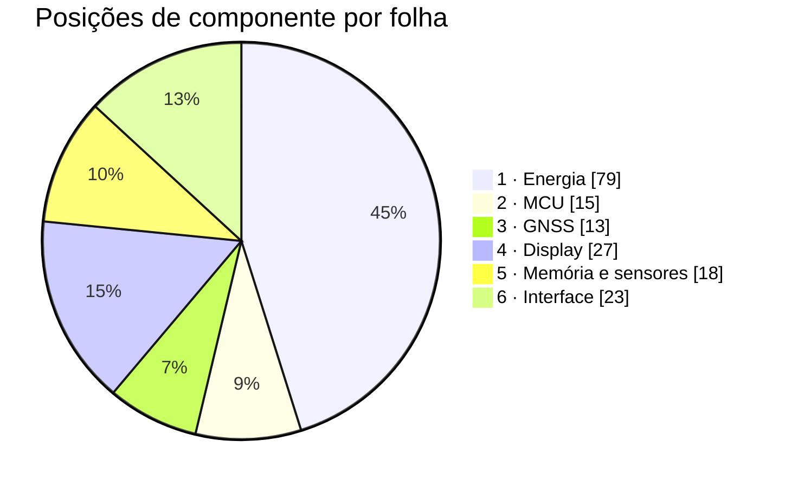

# Materiais por folha

O que cada folha do esquemático consome, ligado à linha correspondente da
[lista de compras](../docs/19-lista-de-compras.md). Esta página **não
repete** a lista de compras: ela diz quantas peças cada folha pede, com
que designador de referência e com que código da LCSC, e aponta para lá,
onde estão o estoque, o preço e a compra sugerida. A fonte de tudo o que
está aqui é o gerador: [`cad/parts.py`](cad/parts.py) (peça, valor,
código da LCSC, nota) e [`cad/nets.py`](cad/nets.py) (o trilho de cada
peça), conferidos em 2026-10-19 contra o esquemático gerado.

**Nesta página:** [Como ler](#como-ler) · [Folha 1 · Energia](#folha-1--energia) · [Folha 2 · MCU](#folha-2--mcu) · [Folha 3 · GNSS](#folha-3--gnss) · [Folha 4 · Display](#folha-4--display) · [Folha 5 · Memória e sensores](#folha-5--memória-e-sensores) · [Folha 6 · Interface](#folha-6--interface) · [Contagem](#contagem) · [Onde os documentos discordam](#onde-os-documentos-discordam) · [O que ainda não tem código de compra](#o-que-ainda-não-tem-código-de-compra) · [Custo](#custo)

> [!WARNING]
> **Nada foi comprado, nada foi montado.** Nenhum pedido foi feito,
> nenhuma peça chegou, nenhuma placa existe. A placa é montada na JLCPCB
> (regra do dono de 2026-09-24), então o código que vale para o pedido é
> o da LCSC; os dados da DigiKey da [lista de compras](../docs/19-lista-de-compras.md)
> são de 2026-09-18 e os da LCSC, da [revisão de 2026-10-18](11-revisao-do-esquematico.md#fim-de-vida-e-fornecimento),
> e mudam até o dia do pedido.

## Como ler

- **Referência**: o designador do esquemático. O **primeiro dígito diz o
  bloco** a que a peça serve: `U1xx`, `R1xx`, `C1xx` e `L1xx` são da
  energia, `U2xx` do MCU, `U3xx` e `C3xx` do GNSS, e assim por diante. As
  tabelas abaixo seguem a **folha em que a peça está desenhada** no
  [PDF do esquemático](esquematico/gnssbike-esquematico.pdf), e as duas
  coisas quase sempre coincidem. As exceções são peças desenhadas junto de
  quem as usa: `R107` e `R108` (pull-ups do `i2c30`), `R504` a `R507`
  (pull-ups do `i2c23` e séries do `spi00` junto do MCU) e `JP102` na
  folha 2; `JP103` na 3; `JP104` na 4; `C123` a `C126`, `R112` e `JP105`
  na 5; `D107` na 6; e `JP106` na 1. As letras seguem a prática usual —
  `U` integrado, `R` resistor, `C` capacitor, `L` indutor, `FB` ferrite,
  `D` diodo e LED, `Q` transistor, `J` conector, `SW` tecla, `DS` display,
  `LS` transdutor sonoro, `E` antena, `BT` bateria, `PV` módulo
  fotovoltaico, `RT` termistor, `JP` jumper, `TP` ponto de teste, `MP`
  peça mecânica.
- **Valor ou código**: a peça e o código da LCSC de `cad/parts.py`.
  "Sem código" quer dizer que o gerador ainda não traz código da LCSC para
  ela ([O que ainda não tem código de compra](#o-que-ainda-não-tem-código-de-compra)).
- **Quantidade**: peças **por placa**. A compra sugerida para 5 placas
  está na [lista de compras](../docs/19-lista-de-compras.md#lista-por-bloco),
  não aqui.
- **Onde está na lista de compras**: a seção de [19](../docs/19-lista-de-compras.md)
  que traz o estoque, o preço e a compra da peça.

## Folha 1 · Energia

Três entradas (USB, painel e célula), os trilhos de saída e o corte térmico
da carga solar ([01](01-esquematico.md#folha-1--energia)). São 79 posições.

| Referência | Componente | Valor ou código | Quantidade | Onde está na lista de compras |
|---|---|---|---|---|
| J101 | Receptáculo USB-C, USB 2.0, 16 contatos, SMD de borda | HRO TYPE-C-31-M-12, LCSC C165948; no lugar do Molex 2036150003 desde 2026-09-24 | 1 | [USB](../docs/19-lista-de-compras.md#usb) |
| D101 | TVS do `VBUS`, unidirecional, junto do `J101` | Nexperia PESD24VS1UL, SOD-882, 24 V de trabalho, LCSC C477994 (decisão D2 de 2026-10-18; era o TI TPD1E05U06, que rompia entre 6,5 e 8,5 V) | 1 | [USB](../docs/19-lista-de-compras.md#usb) |
| D102 | ESD de `CC1`, `CC2`, D+ e D− | TI TPD4E05U06DQAR, LCSC C138714 | 1 | [USB](../docs/19-lista-de-compras.md#usb) |
| U101 | PMIC, carregador e conversores | Nordic nPM1300-QEAA, QFN-32, LCSC C7466043 | 1 | [Energia](../docs/19-lista-de-compras.md#energia) |
| L101, L102 | Indutores do BUCK1 e do BUCK2, no land da Murata DFE201610 (2026-10-18) | Murata DFE201610E-2R2M, 2,2 µH, LCSC C337891 | 2 | [Energia](../docs/19-lista-de-compras.md#energia) |
| R102, R103 | `VSET1` (BUCK1 em 1,8 V) e `VSET2` (BUCK2 em 3,0 V) | 47 kΩ e 150 kΩ ([02](02-calculos.md#conversores-do-npm1300)); LCSC C25792 e C25755 | 2 | [Passivos](../docs/19-lista-de-compras.md#passivos) |
| C101 a C109 | 10 µF do nPM1300: `C101` no `VBUS`, `C102` no `VBAT_SYS`, `C103` no `VSYS`, `C104` e `C109` no `1V8`, `C105` e `C106` no `3V0`, **`C107` no `PVDD`** (o `VSYS`, junto do pino 4) e **`C108` no `3V3BL`** (os dois desde 2026-10-18) | 10 µF, 25 V, X5R, 0603, Taiyo Yuden TMK107BBJ106MA-T, LCSC C386081 | 9 | [Passivos](../docs/19-lista-de-compras.md#passivos) |
| C110, C111 | 1 µF do `VBUSOUT` e do `3V3BL` | 1 µF, 25 V, X5R, 0402, LCSC C52923 | 2 | [Passivos](../docs/19-lista-de-compras.md#passivos) |
| C129 | `VDDIO` do nPM1300, o `C13` da referência | 100 nF, 50 V, X7R, 0603, LCSC C1591 | 1 | [Passivos](../docs/19-lista-de-compras.md#passivos) |
| R109 | Pull-up do `PMIC_INT`, ao `3V0` (o `R110`, pull-up do `ALRT` do MAX17262, saiu em 2026-10-19: o pino vai ao GND, como a ficha pede) | 10 kΩ; LCSC C25744 | 1 | [Passivos](../docs/19-lista-de-compras.md#passivos) |
| U102 | Medidor de carga, **com o sensor de 7 mΩ dentro do CI** | Analog Devices MAX17262REWL+T, WLP-9, LCSC C5328777 | 1 | [Energia](../docs/19-lista-de-compras.md#energia) |
| C118, C122 | `REG` do MAX17262 e bypass do `BATT` | 0,47 µF, 10 V, 0402 (LCSC C77003); 100 nF, 50 V, X7R, 0603 (LCSC C1591) | 2 | [Passivos](../docs/19-lista-de-compras.md#passivos) |
| JP101 | Jumper de medição da corrente da célula | 0 Ω, 1206, Vishay CRCW12060000Z0EA, LCSC C190124 | 1 | [Passivos](../docs/19-lista-de-compras.md#passivos) |
| U104 | LDO de 1,8 V do `VBCKP` do receptor | TI TPS7A0218PDQNR, X2SON-4, LCSC C2862166 | 1 | [Energia](../docs/19-lista-de-compras.md#energia) |
| C113, C114 | Entrada e saída do TPS7A02 | 1 µF, 25 V, X5R, 0402, LCSC C52923 | 2 | [Passivos](../docs/19-lista-de-compras.md#passivos) |
| U103 | Colhedor solar com MPPT | Analog Devices ADP5091ACPZ-2-R7, LFCSP-24 de 4 × 4 mm, LCSC C579259; no lugar do e-peas AEM10900 desde 2026-09-24 | 1 | [Energia](../docs/19-lista-de-compras.md#energia) |
| L103 | Indutor do boost do ADP5091, entre `VIN` e `SW` | Sunlord SPH252012H220MT, 22 µH, Isat 0,45 A, 1008, LCSC C98385 | 1 | [Energia](../docs/19-lista-de-compras.md#energia) |
| C115 | Entrada do boost, no `SRC` | 22 µF, 6,3 V, X5R, 0402, LCSC C7423886 | 1 | [Passivos](../docs/19-lista-de-compras.md#passivos) |
| C116, C117, C120 | `VBAT_SYS`, junto dos pinos `BAT` e `SYS` do ADP5091 (a ficha pede o volume **e** o de alta frequência) | 22 µF, 6,3 V, 0402 (LCSC C7423886); 22 µF, 10 V, 0603 (LCSC C6600230); 100 nF, 10 V, X7R, 0402 (LCSC C71687) | 3 | [Passivos](../docs/19-lista-de-compras.md#passivos) |
| C119 | `CBP`, a amostra da tensão em aberto | 10 nF, 50 V, X7R, 0402, LCSC C15195 | 1 | [Passivos](../docs/19-lista-de-compras.md#passivos) |
| C121 | `REG_OUT` do regulador que não se usa | 4,7 µF, 10 V, 0402, LCSC C23733; o footprint fica e a peça **pode não ser montada** | 1 | [Passivos](../docs/19-lista-de-compras.md#passivos) |
| R116, R117 | Divisor do MPPT: 18 ÷ 22,3 = 81 % da tensão em aberto | 18 MΩ ao `AGND` (LCSC C423222) e 4,3 MΩ do `VIN` (LCSC C227115) | 2 | [Passivos](../docs/19-lista-de-compras.md#passivos) |
| R118, R119 | Divisor do `TERM`, do `REF`: fim de carga em 3,93 V nominais | 4,32 MΩ e 2,67 MΩ; LCSC C423169 e C477658 | 2 | [Passivos](../docs/19-lista-de-compras.md#passivos) |
| R120, R121 | Divisor do `SETSD`, do `REF`: corte de descarga em 3,00 V nominais | 6,65 MΩ e 3,32 MΩ; LCSC C172116 e C2998090 | 2 | [Passivos](../docs/19-lista-de-compras.md#passivos) |
| R122 | `MINOP`: boost parado com o painel abaixo de 1,0 V | 402 kΩ; LCSC C25785 | 1 | [Passivos](../docs/19-lista-de-compras.md#passivos) |
| R123 | `VID`: estado definido do regulador que não se usa | **110 kΩ** a 1 %, LCSC C25745; os 111 kΩ da tabela 7 da ficha não têm estoque | 1 | [Passivos](../docs/19-lista-de-compras.md#passivos) |
| R104, R105 | Divisor do `VBUSOUT` ao `DIS_SW`: o USB bloqueia a carga solar | 100 kΩ em série e 180 kΩ ao `AGND`; LCSC C25741 e C25760 | 2 | [Passivos](../docs/19-lista-de-compras.md#passivos) |
| U105 | Comparador do corte térmico da carga solar, **alimentado pelo `VBAT_SYS`** desde 2026-10-18 | TI TLV7031DCKR, SC-70-5, LCSC C2863637 (o C2869832 de antes era a versão SOT-23-5); pinagem 1 `OUT`, 2 `V−`, 3 `IN+`, 4 `IN−`, 5 `V+` | 1 | [Energia](../docs/19-lista-de-compras.md#energia) |
| RT101 | NTC do corte térmico, **na face de trás, sob a célula** | 10 kΩ B3380, LCSC C209959 | 1 | [Energia](../docs/19-lista-de-compras.md#energia). **Um NTC só no corte**: montar também o segundo NTC do pack no mesmo nó põe 10 kΩ em paralelo com 10 kΩ e corta a carga solar a 25,7 °C ([01](01-esquematico.md#folha-1--energia)) |
| R106 | Resistor de baixo do divisor do NTC: a 45 °C o NTC vale 4,90 kΩ e o meio do divisor cruza a metade do `SRC` | 4,87 kΩ; LCSC C25902 | 1 | [Passivos](../docs/19-lista-de-compras.md#passivos) |
| R124, R125 | Referência do comparador: a metade do `SRC` | 100 kΩ; LCSC C25741 | 2 | [Passivos](../docs/19-lista-de-compras.md#passivos) |
| D106 | OU de diodos do comparador no `DIS_SW` | Diodes BAT54WS-7-F, SOD-323, LCSC C124205 | 1 | [Energia](../docs/19-lista-de-compras.md#energia) |
| PV101 a PV106 | Módulos solares de 3 células, 23 × 8 mm, **fora da placa**, na caixa | ANYSOLAR KXOB25-05X3F-TR; sem código da LCSC (exceção da regra da JLCPCB); a ficha não numera os terminais | 6 | [Energia](../docs/19-lista-de-compras.md#energia) |
| J103 | Entrada dos seis módulos, em três grupos, mais o terra | JST S4B-ZR-SM4A-TF (ZH de 1,5 mm, 4 vias, SMD lateral); LCSC C485354 | 1 | [Energia](../docs/19-lista-de-compras.md#energia), [J103](06-conectores-e-pontos-de-teste.md#j103--painel-solar) |
| R113, R114, R115 | 0 Ω que junta cada grupo de módulos ao `SRC`; abrir para medir um grupo sozinho | 0 Ω, 0402; LCSC C17168 | 3 | [Passivos](../docs/19-lista-de-compras.md#passivos) |
| D105 | Grampo ESD da entrada solar, unidirecional, junto do `J103` no verso (2026-10-18) | Nexperia PESD3V3S1UB-N, SOD-523, LCSC C920299 | 1 | [Energia](../docs/19-lista-de-compras.md#energia) |
| — | Carcaça e terminais do chicote do painel | JST ZHR-4 e 4 × SZH-002T-P0.5, mais cerca de 1 m de AWG 28 | 1 + 4, fora da placa | [Energia](../docs/19-lista-de-compras.md#energia) |
| BT101 | Célula LiPo 1S, 2000 mAh, com PCM e NTC | sob encomenda, 60 × 36 × 7 mm; não está no CAD | 1 | [Compras fora da DigiKey](../docs/19-lista-de-compras.md#compras-fora-da-digikey) |
| RT102 | NTC do pack, no `NTC` do nPM1300 (JEITA de 0 a 45 °C desde 2026-10-18) | 10 kΩ B3380, **dentro da bateria**; não está no CAD | 1 | [Compras fora da DigiKey](../docs/19-lista-de-compras.md#compras-fora-da-digikey) |
| J102 | Conector da célula, **na frente**, em pé na borda esquerda | JST SM06B-SRSS-TB (SH, 1,0 mm, 2,9 mm de altura); LCSC C160405. Era o GH SM06B-GHS-TB, de 4,25 mm, que não cabe sob a tampa: a troca perde a trava positiva ([19](../docs/19-lista-de-compras.md#trocas)) | 1 | [Energia](../docs/19-lista-de-compras.md#energia) |
| — | Carcaça e terminais do cabo da célula | JST SHR-06V-S-B e 6 × SSH-003T-P0.2 (série SH; conferir no catálogo ao fechar o pedido) | 1 + 6, fora da placa | [Energia](../docs/19-lista-de-compras.md#energia) |
| D103, D104 | LED de carga (`LED1`) e de erro (`LED0`), com anodo no `VSYS`; **na fileira das teclas, entre a primeira e a segunda, cada um com a sua janela** desde 2026-10-18 | Kingbright APT1608SURCK; LCSC C5875723 | 2 | [Energia](../docs/19-lista-de-compras.md#energia) |
| JP106 | Jumper de corrente da flash, do `3V0` ao `SD3V0_FLASH` | 0 Ω, 0402; LCSC C17168 | 1 | [Passivos](../docs/19-lista-de-compras.md#passivos) |
| TP101 a TP110, TP112 | Pontos de teste da energia | cobre | 0 peças (11 posições) | [06](06-conectores-e-pontos-de-teste.md#pontos-de-teste) |

**Não existe resistor de medida nesta folha.** O sensor de 7 mΩ entre
`BATT` e `SYS` é **interno ao CI**: o `R` do código `MAX17262REWL+T` é
justamente a versão com o resistor de medida integrado
([13](../docs/13-placa-nova.md#energia),
[14](../docs/14-hardware-placa-nova.md#carga),
[15](../docs/15-avaliacao-componentes.md#medição-da-carga) e
[02](02-calculos.md#medidor-de-bateria)). Um rascunho desta página criou um
`R101` externo, que **não existe**: montado assim, a resistência do caminho
dobraria e o medidor erraria toda corrente e toda estimativa de carga.

**A `LDSW1` não tem carga desde 2026-10-18.** A flash saiu do `SD3V0` para o
`3V0`, pelo `JP106` (achado G6 da [revisão](11-revisao-do-esquematico.md#correções-aplicadas)):
com o `SD3V0` desligado, o chip select punha 3,0 V numa flash sem
alimentação. O `SD3V0` ficou só com o `TP107`.

## Folha 2 · MCU

O módulo traz dentro a radiofrequência, os dois cristais e o casamento
([01](01-esquematico.md#folha-2--mcu)). A folha também desenha os pull-ups
dos dois I²C e as séries do `spi00` que ficam junto do MCU. São 15 posições.

| Referência | Componente | Valor ou código | Quantidade | Onde está na lista de compras |
|---|---|---|---|---|
| U201 | Módulo com o nRF54LM20A, 16,5 × 12,0 × 2,4 mm, antena de PCB | MinewSemi ME54BS13-1Y20TI; **fora da LCSC**: vai como peça consignada na JLCPCB (a DigiKey tinha 45 em 2026-10-18) | 1 | [MCU e rádio](../docs/19-lista-de-compras.md#mcu-e-rádio) |
| C201 | Desacoplamento do `VDD` do módulo | 100 nF, 10 V, X7R, 0402, LCSC C71687 | 1 | [Passivos](../docs/19-lista-de-compras.md#passivos) |
| C210 | **Volume do `3V0` junto do módulo** ([02](02-calculos.md#capacitor-de-volume-no-módulo)) | 4,7 µF, 16 V, X5R, 0603, Samsung CL10A475KO8NNNC, LCSC C19666 | 1 | [Passivos](../docs/19-lista-de-compras.md#passivos) |
| JP102 | Jumper de corrente do módulo, do `3V0` ao `3V0_MOD` | 0 Ω, 0402; LCSC C17168 | 1 | [Passivos](../docs/19-lista-de-compras.md#passivos) |
| J201 | Footprint de depuração SWD | Tag-Connect TC2030-NL, **só furos e pads** | 0 peças | o cabo TC2030-CTX-NL e o clipe estão em [Placas de avaliação e ferramentas](../docs/19-lista-de-compras.md#placas-de-avaliação-e-ferramentas) |
| J202 | Conector de depuração SWD, Cortex Debug de 10 vias | 2 × 5, passo 1,27 mm, SMD, **sem carcaça** (2,5 mm de altura), **peça a escolher**; sem código | 1 | pedido do dono em 2026-09-26, ao lado do Tag-Connect: onde o adaptador Cortex-M de 9 vias do J-Link encaixa sem clipe; o blindado (Samtec FTSH-105-01-L-DV-K, 4,83 mm) não cabe sob a tampa da caixa |
| R107, R108 | Pull-ups do `i2c30` (`PWR_SDA`, `PWR_SCL`), ao `3V0` | **4,7 kΩ** ([02](02-calculos.md#pull-ups-do-i²c)); LCSC C25900 | 2 | [Passivos](../docs/19-lista-de-compras.md#passivos) |
| R504, R505 | Pull-ups do `i2c23` (`SENS_SDA`, `SENS_SCL`), ao `3V0_SENS` | **4,7 kΩ**; LCSC C25900 | 2 | [Passivos](../docs/19-lista-de-compras.md#passivos) |
| R506, R507 | Série do `NOR_SCK` e do `NOR_MOSI`, junto do MCU | 33 Ω; LCSC C25105 | 2 | [Passivos](../docs/19-lista-de-compras.md#passivos) |
| TP201, TP202, TP203 | Pads do console `uart20` e o `GND` ao lado | cobre | 0 peças | [06](06-conectores-e-pontos-de-teste.md#pontos-de-teste) |

A alternativa, se o ME54BS13 faltar, é o **Fanstel BM20C** — o módulo que
esta folha descrevia até 2026-09-23 —, que **tem outro footprint**: trocar
o módulo é refazer a folha e o layout, não trocar uma linha de lista. Ele é
menor em planta (10,0 × 16,2 × 2,0 mm), tem antena de chip no lugar da
antena de PCB, pads só LGA, e traz FCC, ISED, TELEC e conformidade
europeia, que o ME54BS13 ainda não tem confirmadas
([README](README.md#fichas-que-precisam-ser-lidas)).

> [!NOTE]
> A [lista de compras](../docs/19-lista-de-compras.md#mcu-e-rádio) segue,
> desde 2026-10-19, o módulo que o CAD monta, com o BM20C como alternativa.
> A [avaliação](../docs/15-avaliacao-componentes.md#módulo-do-mcu) guarda a
> escolha do BM20C de 2026-09-18, com uma nota do estado atual; fechar a
> escolha do módulo nos dois documentos continua sendo decisão do dono
> ([README](README.md#decisões-que-são-do-dono)).

## Folha 3 · GNSS

Receptor no `3V0`, duas antenas possíveis e um jumper que escolhe uma
([01](01-esquematico.md#folha-3--gnss)). São 13 posições.

| Referência | Componente | Valor ou código | Quantidade | Onde está na lista de compras |
|---|---|---|---|---|
| U301 | Receptor GNSS L1 + L5, `VCC` e `V_IO` no `3V0`, `VIO_SEL` aberto | u-blox MAX-F10S, LCSC C30005563 | 1 | [GNSS](../docs/19-lista-de-compras.md#gnss) |
| U301 (alternativa) | Receptor L1, mesmo footprint | u-blox MAX-M10N-10B | — | [GNSS](../docs/19-lista-de-compras.md#gnss) — 2 peças para o teste A/B |
| JP103 | Jumper de corrente do GNSS, do `3V0` ao `3V0_BLOCO` | 0 Ω, 0402; LCSC C17168 | 1 | [Passivos](../docs/19-lista-de-compras.md#passivos) |
| FB301 | Ferrite do `3V0` junto do receptor | Murata BLM18KG221SN1D, 220 Ω a 100 MHz, 50 mΩ, 0603, LCSC C88980 | 1 | [GNSS](../docs/19-lista-de-compras.md#gnss) |
| C303, C304 | Volume e desacoplamento do `3V0_GNSS`, depois do ferrite | 10 µF, 25 V, X5R, 0603 (LCSC C386081); 100 nF, 10 V, X7R, 0402 (LCSC C71687) | 2 | [Passivos](../docs/19-lista-de-compras.md#passivos) |
| E301 | Antena de chip cerâmica L1 + L5, 5,0 × 3,0 × 0,5 mm, na borda de cima | Unictron H2UJ4U1H2Q0100, LCSC C6569550; no lugar da TE L000670-01 desde 2026-09-24 | 1 | [GNSS](../docs/19-lista-de-compras.md#gnss) |
| C305, C306 | Sintonia dos pinos de terra da antena, valores de partida da Unictron (posições [9] e [8] da figura 8-1) | 6,8 pF (LCSC C88896) e 2,7 pF (LCSC C76904), C0G | 2 | [GNSS](../docs/19-lista-de-compras.md#gnss) |
| J302 | u.FL para uma antena externa de 50 Ω | Hirose U.FL-R-SMT-1, LCSC C88374 | 1 | [GNSS](../docs/19-lista-de-compras.md#gnss) |
| JP301 | Escolhe a antena: `COMUM` no pad do meio, `UFL` e `CHIP` nas pontas (2026-10-18) | 0 Ω, 0402, **um só**; LCSC C17168 | 1 | [Passivos](../docs/19-lista-de-compras.md#passivos) |
| C301 | Paralelo [1] da rede de casamento, com a antena de chip | 1,5 pF, C0G, LCSC C76900; com o u.FL, não se monta | 1 | [GNSS](../docs/19-lista-de-compras.md#gnss) |
| L301 | Série [2] da rede de casamento: **é um capacitor**, apesar do nome | 3,6 pF ± 0,1 pF, C0G, 0402, LCSC C161320 (o C98063 de antes era um indutor de 3,9 nH); com o u.FL, 0 Ω | 1 | [GNSS](../docs/19-lista-de-compras.md#gnss) |
| C302 | Paralelo [3] da rede de casamento | **não montado**: a Unictron manda não montar, e o pad fica para a bancada | 0 | — |

Não há tradutor de nível nesta folha desde 2026-09-26: receptor e MCU
ficam no mesmo `3V0` (`VCC` e `V_IO` juntos, `VIO_SEL` aberto), e as
cinco linhas digitais vão de pino a pino ([03](03-netlist.md#gnss--uart21)).
O TXU0204 que estava aqui, com os seus dois capacitores, saiu da lista
junto com o LDO de 1,8 V ±1 % que o substituiria por umas horas
([01](01-esquematico.md#folha-3--gnss)).

> [!NOTE]
> Uma versão anterior desta página dizia que "o quinto sinal não coube nos
> quatro canais" e deixava o `GNSS_EXTINT` sem componente. **Era a
> invenção que o dry-run de 2026-09-22 retratou** ([README](README.md#os-dry-runs)),
> e ela sobreviveu aqui, que é o documento que vira pedido e montagem.
> Montar por ela deixaria o `EXTINT` desligado ou, pior, encostaria uma
> saída de 3,0 V do MCU num pino de máximo absoluto de 1,98 V.

Os valores da rede de casamento e dos dois capacitores de sintonia são de
partida, da placa de avaliação de 80 × 40 mm da Unictron: quem os fecha é o
VNA, dentro da caixa final.

## Folha 4 · Display

**Duas telas, um conector de sinal**, desde 2026-10-18 (pedido do dono, na
[revisão](11-revisao-do-esquematico.md#as-duas-telas-na-mesma-placa)): a
placa aceita a **JDI LPM027M128C**, de 3,0 V e com luz integrada, que
continua sendo a tela padrão (decisão D1: comprar todas as telas do lote,
mais duas de reserva), ou a **Sharp LS027B7DH01A**, nua ou como o módulo
**Azumo 11103-06**, que é a Sharp com luz frontal, sem refazer a placa
([01](01-esquematico.md#folha-4--display),
[06](06-conectores-e-pontos-de-teste.md#j401--display)). As peças do 5 V e
da luz do Azumo vão montadas nas duas versões; o que muda entre elas é a
tela que se encaixa, a posição do `JP401` e o firmware. São 27 posições.

| Referência | Componente | Valor ou código | Quantidade | Onde está na lista de compras |
|---|---|---|---|---|
| DS401 | Tela padrão: 2,7", 400 × 240, MIP de 8 cores, **com luz de 4 LED**, fora da placa (no `J401` e no `J402`) | JDI LPM027M128C; **fora de venda** (sem canal autorizado; só mercado paralelo, sem garantia) | 1 | [Display](../docs/19-lista-de-compras.md#display) |
| DS402 | Tela alternativa, no mesmo `J401`: MIP monocromático de 400 × 240, `VDD` e `VDDA` de 4,8 a 5,5 V | Sharp LS027B7DH01A, ou o Azumo 11103-06 (a Sharp com luz frontal, um módulo só pelo desenho T7) | 0 com a JDI; 1 no lugar dela | [Display](../docs/19-lista-de-compras.md#display) |
| J401 | FPC de sinal das duas telas, 10 vias, passo de 0,5 mm, **contato dos dois lados**; o pino 1 das telas cai no circuito 10 | Molex 503480-1000, LCSC C127355 (era o Hirose FH12, de contato por baixo) | 1 | [Display](../docs/19-lista-de-compras.md#display) |
| J402 | Luz da JDI, 5 vias: catodos nos circuitos 5 a 2, anodo comum no 1 | Molex 503480-0540, LCSC C5527934 (era o HCTL HC-FPC-05-10-5RLTAG) | 1 | [Display](../docs/19-lista-de-compras.md#display) |
| J403 | Luz do Azumo, 4 vias, **no verso**: a fita contorna a borda esquerda | Molex 503480-0440, LCSC C3170007 | 1 | [Display](../docs/19-lista-de-compras.md#display) |
| JP104 | Jumper de corrente do display, do `3V0` ao `DISP_VDD_SEL` | 0 Ω, 0402; LCSC C17168 | 1 | [Passivos](../docs/19-lista-de-compras.md#passivos) |
| JP401 | Tensão do painel, **três pads**: `COMUM` com `3V0` para a JDI (**montado**) ou com `5V0` para a Sharp | 0 Ω, LCSC C17168, **um só** | 1 | [Passivos](../docs/19-lista-de-compras.md#passivos) |
| U402 | Boost de 5,0 V da Sharp (4,90 a 5,10 V), `EN` no `DISP_PWR_EN` (P3.07), saída desconectada quando desligado | TI TPS610997YFFR, LCSC C2072359 | 1 | [Display](../docs/19-lista-de-compras.md#display) |
| L401 | Indutor do boost | Murata DFE201610E-2R2M, 2,2 µH, LCSC C337891 (o mesmo dos bucks) | 1 | [Energia](../docs/19-lista-de-compras.md#energia) |
| C405, C406, C407 | Entrada do boost e as duas da saída (a ficha pede 20 µF nominais na saída) | 10 µF, 25 V, X5R, 0603, LCSC C386081 | 3 | [Passivos](../docs/19-lista-de-compras.md#passivos) |
| C404 | Desacoplamento do `DISP_VDD` | 100 nF, 10 V, X7R, 0402, LCSC C71687 | 1 | [Passivos](../docs/19-lista-de-compras.md#passivos) |
| Q401 | MOSFET de canal N da luz, no PWM, comum às duas luzes | Diodes DMG1012T-7, LCSC C20512 | 1 | [Display](../docs/19-lista-de-compras.md#display), linha "Chave da luz" |
| R406 a R409 | `R_BL` da JDI, **um por catodo**: cerca de 4 mA por LED, 16 mA no total | 150 Ω; LCSC C25082 | 4 | [Passivos](../docs/19-lista-de-compras.md#passivos) |
| R410 | Corrente da luz do Azumo pelo `3V3BL`: 13 mA com V_F de 2,8 V, 8 mA com 3,0 V | 39,2 Ω, LCSC C45323 | 1 | [Passivos](../docs/19-lista-de-compras.md#passivos) |
| JP402, JP403 | Polaridade da luz do Azumo pelo desenho T7: anodo no par 1-2, catodo no par 3-4 | 0 Ω, LCSC C17168 | 2 | [Passivos](../docs/19-lista-de-compras.md#passivos) |
| JP404, JP405 | Polaridade invertida, a da folha de 2020 | **não montados**; montar os quatro põe o `3V3BL` em curto pelo `R410` | 0 | — |
| R402 | Pull-down da porta do `Q401` | 100 kΩ; LCSC C25741 | 1 | [Passivos](../docs/19-lista-de-compras.md#passivos) |
| R403, R404, R405 | Pull-down de `DISP_PWR_EN`, `DISP_ON` e `DISP_CS`, os três ativos altos | 100 kΩ; LCSC C25741 | 3 | [Passivos](../docs/19-lista-de-compras.md#passivos) |

> [!IMPORTANT]
> **Um JDI com 5 V queima** (máximo absoluto de 3,6 V). Duas coisas o
> protegem: o `JP401` tem um pad do meio só, de modo que nenhuma montagem
> põe os dois trilhos no painel; e **o boost só liga com o firmware da
> Sharp** (`power-gpios` só no overlay dela): com o firmware da JDI, um
> `JP401` esquecido na posição do `5V0` dá 0 V, não 5 V
> ([06](06-conectores-e-pontos-de-teste.md#jp401--tensão-do-display)).

> [!CAUTION]
> **Duas coisas só a tela na mão confirma**: a dobra de cada fita até a
> boca do conector (o alcance calculado tem cerca de 0,6 mm de folga) e a
> polaridade do LED do Azumo, porque o desenho T7 e a folha de 2020 se
> contradizem — teste de diodo antes de escolher entre `JP402`/`JP403` e
> `JP404`/`JP405` ([06](06-conectores-e-pontos-de-teste.md#j403--luz-do-azumo-no-verso)).

Até 2026-10-18 esta folha montava uma tela só: a JDI, com o REG710NA-5
(`U401`), o `C401` de bombeamento e os dois 10 µF dele sem peça, o filme
Azumo (`DS402`) e o conector de 4 vias dele fora do pedido, e um `R_BL`
único de 39 Ω (`R401`, que saiu em 2026-09-26 para os quatro resistores de
150 Ω). O REG710 não volta: ele dá 4,7 V no mínimo, abaixo dos 4,8 V da
Sharp, e o TPS610997 tomou o lugar dele.

## Folha 5 · Memória e sensores

A flash e os quatro sensores; os pull-ups do `i2c23` e as duas séries do
`spi00` junto do MCU estão desenhados na [folha 2](#folha-2--mcu). São 18
posições.

| Referência | Componente | Valor ou código | Quantidade | Onde está na lista de compras |
|---|---|---|---|---|
| U501 | Flash NOR de 64 Mbit (8 MB), no `spi00`, **no `3V0`** desde 2026-10-18, em deep power-down quando parada | Macronix MX25R6435F, LCSC C2802844; a JLCPCB tinha 2 em 2026-10-18: vai consignada (a DigiKey tinha 2.480) | 1 | [Armazenamento](../docs/19-lista-de-compras.md#armazenamento) |
| C501 | Volume da flash, no `SD3V0_FLASH` (o `3V0` depois do `JP106`) | 22 µF, 10 V, X5R, 0603, LCSC C6600230 | 1 | [Passivos](../docs/19-lista-de-compras.md#passivos) |
| R501 | Pull-up do `NOR_CS`, ao `3V0` | 100 kΩ; LCSC C25741 | 1 | [Passivos](../docs/19-lista-de-compras.md#passivos) |
| R502, R503 | Pull-ups de `WP` e `HOLD` da flash, ao `3V0` | 47 kΩ; LCSC C25792 | 2 | [Passivos](../docs/19-lista-de-compras.md#passivos) |
| R508 | Série do `NOR_MISO`, junto da flash | 33 Ω; LCSC C25105. Com o `R506` e o `R507`, amacia a borda de 8 MHz, cujo 197º harmônico cai a 0,58 MHz do centro de L1 ([04](04-pcb-e-caixa.md#o-harmônico-de-8-mhz-da-flash)) | 1 | [Passivos](../docs/19-lista-de-compras.md#passivos) |
| JP105 | Jumper de corrente dos sensores, do `3V0` ao `3V0_SENS` | 0 Ω, 0402; LCSC C17168 | 1 | [Passivos](../docs/19-lista-de-compras.md#passivos) |
| U502 | Barômetro, `0x47` | Bosch BMP585, LCSC C18184976 | 1 | [Sensores](../docs/19-lista-de-compras.md#sensores) |
| U503 | IMU, `0x68` | Bosch BMI270, LCSC C2836813 (alternativa ST LSM6DSV16X, `0x6A`, no mesmo footprint) | 1 | [Sensores](../docs/19-lista-de-compras.md#sensores) |
| U504 | Magnetômetro, `0x30` | Memsic MMC5603NJ, WLP de 0,82 mm, LCSC C404328 (no lugar do MMC5633NJL, que a LCSC não tem, desde 2026-09-24) | 1 | [Sensores](../docs/19-lista-de-compras.md#sensores) |
| U505 | Luz ambiente, `0x44`, com o pad térmico 7 no `GND` | TI OPT3001DNPR, LCSC C90462 | 1 | [Sensores](../docs/19-lista-de-compras.md#sensores) |
| C502 | `VDD` do MMC5603NJ, que pede 2,2 µF no mínimo | 4,7 µF, 16 V, X5R, 0603, LCSC C19666 | 1 | [Passivos](../docs/19-lista-de-compras.md#passivos) |
| C123, C124, C125, C126 | `VDD` e `VDDIO` do BMI270, `VDD`/`VDDIO` do BMP585 e `VDD` do OPT3001 | 100 nF, 50 V, X7R, 0603, LCSC C1591 | 4 | [Passivos](../docs/19-lista-de-compras.md#passivos) |
| C503 | Desacoplamento do `3V0_SENS` | 100 nF, 10 V, X7R, 0402, LCSC C71687 | 1 | [Passivos](../docs/19-lista-de-compras.md#passivos) |
| R112 | Pull-up do `INT` do OPT3001, que não vai a pino do MCU | 10 kΩ; LCSC C25744 | 1 | [Passivos](../docs/19-lista-de-compras.md#passivos) |
| MP501 | Respiro do barômetro, na caixa; não está no CAD | Amphenol LTW VENT-PS2NBK-O8001 | 1 | [Sensores](../docs/19-lista-de-compras.md#sensores) — rosca M6, pede ressalto na tampa |

**Não há cartão nem soquete de cartão nesta placa** (decisão de
2026-09-20), e o soquete microSD do protótipo saiu da lista de compras em
2026-10-19. O chip select livre de P2.03 é o que sobra para quem quiser um
cartão num protótipo.

## Folha 6 · Interface

Teclas, buzzer e LED RGB, com a proteção das teclas e a chave da tecla
central ([01](01-esquematico.md#folha-6--interface)). São 23 posições.

| Referência | Componente | Valor ou código | Quantidade | Onde está na lista de compras |
|---|---|---|---|---|
| SW601, SW602, SW603 | Teclas táteis SPST-NO, 3,90 × 3,00 × 2,00 mm, 260 gf | XunPu TS-1088R-02026, LCSC C455280 (no lugar da Omron B3S-1002P desde 2026-09-24: o êmbolo sobe 0,50 mm, contra 0,7) | 3 | [Interface](../docs/19-lista-de-compras.md#interface) |
| R604, R605, R606 | Série das teclas | 100 Ω ([02](02-calculos.md#proteção-das-teclas)); LCSC C25076 | 3 | [Passivos](../docs/19-lista-de-compras.md#passivos) |
| C601, C602, C603 | Ao `GND` em cada tecla | 1 nF, 50 V, X7R, 0603, LCSC C1588 | 3 | [Passivos](../docs/19-lista-de-compras.md#passivos) |
| D107 | Schottky entre o P1.27 e o nó da tecla central, que é o `SHPHLD` | Diodes BAT54WS-7-F, SOD-323, LCSC C124205 | 1 | [Energia](../docs/19-lista-de-compras.md#energia), linha dos Schottky |
| LS601 | Buzzer piezo passivo, 12 × 12 × 3,0 mm, 81 dB a 4 kHz, furo de som **lateral**, em contrafase | Same Sky CPT-12123-81-SMT-TR, LCSC C3812179 (o Murata PKLCS1212E4001-R1 está em *Last Time Buy* até 31/03/2027) | 1 | [Interface](../docs/19-lista-de-compras.md#interface) |
| R607, R608 | Série do buzzer, um por pino | **1 kΩ**; LCSC C11702 | 2 | [Passivos](../docs/19-lista-de-compras.md#passivos) |
| D601 | LED RGB de anodo comum, 3,5 × 2,8 × 1,9 mm, MSL 4 | TUOZHAN S4-3528RGBTA-A, LCSC C2827321 (no lugar do Kingbright APTF1616SEEZGKQBKC desde 2026-09-24) | 1 | [Interface](../docs/19-lista-de-compras.md#interface) |
| R601, R602, R603 | `R_LEDR`, `R_LEDG` e `R_LEDB`, no catodo | 1 kΩ; LCSC C11702; **a recalcular** para o S4-3528 | 3 | [Passivos](../docs/19-lista-de-compras.md#passivos) |
| Q601, Q602, Q603 | Chaves do LED RGB, uma por cor | Diodes DMG1012T-7, a mesma peça do `Q401`; o CAD não traz o código nelas | 3 | [Interface](../docs/19-lista-de-compras.md#interface) — a lista compra **4 por placa**, 3 aqui e 1 da luz (`Q401`) |
| R609, R610, R611 | Pull-down das portas dos MOSFET do LED | 100 kΩ ([03](03-netlist.md#pinos-de-configuração-amarrados-em-cobre)); LCSC C25741 | 3 | [Passivos](../docs/19-lista-de-compras.md#passivos) |

**Os resistores do LED RGB precisam de conta nova.** O 1 kΩ fechou em
2026-09-23 com a tensão direta do Kingbright APTF1616SEEZGKQBKC (1,83 V no
vermelho e 2,66 V no verde e no azul, a 2 mA), e a conta de
[02](02-calculos.md#led-rgb) ainda é a dele. O S4-3528RGBTA-A que o CAD
monta é muito mais brilhante (460 a 1000 mcd no vermelho, contra 15), e o
`cad/parts.py` manda recalcular `R601` a `R603`. **O catodo continua sem ir
ao pino do MCU**: cada cor passa pelo dreno do seu MOSFET, porque com o
cabo USB o `VSYS` chega a 5,5 V ([01](01-esquematico.md#folha-6--interface),
[03](03-netlist.md#nós-sem-ligação-ao-mcu)).

As teclas **ganharam proteção** em 2026-09-23: elas saem para a caixa e são
o que o ciclista toca, e até então iam direto ao pino do MCU sem nada. Os
100 Ω em série e o 1 nF ao terra dão τ de 13 µs com o pull-up interno e
tiram só 23 mV do nível baixo ([02](02-calculos.md#proteção-das-teclas)).
O nível alto continua vindo do pull-up interno, sem resistor externo.

## Contagem

**A contagem que vale é a do CAD.** O `cad/parts.py` tem, em 2026-10-19,
**175 posições**, e o esquemático gerado desenha cada uma numa das seis
folhas (conferido nos arquivos `folha*.kicad_sch`):

| Folha | Posições | Das quais passivas | Fora da placa, só cobre ou não montadas | O que pesa |
|---|---|---|---|---|
| 1 · Energia | 79 | 47 | 6 módulos solares; 11 pontos de teste | os nove 10 µF da referência da Nordic, a rede de resistores do ADP5091 e o corte térmico |
| 2 · MCU | 15 | 9 | `J201` e 3 pontos de teste | o módulo, o SWD e os pull-ups e as séries desenhados junto do MCU |
| 3 · GNSS | 13 | 10 | `C302` | as duas antenas, a rede de casamento e o `JP301` |
| 4 · Display | 27 | 20 | `DS401` e `DS402`; `JP404` e `JP405` | as duas telas: o boost de 5 V, três conectores e os jumpers de polaridade |
| 5 · Memória e sensores | 18 | 13 | — | cinco CIs, o desacoplamento que as fichas pedem e os pull-ups da flash |
| 6 · Interface | 23 | 14 | — | três teclas com proteção, três MOSFET e os pull-downs |
| **Total** | **175** | **113 (65 %)** | **26** | |

Passiva aqui é resistor, capacitor, indutor, ferrite ou jumper (o `L301`,
que é capacitor, entra pela letra). A conta (**conta**):

```
posições: 79 + 15 + 13 + 27 + 18 + 23 = 175
passivas: 47 + 9 + 10 + 20 + 13 + 14 = 113, ou 113 ÷ 175 = 65 %
fora da placa: DS401, DS402 e PV101 a PV106          =  8
só cobre: TP101 a TP110, TP112, TP201 a TP203 e J201  = 15
não montadas: C302, JP404 e JP405                     =  3
peças soldadas por placa: 175 − 8 − 15 − 3            = 149
```



O `C121` entra nas 149 e pode ficar sem peça (o regulador do ADP5091 não é
usado). Ficam **fora** da contagem do CAD a célula (`BT101`), o NTC do
pack (`RT102`), o respiro (`MP501`), os dois cabos (célula e painel) e a
tela que vai no conector.

> [!NOTE]
> **De onde vêm os números.** Esta página já contou 89, 91, 120 e 115
> itens de material (até 2026-09-23) e 162 posições do CAD
> (2026-09-26). A revisão do esquemático começou com **163**, e as
> correções do mesmo dia somaram as **12** peças das duas telas — `DS402`,
> `J403`, `U402`, `L401`, `C405`, `C406`, `C407`, `JP402` a `JP405` e
> `R410` —: 163 + 12 = **175**. Nenhuma posição saiu; mudaram de peça ou
> de código o `D101`, o `J401`, o `J402`, o `LS601`, o `L301`, o `R123` e
> o `U105`, e ganharam código da LCSC os capacitores, o `JP101`, o
> `JP401`, o `L103`, o `R116`, o `U101` e o `U301`.
>
> Na mesma rodada, **nove peças de pinagem não confirmada** foram
> confirmadas pela conferência cega (`D105`, `D106`, `D107`, `J103`,
> `J302`, `Q401`, `Q601`, `Q602` e `Q603`), e o `U105` foi renumerado
> pela ficha. Só os seis módulos solares continuam sem confirmação: a
> ficha deles não numera os terminais.

## Onde os documentos discordam

Conferido em 2026-10-19 contra `cad/parts.py`. As quatro primeiras mudam o
que se compra ou o valor que se monta:

| O que diverge | O CAD (`cad/parts.py`) | O documento |
|---|---|---|
| **Série do buzzer** | `R607` e `R608` de **1 kΩ**; o comentário do `LS601` lembra que a especificação do buzzer da Murata pedia de 1 a 2 kΩ, e o Same Sky não foi conferido contra esse número | [02](02-calculos.md#buzzer-piezo) escolhe **330 Ω** |
| **Resistor da luz da JDI** | um de **150 Ω por catodo** (`R406` a `R409`, 4 mA por LED), e o `R410` de 39,2 Ω é da luz do Azumo | [02](02-calculos.md#luz-do-display) fecha um `R_BL` único de **39 Ω** |
| **LED RGB** | TUOZHAN S4-3528RGBTA-A, com a ordem de recalcular `R601` a `R603` | [02](02-calculos.md#led-rgb) faz a conta com o Kingbright APTF1616SEEZGKQBKC |
| **Códigos da LCSC dos passivos** | os capacitores têm código (menos o `C302`, não montado); dos 51 resistores, só `R116`, `R123` e `R410` têm, e dos 12 jumpers, só `JP101` e `JP401` a `JP403` | a [revisão](11-revisao-do-esquematico.md#correções-aplicadas) diz "códigos da LCSC em todos os passivos" |
| **Trilho da flash** | `3V0`, pelo `JP106`, com os pull-ups `R501` a `R503` no `3V0` | [02](02-calculos.md) e [03](03-netlist.md#nós-de-alimentação) ainda a põem no `SD3V0` da `LDSW1` |

As divergências que esta seção registrava antes foram fechadas, e ficam
abaixo como histórico para ninguém reabri-las.

| O que divergia | Como fechou |
|---|---|
| **LED do nPM1300**: o esquemático pede 2 por placa, a lista comprava 1 | a [lista de compras](../docs/19-lista-de-compras.md#energia) compra 2 por placa desde 2026-10-19 |
| **Quantidade de 100 kΩ** | a [lista](../docs/19-lista-de-compras.md#passivos) traz as 11 posições: `R104`, `R124`, `R125`, `R402` a `R405`, `R501` e `R609` a `R611` |
| **Valores de passivo sem linha na lista** (100 Ω, 1 nF, 33 Ω, 10 kΩ, o 0 Ω de 1206 e os que vieram depois) | todos têm linha em [Passivos](../docs/19-lista-de-compras.md#passivos), com o código da LCSC quando o CAD o traz |
| **Valor dos resistores do LED RGB** | um rascunho supunha tensão direta de 2,0 V e 3,0 V e chegava a 470 Ω e 150 Ω; com a ficha do Kingbright o valor fechou em **1 kΩ** em 2026-09-23. **Reaberto** com a troca do LED (acima) |
| **Acionamento do LED RGB** | o catodo **não** vai ao pino do MCU: vai um N-MOSFET por cor (Diodes DMG1012T-7), como [01](01-esquematico.md#folha-6--interface), [02](02-calculos.md#led-rgb) e [03](03-netlist.md#nós-sem-ligação-ao-mcu) descrevem |
| **Peça das teclas** | a C&K PTS526 é a tecla da **V3** ([docs/02](../docs/02-hardware.md)) e saiu por não ter grau IP; a Omron B3S-1002P fechou em 2026-09-23 e saiu em 2026-09-24, com a montagem pela JLCPCB, para a XunPu TS-1088R-02026 |

## O que ainda não tem código de compra

Conferido em `cad/parts.py` (campo `lcsc`) em 2026-10-19. Os 48 resistores, os seis jumpers de 0 Ω, os LEDs de carga, as chaves do LED RGB, o `J102` e o `J103` ganharam código no mesmo dia, pela tabela de fornecimento da [revisão](11-revisao-do-esquematico.md#correções-aplicadas); o que fica abaixo não tem código, ou não leva.

| Item | Folha | Situação |
|---|---|---|
| **Conector SWD** (`J202`) | 2 | peça a escolher: 2 × 5, passo de 1,27 mm, SMD, sem carcaça, até 2,5 mm |
| **Módulo** (`U201`) | 2 | o ME54BS13 não está na LCSC: vai consignado na JLCPCB |
| **Módulos solares** (`PV101` a `PV106`) | 1 | fora da LCSC, a outra exceção da regra do dono; compra na DigiKey |
| **Painel JDI LPM027M128C** (`DS401`) | 4 | **fora de venda**: nenhum distribuidor autorizado a vende, e a Switch Science encerrou a venda. Só o mercado paralelo (AliExpress, sem garantia e sem procedência); a decisão D1 manda comprar agora todas as telas do lote, mais duas de reserva ([19](../docs/19-lista-de-compras.md#display)) |
| **Sharp ou Azumo** (`DS402`) | 4 | fora da placa; entra no pedido só se a montagem for a da Sharp ([19](../docs/19-lista-de-compras.md#display)) |
| **Célula LiPo de 2000 mAh** | 1 | sem código: encomenda a um fabricante de packs, com PCM, NTC de 10 kΩ B3380, cabo com a JST SHR-06V-S-B e UN38.3 |

Têm código e mesmo assim vão **consignadas**, porque a JLCPCB não tinha
estoque em 2026-10-18: a flash `U501` (2 peças na JLCPCB) e, se o estoque
da LCSC acabar, o nPM1300 `U101` (51 peças na LCSC naquele dia)
([revisão](11-revisao-do-esquematico.md#fim-de-vida-e-fornecimento)).

Quatro itens que costumam ser dados como pendentes **não são**, e vale
dizer para ninguém os procurar de novo:

- **O sensor de 7 mΩ do medidor não é peça**: ele é **interno** ao
  MAX17262REWL+T, e o `R` do código é a versão com o resistor de medida
  integrado ([13](../docs/13-placa-nova.md#energia),
  [14](../docs/14-hardware-placa-nova.md#carga),
  [15](../docs/15-avaliacao-componentes.md#medição-da-carga)). Não há
  resistor externo a comprar, e criar um seria um defeito de projeto
  ([02](02-calculos.md#medidor-de-bateria)).
- **O MOSFET da luz tem código**: Diodes DMG1012T-7, LCSC C20512 e
  DMG1012T-7DICT-ND na DigiKey. A compra dele e a dos três do LED RGB
  estão na mesma linha da [Interface](../docs/19-lista-de-compras.md#interface):
  **4 por placa**.
- **O buzzer tem código**: Same Sky CPT-12123-81-SMT-TR, LCSC C3812179,
  com 240 peças na LCSC e 1.804 na DigiKey em 2026-10-18. Falta conferir o
  lado do furo de som contra a abertura da caixa.
- **A antena tem código**: Unictron H2UJ4U1H2Q0100, LCSC C6569550, e o u.FL
  da alternativa, LCSC C88374. O que está em aberto não é a compra, é o
  desempenho: a ficha dá 70 % de eficiência típica em L1 e em L5 numa placa
  de 80 × 40 mm, esta tem 34 mm de largura, e a sintonia final é de
  bancada, com VNA e dentro da caixa.

## Custo

**Este documento não refaz o total, e o total de hoje não existe.** A
estimativa de [19 · Custo](../docs/19-lista-de-compras.md#custo), de cerca
de **US$ 225 por placa**, é de 2026-09-23 e somava os preços da DigiKey de
2026-09-18 com a tela JDI a R$ 776. Desde então entraram peças com **preço
e estoque não conferidos** — o ADP5091 e o seu indutor, o comparador, as
antenas, o USB-C da HRO, as teclas, o LED, o buzzer, os três Molex 503480 e
o boost de 5 V —, o ME54BS13 tomou o lugar do BM20C (US$ 9,00 na DigiKey
ou US$ 6,00 na loja da MinewSemi, contra US$ 9,96), e a placa passou a ser
montada na JLCPCB com os preços da LCSC, que ninguém somou. O total volta
quando a lista tiver preço em todas as linhas.

A conta de 2026-09-23 fica como história (**conta**, a R$ 5,40 por
dólar):

```
saem:  Sharp 23,61 + filme Azumo 66,45         = 90,06
       REG710 1,296 + conector do filme 0,68   =  1,98
entra: JDI LPM027M128C, R$ 776 ÷ 5,40          = 143,70
placa: 173,25 − 90,06 − 1,98 + 143,70          = 224,91
```

Ela dizia **US$ 54 a mais só na tela** (143,70 contra 90,06) e cerca de
**US$ 52 a mais na placa**, porque o REG710 e o conector do filme saíam
junto.
