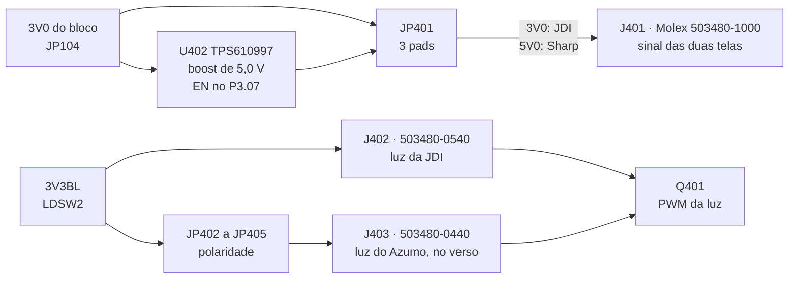
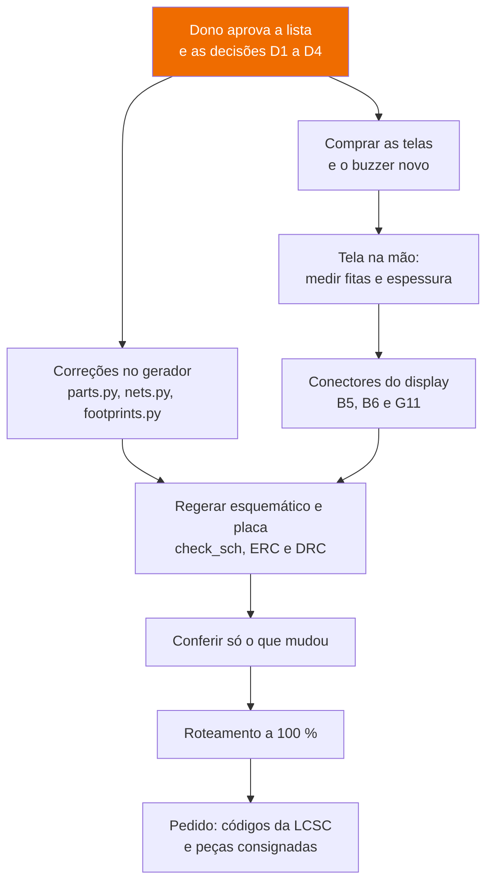

# Revisão do esquemático de 2026-10-18

Este documento responde às duas perguntas do dono antes de mandar a placa para a fábrica: o esquemático está certo, isto é, a placa montada a partir dele funciona sem se danificar? Alguma peça está em fim de vida ou não se consegue comprar? A revisão cobriu as 163 peças e as 143 redes do esquemático gerado por [`cad/`](cad/README.md). Cada tipo de peça foi auditado contra a ficha do fabricante, os pinos e footprints foram conferidos às cegas por um segundo revisor, cada achado grave foi verificado por outro agente, e três revisões de circuito procuraram o que impede a placa de funcionar. Nada foi montado nem medido: tudo o que está aqui foi tirado do netlist, das fichas e dos arquivos do CAD.

**Nesta página:** [resposta curta](#resposta-curta) · [correções aplicadas](#correções-aplicadas) · [as duas telas](#as-duas-telas-na-mesma-placa) · [bloqueios](#bloqueios) · [fim de vida e fornecimento](#fim-de-vida-e-fornecimento) · [graves](#graves) · [o que está certo](#o-que-está-certo) · [decisões do dono](#decisões-do-dono) · [caminho até a fábrica](#caminho-até-a-fábrica) · [método](#método)

## Resposta curta

> [!IMPORTANT]
> **As correções foram aplicadas em 2026-10-18** ([abaixo](#correções-aplicadas)): os 6 bloqueios, as 2 peças fora de venda ou em fim de vida e os 15 graves estão resolvidos no gerador, e a placa aceita a JDI ou a Sharp no mesmo conector. **A placa ainda não vai para a fábrica**: o roteamento não fecha (48 itens desconectados em 2026-10-19, com o DRC sem nenhum erro), e a dobra das fitas das telas e a polaridade do LED do Azumo só se confirmam com as peças na mão. O que vinha abaixo é o retrato da revisão antes das correções.

| Pergunta | Resposta |
|---|---|
| O esquemático está certo? | **Não ainda.** Dois footprints errados (BMP585 e LED RGB) e um incompleto (OPT3001), o comparador com a pinagem de outra variante, o jumper de RF que nunca liga a antena de chip e os dois conectores do display com o lado de contato e a posição errados |
| Alguma peça em fim de vida? | **Duas.** A tela JDI LPM027M128C saiu de venda: nenhum distribuidor autorizado a vende; o buzzer Murata PKLCS1212E4001-R1 está em *Last Time Buy* até 31/03/2027 e tem substituto ativo no mesmo land |
| O resto se compra? | Sim: 48 dos 69 itens conferidos estão ativos e com código certo. Os outros precisam de código de peça (capacitores, resistores, `L103`, `J202`, `JP101`) ou de código corrigido (`U105`, `L301`). O módulo e a flash vão como peça consignada na JLCPCB |

## Correções aplicadas

O dono aprovou a lista e as decisões D1 a D4 em 2026-10-18 e, no mesmo dia, pediu os conectores das duas telas na placa, para escolher a tela sem refazer a PCB. Tudo entrou no gerador de [`cad/`](cad/README.md); o esquemático, a placa e a caixa foram regerados e conferidos pelas mesmas regras de antes.

| Item | O que mudou | Onde |
|---|---|---|
| B1 | BMP585: footprint pela figura 29 da ficha, pads nos quatro lados, sem cobre sob o corpo | `footprints.py` |
| B2 | LED RGB: os quatro pads com o y certo, marca no canto chanfrado do vermelho | `footprints.py` |
| B3, D4 | TLV7031DCKR: símbolo renumerado (1 OUT, 2 V−, 3 IN+, 4 IN−, 5 V+), código C2863637 | `parts.py` |
| B4 | JP301: `COMUM` no pad do meio, `UFL` e `CHIP` nas pontas | `parts.py` |
| B5, B6 | conectores Molex 503480, de contato dos dois lados, onde as fitas caem; ver [as duas telas](#as-duas-telas-na-mesma-placa) | `parts.py`, `make_pcb.py` |
| G1 | OPT3001: pad térmico 7 no GND e land da p. 42 da ficha; o roteador não põe via sob nenhum dos quatro pads térmicos | `footprints.py`, `route.py` |
| G2 | L101 e L102 no land da Murata DFE201610 | `footprints.py` |
| G3 | comparador do corte térmico no `VBAT_SYS`, que o ship mode não corta | `nets.py` |
| G4 | C107 no `PVDD`, junto do pino 4 do nPM1300; C108 no `3V3BL` | `nets.py`, `make_pcb.py` |
| G5, D2 | TVS do VBUS: Nexperia PESD24VS1UL, 24 V de trabalho, unidirecional, SOD-882 (C477994) | `parts.py`, `footprints.py` |
| G6 | flash no `3V0`; o `LDSW1` fica sem carga, com o ponto de teste | `nets.py`, `parts.py` |
| G7 | marca de pino 1 na serigrafia de todo footprint gerado | `footprints.py` |
| G8, D3 | LEDs de carga e de erro na fileira das teclas, entre a primeira e a segunda, cada um com a sua janela. **Desvio da recomendação**: junto do `D601` eles ficavam a menos de 5 mm do keep-out da antena do módulo ou no corredor do par USB | `make_pcb.py`, `make_caixa.py` |
| G9 | `D101` junto do VBUS do USB-C; `D105` junto do `J103`, no verso | `make_pcb.py` |
| G10 | USB-C 1,10 mm mais perto da borda, na linha "PCB EDGE" da HRO | `make_pcb.py`, `check_pcb.py` |
| G11 | a tela de 2,2 mm e a união das duas telas na caixa, que passa a 63 × 106 × 18,2 mm (64 desde 2026-10-19, pelos bolsos dos módulos solares: [12](12-revisao-da-caixa.md#1--painéis-solares)) | `make_caixa.py`, `make_dxf.py` |
| G12 | JEITA: carga só de 0 a 45 °C | devicetree |
| G13 | UART do GNSS a 9600 Bd | devicetree, binding |
| Fornecimento | buzzer Same Sky CPT-12123-81-SMT-TR (C3812179) com o land da ficha; `L301` com código de capacitor de 3,6 pF; `L103`, `R116` e `R123` (110 kΩ) com peça; códigos da LCSC em toda peça montada, pela tabela de fornecimento da revisão: os passivos, os LEDs de carga, os transistores, o `J102`, o `J103`, o nPM1300 e o MAX-F10S. Em 2026-10-18 só os capacitores tinham entrado, e 48 dos 51 resistores ficaram sem código até 2026-10-19 (achado da sincronização dos documentos). Sem código ficam o módulo de rádio (consignado), o `J202` (peça não escolhida), as peças não montadas, as telas e os módulos solares (fora da placa) e os pontos de teste | `parts.py`, `footprints.py` |

Achados no caminho, e corrigidos:

- **A janela do LED RGB nunca abria.** Ela cai dentro do rebaixo da membrana das teclas, e o fundo desse rebaixo era desenhado só com os furos das teclas. As janelas dos LEDs agora são cortadas também nele, sob a membrana de TPU natural, translúcida, e o CX9 do dry run da caixa acusa uma janela fechada.
- **Nove peças de pinagem não confirmada** tinham sido confirmadas pela conferência cega (`D105`, `D106`, `D107`, `J103`, `J302` e `Q401` a `Q603`) e saíram da lista. Ficam os seis módulos solares, cuja ficha não numera os terminais.
- **A exportação para o Freerouting recusava a placa em silêncio**: os dois furos M2 se chamavam `REF**`. Agora são `H1` e `H2`.
- **Os três conectores Molex abriam para dentro da placa** (achado da segunda conferência cega, a dos pinos e footprints mudados no dia, que confirmou os outros nove itens). A fita entra pelo lado dos pregos de fixação, e os rabichos dos terminais ficam atrás, sob o atuador: a seção Y-Y, as vistas de frente, de lado e de baixo e a área de pega do desenho dizem o mesmo. O footprint foi redesenhado com a frente no lado dos pregos, o pad 1 no circuito 1 da Molex e o land na posição do contorno do desenho (estava 0,1 a 0,2 mm deslocado do corpo); a boca continua em x = 1,27 mm. Como o circuito 1 passou para a ponta de y menor, as redes foram renumeradas para o pino 1 de cada fita continuar caindo no mesmo lugar: o pino 1 das telas no circuito 10 do `J401`, o primeiro catodo da JDI no circuito 5 do `J402`, o anodo do Azumo no par 1-2 do `J403`.
- **Os capacitores de sintonia da antena de chip estavam no lugar e com o valor errados** (corrigido em 2026-10-19). As figuras 5-1 (p. 2, layout guide) e 8-1 (p. 11) da ficha da Unictron H2UJ4U1H2Q0100 põem os dois elementos de sintonia fina, [8] e [9], deitados na borda da placa, nas duas pontas do recorte: cada pino de terra da antena segue por uma faixa de 0,35 mm ao longo da borda até o capacitor, e a outra ponta do capacitor pousa no terra de fora do recorte. Aqui os dois estavam em pé no meio do recorte, e o terra do `C305` não tinha terra ao alcance (ficava solto). Agora o `C305` e o `C306` ficam na borda, nas pontas do recorte, e o roteador puxa a faixa de 0,35 mm. E os valores estavam trocados (achado `max-f10s-a4` da revisão, que tinha ficado como suspeita): a figura 8-1 põe o [9], de 6,8 pF, na ponta do lado largo do recorte, que é a do pino 1 (a do "U"), e o [8], de 2,7 pF, na do lado estreito. O `C305`, do pino 1, passou a 6,8 pF, e o `C306` a 2,7 pF. Continuam em 0402, e não no 0201 da ficha: a mesma série C0G da Murata, e a sintonia na bancada absorve a diferença. A ficha ficou no material da revisão (`ds/unictron/`), fora do git.
- **O indutor e os capacitores do boost da Sharp ficavam a 17–23 mm do TPS610997**, e a TI pede que fiquem o mais perto possível (SLVSD88M 8.4.1). Agora o `U402` fica junto do `J401`, e o `L401`, o `C405`, o `C406` e o `C407` encostam nos pinos `SW`, `VIN` e `VOUT`.

## As duas telas na mesma placa

Pedido do dono em 2026-10-18: a placa aceita a **JDI LPM027M128C** ou a **Sharp LS027B7DH01A**, nua ou como o módulo **Azumo 11103-06**, que é a Sharp com luz frontal, sem refazer a PCB. As cotas vêm das fichas: JDI spec Rev.02 p. 34; Sharp LCP-2110015A e LD-28305A; Azumo, desenho T7 de 2022-01-10.

| O quê | Como ficou |
|---|---|
| Fita de sinal | **um conector só**, o `J401`: as fitas das duas telas saem do meio da borda longa e caem no mesmo lugar, com a mesma ordem de dez pinos. Boca para a borda esquerda em x = 1,27 mm, centro em y = 31,5 mm; a fita entra pelo lado dos pregos, e o pino 1 das telas cai no circuito 10 do conector |
| Contato | Molex 503480, **dos dois lados**: as fitas chegam dobradas sob o vidro com os contatos para cima, e o lado deixa de importar |
| Tensão | `JP401`, três pads: 3V0 para a JDI (montado), 5V0 para a Sharp. O 5 V vem de um TPS610997 (4,90 a 5,10 V; o REG710 dá 4,7 V no mínimo, abaixo dos 4,8 V da Sharp) |
| Proteção | **o boost só liga com o firmware da Sharp** (`power-gpios` só no overlay dela): com o firmware da JDI, um `JP401` esquecido na posição de 5 V dá 0 V, não 5 V |
| Luz da JDI | `J402`, 503480-0540, centro em y = 16,8 mm. O receptor GNSS e a rede π andaram 2,67 mm para a direita para dar lugar a ele |
| Luz do Azumo | `J403`, 503480-0440, **no verso**: a fita de 27,8 mm contorna a borda esquerda. A polaridade fica em jumpers (`JP402` a `JP405`), porque o desenho T7 e a folha de 2020 se contradizem |
| Barra do Azumo | atrás do vidro, a 0,59 mm da placa: a faixa de y = 53,6 a 60,5 mm fica sem peça na frente |
| Caixa | bolso da união dos contornos (43,02 × 64,57 mm), tela de 2,2 mm, janela centrada na área ativa, que fica 1,67 mm à direita do meio da placa |
| Firmware | a JDI é o padrão; a Sharp é `TELA=sharp` em `tools/fw/fw.sh`, com o overlay `zephyr_app/boards/gnssbike_sharp.overlay` |

O que só a tela na mão confirma: a dobra de cada fita até a boca do conector (o alcance calculado tem cerca de 0,6 mm de folga) e a polaridade do LED do Azumo (teste de diodo antes de ligar).

## Bloqueios

Com qualquer um destes, a placa montada não funciona. Os identificadores entre parênteses são do registro da revisão, em `.claude/reviews/2026-10-18-esquematico/out/register.json`, fora do git.

| # | Problema | Peças | Correção proposta |
|---|---|---|---|
| B1 | O footprint do barômetro é um SON genérico de duas fileiras, não o LGA de quatro lados do BMP585: ligaria `3V0_SENS` ao GND e `SENS_SDA` ao `3V0_SENS`, e deixaria VDD e VDDIO soltos (`bmp585-a1`, `bmp585-x1`) | `U502` | redesenhar o footprint pela figura 29 da ficha (p. 64): pads 1 a 3 e 5 a 7 de 0,60 × 0,85 em x = ±1,225, pads 4 e 8 de 0,85 × 0,60 em y = ±1,225, sem pad central e sem cobre sob o corpo |
| B2 | O footprint do LED RGB é o espelho da pinagem do S4-3528RGBTA-A: o anodo comum nunca chega ao `VSYS` e o LED nunca acende (`leds-a1`, `leds-x1`) | `D601` | em `footprints.py` (`led_rgb_3528`), trocar o sinal de y dos quatro pads e marcar o canto do `KR` |
| B3 | O símbolo do comparador tem a pinagem da TLV7031**S**; a peça pedida, TLV7031DCKR, tem OUT no pino 1, IN+ no 3 e IN− no 4. Além disso, o código C2869832 da LCSC é a versão SOT-23-5, que não cabe no SC-70 (`tlv7031-a1`, `tlv7031-x1`, `tlv7031-a2`, `tlv7031-x2`) | `U105` | renumerar o símbolo para a TLV7031DCKR (1 OUT, 2 V−, 3 IN+, 4 IN−, 5 V+) e usar o código C2863637, que tem estoque |
| B4 | O jumper de RF tem a rede comum num pad da ponta: com um 0402, a antena de chip `E301` nunca chega ao receptor (`max-f10s-a1`) | `JP301` | pôr `COMUM` no pino 2, no pad do meio, e `UFL` e `CHIP` nos pinos 1 e 3; acertar `nets.py` e as três trilhas curtas |
| B5 | `J401` e `J402` são conectores de contato por baixo, mas as fitas da tela chegam dobradas com os contatos para cima: nenhum contato encosta (`display-a1`) | `J401`, `J402` | conectores de contato por cima: `J401` Hirose FH12A-10S-0.5SH(55), mesma altura de 2,0 mm, com o land da tabela de contato por cima (catálogo p. 10); para o `J402`, um ZIF de 5 vias a 0,5 mm de contato por cima que aceite a fita curta da luz |
| B6 | Os dois conectores não estão onde as fitas chegam: ordem trocada, 5,5 mm e 19,7 mm fora, pino 1 na ponta errada (`display-a2`) | `J401`, `J402`, `DS401` | com a tela na mão, fixar a posição dela e das fitas; pôr o conector da luz em y ≈ 42,3 e o do sinal em y ≈ 57,0, com `SCLK` (`J401`) e `BL_K1` (`J402`) do lado das teclas (ordem do `nets.py` invertida nos dois); ou girar a tela 180° e tomar as fitas pela borda direita. Conferir a dobra com uma maquete de papel |

## Fim de vida e fornecimento

Ciclo de vida e estoque lidos na LCSC, na JLCPCB e na DigiKey em 2026-10-18; o das peças que as auditorias já tinham conferido vem dos cartões da revisão.

| Peça | Situação | O que fazer |
|---|---|---|
| `DS401` JDI LPM027M128C | **fora de venda**: a Switch Science, último vendedor autorizado listado, encerrou a venda e está esgotada; DigiKey, LCSC e JLCPCB não a listam. Só se compra no mercado paralelo (AliExpress, sem garantia). O estado da peça na JDI não foi encontrado | decisão do dono, [abaixo](#decisões-do-dono) (`sourcing-d1`) |
| `LS601` Murata PKLCS1212E4001-R1 | **Last Time Buy** até 31/03/2027: o aviso PTNMUR08491 da Murata cobre toda a linha de sounders piezo, então a variante irmã não serve | trocar pelo **Same Sky CPT-12123-81-SMT-TR** (ativo, LCSC C3812179 com 240 em estoque, DigiKey com 1.804), que cabe no land de 12 × 12 desenhado; conferir o lado do furo de som contra a abertura da caixa (`buzzer-a1`, `sourcing-d2`) |
| `U105` TLV7031DCKR | ativa; código errado | C2863637 (item B3) |
| `L301` | desenhado como 3,6 pF, mas o código C98063 é um indutor de 3,9 nH | capacitor C0G 0402 de 3,6 pF ± 0,1 pF (C161320), ou renomear para `C307` (`max-f10s-a2`) |
| `L103` | sem peça | Sunlord SPH252012H220MT, 22 µH, 0,45 A (C98385), no land 1008 desenhado (`sourcing-d3`) |
| `R123` | 111 kΩ (código VID de 2,0 V, tabela 7 da ficha do ADP5091) não tem estoque | 110 kΩ a 1 %, a 0,9 % do valor da tabela; os códigos vizinhos são 55,6 kΩ e 221 kΩ |
| `J202`, `JP101`, capacitores e resistores | sem código de peça no desenho | os códigos propostos estão na tabela do fornecimento (`out/blocks/sourcing.md` da revisão); `R116` de 18 MΩ existe em 0402 a 1 % (C423222) |
| `U101` nPM1300, `U301` MAX-F10S | ativos; sem código no desenho | C7466043 (51 em estoque) e C30005563 (159) |
| `U201` ME54BS13, `U501` MX25R6435F | ativos; sem estoque na JLCPCB (o módulo não está na LCSC; a flash tem 2) | peças consignadas: DigiKey com 45 módulos e 2.480 flashes (`sourcing-d4`) |

Todos os outros circuitos integrados estão ativos: nPM1300, MAX17262, ADP5091, TPS7A02, TLV7031, OPT3001, MX25R6435F, MAX-F10S (*mass production*), ME54BS13, BMP585, BMI270, MMC5603NJ, as proteções TPD1E05U06 e TPD4E05U06 e o DMG1012T.

## Graves

A placa funcionaria, mas fora das condições da ficha ou com falha provável no uso normal. Corrigir antes de terminar o roteamento.

### Esquemático e footprints

| # | Problema | Correção proposta |
|---|---|---|
| G1 | `U505` (OPT3001) sem o pad térmico exposto, que a TI manda soldar; o land não é o da TI e já passam trilhas sob o corpo (`opt3001-a1`, `opt3001-x1`) | pad 7 de 0,65 × 1,35 no GND, pads de 0,5 × 0,25 em x = ±0,95 (ficha p. 42); tirar `USB_DM` e `SENS_SCL` de baixo do corpo |
| G2 | `L101` e `L102` em land 0805, mas a peça pedida (C337891) é a Murata DFE201610E, de 2016 (`npm1300-x1`, `npm1300-a4`) | `Inductor_SMD:L_Murata_DFE201610P` em `footprints.py` |
| G3 | O corte térmico do carregador solar fica sem alimentação em *ship mode*: o `V+` do `U105` está no `VSYS`, que o nPM1300 desliga, enquanto o ADP5091 continua carregando a célula (`npm1300-a1`, `tlv7031-a3`, `adp5091-a1`) | alimentar `U105.5` pelo `VBAT_SYS`, depois de conferir a faixa de alimentação do TLV7031 contra 3,0 a 4,45 V |
| G4 | O `PVDD` do nPM1300 não tem capacitor de entrada próprio, e o `LDSW2`, usado como LDO da luz, tem 1 µF na saída onde a referência da Nordic usa 2 × 10 µF (`npm1300-a2`, `npm1300-a3`) | 10 µF no `PVDD`, junto do `U101.4` (a referência usa dois, um para cada `PVSS`, de 25 V: o `PVDD` vai a 5,5 V), e 10 µF no `3V3BL`, junto do `U101.31`. Dá para tirá-los dos quatro 10 µF do `3V0`, que tem capacitância de sobra (`capacitors-a1`) |
| G5 | O TVS do `VBUS` (`D101`, TPD1E05U06) rompe entre 6,5 e 8,5 V: um carregador fora da norma que o nPM1300 aguentaria (até 22 V) queima o `D101` e pode deixar o `VBUS` em curto (`protection-a1`) | decisão do dono, [abaixo](#decisões-do-dono) |
| G6 | A flash recebe 3,0 V no `CS#`, sem resistor em série, com o próprio VCC (`SD3V0`) desligado: passa do máximo absoluto da entrada e alimenta a flash de volta (`mx25r6435f-a1`; junto fecham `docs-k3` e `docs-k4`) | alimentar a flash pelo `3V0`, que fica sempre ligado (`JP106.1` e `R501` a `R503` do `SD3V0` para o `3V0`), e usar o *deep power-down* (0,35 µA, 0,15 % da célula por ano) |
| G7 | O `D101` é unidirecional e o footprint não tem marca de polaridade; nenhum footprint gerado por `footprints.py` tem marca de pino 1 (`protection-x1`) | marca de pino 1 ou de catodo, na serigrafia e no `F.Fab`, em todos os footprints gerados |
| G8 | Os LEDs de carga e de erro (`D103`, `D104`) ficam sob o display, sem janela: a indicação de carga sem firmware, que é requisito do projeto, não aparece (`leds-a2`) | decisão do dono, [abaixo](#decisões-do-dono) |

### Placa e caixa

| # | Problema | Correção proposta |
|---|---|---|
| G9 | `D101` está a 47 mm do `J101`, e `D105` a 33 mm do `J103`; a TI pede o TVS junto do conector (`protection-a2`) | encostar cada um no seu conector, com via curta ao plano de terra |
| G10 | O `J101` está 1,10 mm atrás da linha de borda da HRO: a placa passa 0,61 mm da boca do conector (`usb-c-x1`, `usb-c-a1`) | levar o `J101` 1,10 mm para a borda, ou recuar a borda à frente dele, e conferir a abertura da caixa |
| G11 | A placa e a caixa modelam a tela com 61,8 × 40,08 × 1,0 mm; o desenho da JDI dá 62,5 × 42,2 mm e 2,2 mm de espessura (`display-a3`) | corrigir `make_caixa.py` e `make_dxf.py`, rodar os dois dry runs e reposicionar as peças sob a tela |

### Firmware

Não impedem a fabricação; precisam estar corrigidos antes de ligar a placa.

| # | Problema | Correção proposta |
|---|---|---|
| G12 | O devicetree deixa o limite quente do JEITA do nPM1300 em 60 °C: a carga pelo USB continua com 600 mA e 4,20 V entre 45 e 60 °C (`npm1300-a5`) | 45 °C no devicetree |
| G13 | O firmware abre a UART do GNSS a 38.400 Bd, e o MAX-F10S sai de fábrica a 9.600 Bd (`max-f10s-a3`) | abrir a 9.600 Bd e reconfigurar o receptor |

### Menores

O registro guarda 30 achados menores confirmados e 80 não verificados, que ficaram fora desta rodada a pedido do dono. Entre os novos estão:

- o sol sozinho não reanima uma célula cujo circuito de proteção abriu, porque o nPM1300 liga o BUCK2 e o GNSS em 2,75 V e o nó fica oscilando entre 2,4 e 2,75 V (`energia-s1`);
- no escuro, o `U105` não tem estado definido e pode segurar o `DIS_SW` alto a noite inteira (`energia-s2`);
- o devicetree liga os capacitores de carga internos do cristal, enquanto o esquema interno do módulo desenha capacitores externos (`mcu-gnss-s1`);
- o footprint do `U301` está girado 180° em relação ao da biblioteca do KiCad, o que importa no arquivo de posição para a montadora (`max-f10s-x1`).

## O que está certo

| Bloco | Conferido |
|---|---|
| Pinos e footprints | conferência cega de todos os grupos de peças com pinagem, menos o display, auditado uma vez (os conectores dele estão em B5 e B6). **O mapa de pads do ME54BS13 (80 pads) está certo**, o que fecha a dúvida de espelhamento entre as fichas V1.0.0 e V0.5.0 (`docs-k1`). Também estão certos o MAX17262, o ADP5091, o MAX-F10S, o nPM1300, o TPS7A02, o MX25R6435F, o BMI270, o MMC5603NJ, o DMG1012T, as proteções e os conectores, fora os itens das tabelas acima e alguns menores |
| Energia | árvore de trilhos, enables e polaridades corretos. Os dois carregadores nunca carregam juntos (o `VBUSOUT` segura o `DIS_SW`). Não há caminho reverso para o host USB, para os painéis nem para a célula pelo TPS7A02. Nenhum regulador passa do limite: o BUCK2 fica em cerca de 60 mA em regime, contra 200 mA |
| MCU | os pinos usados respeitam os domínios de energia e os pinos de clock do nRF54LM20A; cada bloco serial é usado por uma instância só. O devicetree confere com o netlist pino a pino, e as polaridades estão certas |
| GNSS | a UART está na direção certa (P1.04 → RXD, TXD → P1.05) e a 3,0 V nos dois lados. `RESET_N`, `EXTINT` e `TIMEPULSE`/`SAFEBOOT_N` ficam nos pull-ups do receptor durante o reset do MCU |
| Gravação | `J201` e `J202` levam VTref, SWDIO, SWDCLK e nRESET direto aos pads do módulo: um depurador grava o módulo na primeira vez, alimentado pela célula ou pelo USB |
| Interface e sensores | endereços I²C únicos contra os *straps*, pull-ups no trilho certo, interrupções contra as entradas do MCU, pinos não usados, polaridade de todo MOSFET e diodo, e o caminho da tecla central ao `SHPHLD` pelo `D107` |

Continuam abertas, porque dependem da bancada ou de decisão já registrada: carga solar abaixo de 0 °C (`docs-k11`), tela sobre a área da antena GNSS (`docs-k25`), isolamento entre o rádio de 2,4 GHz e a entrada do GNSS (`docs-k26`) e o comprimento da célula (`docs-k27`).

## Decisões do dono

Cada decisão traz uma recomendação. Uma linha de resposta basta.

| # | Decisão | Recomendação | Motivo |
|---|---|---|---|
| D1 | Tela fora de venda (`DS401`) | **manter a JDI LPM027M128C e comprar agora todas as telas do lote, mais duas de reserva**; testar uma ao chegar e usá-la para medir as fitas antes de corrigir B5 e B6 | a placa, o driver e a caixa foram feitos para ela. A Sharp LS027B7DH01A, ativa, precisa de 5 V (segundo o [03](03-netlist.md)) e de luz frontal, que a placa não tem mais: seria outra placa |
| D2 | TVS do `VBUS` (G5) | **voltar a um TVS com tensão de trabalho de 20 a 24 V** e estoque na LCSC, como o ESD761 da decisão anterior de [07](07-sequencias-e-protecao.md) | assim o nPM1300 cuida da sobretensão contínua e o TVS só da ESD, e um carregador ruim não queima o `D101` |
| D3 | LEDs de carga sob o display (G8) | **levar `D103` e `D104` para a fileira das teclas, junto do `D601`**, sob a mesma janela | a carga visível sem firmware é requisito do projeto e a janela do `D601` já existe |
| D4 | Comparador (B3) | **renumerar o símbolo para a TLV7031DCKR** (C2863637) | a TLV7031SDCKR, que dispensaria a mudança, não tem código na LCSC; o roteamento ainda não terminou, então religar três pinos custa pouco |

## Caminho até a fábrica

Só a lista aprovada entra no gerador. Depois da correção, a conferência repete o que mudou (os footprints novos, o `JP301`, o `U105`, os conectores do display) contra as mesmas fichas.

## Método

| Etapa | O que foi feito |
|---|---|
| Material | `tools/review/prepare.py` exportou do KiCad o netlist, o PDF, o ERC e o DRC com paridade, e resumiu tudo por folha, por tipo de peça e por rede ([`tools/review`](../tools/review/README.md)) |
| Auditoria por peça | 22 grupos de peças auditados com a ficha do fabricante: pinagem, footprint, limites em cada estado, circuito exigido pela ficha e ciclo de vida, cada um com um cartão citando página |
| Conferência cega | um segundo revisor refez a pinagem e o footprint de cada grupo sem ler o primeiro cartão; esta etapa achou de novo, de forma independente, os bloqueios B1, B2 e B3 |
| Verificação | cada bloqueio e cada grave das auditorias e da conferência cega foi refeito na fonte por outro agente; os que tinham a mesma causa foram juntados. Os dois achados de fornecimento (`sourcing-d1`, `sourcing-d2`) vêm de consulta direta aos distribuidores, sem segundo agente |
| Circuito | três revisões (energia; MCU e GNSS; display, sensores e interface) atrás de defeitos de interação: polaridade, caminhos de corrente, estados, interfaces e pinos do MCU |
| Fornecimento | 69 peças e grupos de passivos conferidos na LCSC, na JLCPCB e na DigiKey em 2026-10-18 |

O material de trabalho (cartões, relatórios por folha, fichas baixadas e o registro com 210 achados) fica em `.claude/reviews/2026-10-18-esquematico/`, fora do git. O que vale para o projeto está neste documento.
