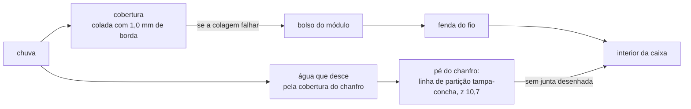
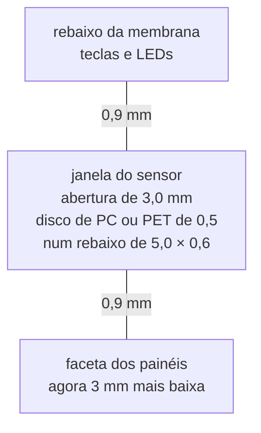
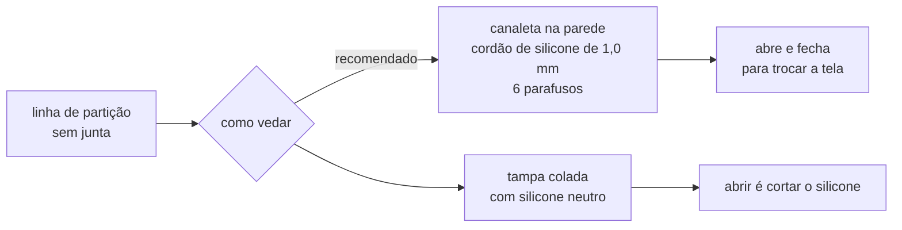

# 12 · Revisão da caixa, parte por parte

Pedido do dono em 2026-10-18: reanalisar a caixa uma parte de cada vez, para
ver se a placa, a célula e o resto batem com ela, a começar pelos encaixes dos
painéis contra a água, as três teclas, o sensor de luz e o USB-C. **Nada foi
impresso.** Cada parte diz o que o gerador ([`caixa/make_caixa.py`](caixa/make_caixa.py))
desenha, o que o dry run ([`caixa/dry_run_caixa.py`](caixa/dry_run_caixa.py))
mede, o que foi conferido com a ficha da peça, o que mudou e o que fica para o
dono decidir.

**Nesta página:** [Resumo](#resumo) · [1 · Painéis solares](#1--painéis-solares) · [2 · Teclas, membrana e LEDs](#2--teclas-membrana-e-leds) · [3 · Sensor de luz](#3--sensor-de-luz) · [4 · USB-C](#4--usb-c) · [5 · Tela e janela](#5--tela-e-janela) · [6 · Célula](#6--célula) · [7 · Placa na caixa](#7--placa-na-caixa) · [8 · Buzzer e barômetro](#8--buzzer-e-barômetro) · [9 · Antenas](#9--antenas) · [10 · Fechamento](#10--fechamento)

## Resumo

| Parte | Situação | O que mudou | Para o dono |
|---|---|---|---|
| 1 · Painéis solares | corrigida no gerador; dry run 12/0/1 | bolsos pela tolerância da ficha, fendas para a solda, fita de 0,15, caixa de 64 de largura, faceta de 1,95 | módulo fino de 1,2 mm, que devolveria a caixa a 63; a vedação da linha de partição (parte 10) |
| 2 · Teclas, membrana e LEDs | corrigida no gerador; dry run 12/0/1 | 0,15 mm de ar entre a tecla e a membrana; membrana e coberturas de filme cortado, não impressas | nenhum |
| 3 · Sensor de luz | corrigida no gerador e na placa | janela vedada por disco transparente num rebaixo, fora da membrana e da faceta; o `U505` desce 0,4 mm; a faceta desce 3 mm | nenhum |
| 4 · USB-C | **decisão do dono** | nada ainda | a porta não veda, e a capa de um cabo comum pode não deixar o plugue entrar até o fim: tampão de TPU e rebaixo para a capa (recomendado), ou voltar ao receptáculo IPX8 |
| 5 · Tela e janela | certa; dois pontos só com a tela na mão | nada | a fita da janela em anel de peça única |
| 6 · Célula | certa no desenho; o pack ainda não existe | nada | especificar ao fabricante 60 × 36 × 7 **no máximo, com o PCM**, e o lado da saída do cabo |
| 7 · Placa na caixa | certa | nada | nenhum |
| 8 · Buzzer e barômetro | **furos abertos** | nada ainda | membrana de ePTFE adesiva por dentro de cada furo (recomendado) |
| 9 · Antenas | certa na caixa; o `RF9` da placa continua violado, como registrado | nada | nenhum novo |
| 10 · Fechamento | **sem vedação na linha de partição** | nada ainda | junta em canaleta e 6 parafusos (recomendado), ou tampa colada com silicone |

## 1 · Painéis solares

### O que está desenhado

Seis módulos ANYSOLAR KXOB25-05X3F: dois lado a lado na faceta abaixo das
teclas e dois em cada chanfro de 45° das laterais longas. Cada módulo fica num
bolso, sob uma cobertura transparente colada no rebaixo em volta. Os fios
descem por fendas no fundo do bolso e correm por dentro da tampa até o `J103`
da placa (JST ZH de 4 vias: os três grupos de dois módulos, frente, chanfro
esquerdo e chanfro direito, e o terra comum).

### O que a ficha diz

A [ficha da ANYSOLAR](https://anysolar.biz/wp-content/uploads/2026/09/KXOB25-05X3F-DATASHEET.pdf)
(preliminar, setembro de 2026, p. 3) dá:

| Item | Valor |
|---|---|
| Corpo | 23 × 8 × 1,8 mm, **±0,3 em todas as cotas** sem tolerância própria |
| Células | três de 7,20 × 6,59 mm na frente |
| Terminais | no verso, **um em cada ponta**, 2,0 mm ao longo do módulo e 7,4 mm através; `+` numa ponta, `−` na outra |
| Solda | à mão, 5 s abaixo de 400 °C, ou refusão com liga de baixa temperatura (Sn42Bi58) |
| Limpeza | água morna; detergente e IPA podem estragar o filme da frente |

### O que estava errado

O gerador usava a medida nominal, e a lista de ferragens do PDF da caixa pedia
fita de 0,5 mm sob os módulos, que não cabia no bolso.

| Item | Antes | Problema | Agora |
|---|---|---|---|
| Folga do bolso | 0,2 mm por lado (23,4 × 8,4) | o maior módulo da ficha, 23,3 × 8,3, não entra num bolso impresso, que sai menor que o desenho | 0,4 ao longo e 0,3 através: **23,8 × 8,6** |
| Fundo do bolso | 1,9 mm (1,8 + 0,1) | um módulo de 2,1 levanta a cobertura 0,2 mm, e a fita de 0,5 levanta 0,4 a 0,7: a colagem que segura a chuva abre | **2,35 mm**: módulo de até 2,1 em fita de 0,15, com 0,1 de ar |
| Fita sob o módulo | 0,5 mm, "para a célula e os módulos" | não cabe sob o módulo | **0,15 mm**, acrílica dupla face da classe 3M 9080A; a de 0,5 fica só na célula |
| Passagem do fio na faceta | furo de 1,0 mm a 1,5 mm da ponta do bolso | a solda do fio no terminal não entra num furo de 1 mm, e o módulo assenta sobre ela | **fenda de 1,6 × 3,0** sob o meio de cada terminal, conferida pelo CX10 |
| Passagem do fio no chanfro | fenda de 1,5 × 2,0 a 0,4 mm da ponta | nenhum: cai sob o terminal | mantida |
| Largura da caixa | 63 mm | com o bolso mais fundo, o canto de dentro do bolso ficava a 0,06 mm da face interna do chanfro, que encosta a 1,0 mm do vidro da tela | **64 mm**: 0,5 mm de parede atrás do bolso, 1,0 mm do vidro, chanfro de 7,5 mantido |
| Faceta | 1,5 mm acima da tampa | o bolso mais fundo não cabia | **1,95 mm**, derivada do bolso |

Resultado do dry run da caixa com a placa de 2026-10-19: **12 regras medidas e
cumpridas, 0 violadas, 1 não medida**. O CX10 passou a conferir a folga contra
a tolerância da ficha, o fundo contra o módulo mais grosso na fita e uma
passagem de solda sob cada terminal.

### A água

- **A cobertura é a única barreira do bolso.** A borda de colagem tem 1,0 mm
  em volta dos bolsos da faceta e 1,0 mm nas laterais e nas pontas da tira de
  cada chanfro (rampa de 10,61 mm, bolso de 8,6). A recomendação é cobertura
  de PC ou PET de 0,5 mm cortada a laser, e não impressa em resina, que
  amarela e espalha a luz; colada com cordão contínuo de silicone de cura
  neutra (o de cura acética solta ácido, que ataca o filme do módulo e o PC)
  ou adesivo UV transparente. Depois de soldar, uma gota de silicone em cada
  fenda de fio é a segunda barreira.
- **O pé de cada chanfro é a linha de partição entre a tampa e a concha**, em
  z = 10,7 mm, de y = 16 a 76 mm nos dois lados. A água que desce pela
  cobertura chega direto nela, e ela não tem junta: o PDF da caixa só diz
  "silicone neutro para a partição". É o ponto fraco da vedação inteira, e é
  a [parte 10](#resumo), do fechamento.

### Para o dono

- **Módulo fino.** A ANYSOLAR tem o KXOB25-05X3TF, com 23 × 8 × 1,2 mm e a
  mesma potência anunciada na DigiKey. Com ele o bolso perde 0,6 mm de fundo,
  a caixa volta a 63 mm e a faceta a 1,35 mm. Falta conferir a ficha dele, a
  tolerância e a oferta, antes de trocar.

## 2 · Teclas, membrana e LEDs

### O que está desenhado

Três chaves XunPu TS-1088R-02026 na placa (3,90 × 3,00 × 2,00 mm, 260 gf,
curso de **0,2 ± 0,1 mm**), no passo de 13,4 mm. Sobre cada uma, uma tecla
impressa: um pé de 7,0 × 7,0 × 0,5 mm apoiado no êmbolo e uma haste de
5,0 × 5,0 mm que sobe por um furo de 5,6 mm da tampa. O pé, mais largo que o
furo, prende a tecla por baixo. Por cima, uma membrana de 0,3 mm num rebaixo
de 0,4 mm cobre os três furos e as janelas dos LEDs: o RGB (`D601`, janela de
2,5 mm entre a segunda e a terceira tecla) e os dois de carga (`D103` e
`D104`, janelas de 1,5 mm entre a primeira e a segunda).

### O que foi conferido

| Item | Medido | Situação |
|---|---|---|
| Tecla sobre a chave | desvio de 0,00 mm nas três (CX4) | certo |
| Haste no furo | 0,3 mm de folga por lado | certo |
| Borda de colagem da membrana | 3,2 mm ao lado da primeira e da última tecla, 2,2 mm acima e abaixo dos furos | certo |
| Janelas dos LEDs | dentro do rebaixo, cortadas também no fundo dele (corrigido em 2026-10-18) | certo |
| Pilha da tecla | êmbolo em z = 13,3; topo da tecla rente ao fundo do rebaixo, em z = 17,8: **folga zero** | **errado** |

**Folga zero na pilha.** A tecla encostava na membrana com a chave em
repouso. A pilha soma a placa nas bossas, os 2,0 mm da chave, a tecla impressa
e a tampa, cada uma com décimos de tolerância, e o curso da chave é de 0,2 ±
0,1 mm: uma pilha 0,1 mm alta deixa a chave apertada para sempre. Agora a
tecla para **0,15 mm abaixo da membrana** (`TECLA_FOLGA`). É curso morto sob o
dedo, e a tecla nunca se aperta sozinha. O CX4 confere que essa folga fica
entre 0,1 e 0,2 mm.

### A água

A membrana colada no rebaixo é a barreira dos três furos e das três janelas.
O PDF mandava imprimir a membrana em TPU de 0,3 mm. Com uma ou duas camadas,
a TPU impressa fica com poros e não veda. Agora o STL serve de contorno para
cortar filme de TPU ou PU de 0,2 a 0,3 mm, natural e translúcido, colado com
cordão contínuo em volta do rebaixo. A mesma troca vale para as coberturas
dos painéis: PC ou PET de 0,5 mm cortado a laser, no lugar de resina
transparente impressa.

### Para a parte 3

A membrana translúcida conduz luz por dentro dela. Ela não pode cobrir o
sensor de luz junto com os LEDs: o sensor leria o LED.

## 3 · Sensor de luz

### O que estava desenhado

O OPT3001 (`U505`) fica na frente da placa, abaixo da primeira tecla, longe
de toda peça mais alta que o dobro da altura dele (a regra da ficha contra
reflexo secundário, conferida na colocação). Sobre ele, a tampa tinha um furo
quadrado de 3,5 mm, **aberto**.

### O que estava errado

| Item | Problema |
|---|---|
| Furo aberto | a chuva entra direto na caixa, sobre a placa |
| Faceta | o furo entrava 0,95 mm na borda da faceta dos painéis |
| Debaixo da membrana? | não serve: a membrana translúcida conduz a luz dos três LEDs por dentro dela, e o sensor leria os LEDs |

### O que mudou

- A janela tem uma abertura de 3,0 mm e, por fora, um rebaixo de 5,0 × 0,6 mm
  para um disco transparente de 0,5 mm colado (0,1 de cola). O disco fica
  rente à tampa e veda a janela sem passar pela membrana.
- A faixa entre o rebaixo da membrana e a faceta tinha 3,8 mm. A faceta
  desceu 3 mm (começa 9,0 mm abaixo dos furos das teclas, e não 6,0), e o
  `U505` desceu 0,4 mm na placa (y = 74,4). Assim o rebaixo do disco fica a
  0,9 mm de cada vizinho. A faceta ainda tem 15,7 mm de altura para os bolsos
  de 8,6 mm e a borda da cobertura.
- Os vizinhos do sensor mantêm a distância da ficha: `J102` e `J202` ficam ao
  lado e não mudam; `SW601` fica mais longe; `D102` fica a 2,7 mm, contra os
  0,8 que pede.
- O CX9 passou a acusar janela sem disco, rebaixo a menos de 0,8 mm da
  membrana ou da faceta e abertura menor que 2,5 mm.

O campo de visão fica num cone de cerca de ±13° para cima: a abertura de
3,0 mm está uns 6,2 mm acima do sensor. Serve para decidir a luz da tela, mas
não é uma medida de lux de ângulo aberto. Se um dia precisar disso, o caminho
é um guia de luz.

## 4 · USB-C

### O que está desenhado

O `J101` é o HRO TYPE-C-31-M-12 (LCSC C165948), um receptáculo comum, sem
vedação, que entrou no lugar do Molex 2036150003 (IPX8) em 2026-09-24 pelo
preço e pela montagem na JLCPCB ([19](../docs/19-lista-de-compras.md)). A
parede de baixo tem um entalhe de 10 × 4,2 mm centrado nele, e por fora uma
porta de 14,0 × 8,2 × 1,2 mm articulada em dois ressaltos com um pino de
1,5 mm. O CX6 confere o entalhe centrado, a altura dele sobre o receptáculo e
a porta cobrindo o entalhe com 2 mm de aba.

### O que está errado

| Item | Medido | Problema |
|---|---|---|
| Vedação | a porta é uma aba lisa encostada na parede, sem junta e sem nada que entre no entalhe | a chuva escorre pela borda da aba, entra pelo entalhe em volta do receptáculo e chega à placa |
| Boca do receptáculo | a 1,54 mm da face de fora da parede (CX6: o fim do contorno do `J101` passa 0,46 mm da face de dentro de uma parede de 2,0) | o plugue só assenta se a capa do cabo entrar no entalhe. O entalhe tem 10 × 4,2 mm, e a capa de muitos cabos é maior que isso: o plugue para antes de fazer contato |

O segundo item depende do cabo, e não há medida de cabo neste projeto. O teste
é simples: com o cabo que o dono vai usar, medir a largura e a altura da capa
e a distância da ponta do plugue até ela.

### Opções

| Opção | O que muda | Custo |
|---|---|---|
| **A (recomendada)** | a porta vira um tampão de TPU 95A que entra no entalhe com 0,15 mm de interferência, preso por uma alça à caixa; por fora, um rebaixo em volta do entalhe do tamanho da capa do cabo (largura e altura medidas, com a profundidade que deixa a capa a 0,3 mm da boca) | só a caixa: o `J101` e a placa ficam |
| B | volta o receptáculo IPX8 (Molex 2036150003), vedado no corpo e por um anel de silicone contra a parede, com a boca na face de fora; sem porta | o `J101` e o land mudam; US$ 5,69 por peça na LCSC em 2026-09-24, e não é peça básica da JLCPCB |

A opção A mantém a placa como está e fecha os dois problemas na caixa. Ela só
espera a medida do cabo.

## 5 · Tela e janela

O bolso é a união dos contornos das três telas (43,02 × 64,57 mm, com 0,3 mm
de folga), e o vidro fica colado sob a tampa por uma fita de 0,2 mm em volta
da janela. O dry run mede: janela de 36,28 × 59,80 centrada na área ativa,
1,50 mm de vidro nos lados curtos e 5,04 mm nos longos para a fita (CX5);
1,0 mm do vidro à face interna de cada chanfro (CX11); nenhuma peça sob o
vidro acima de 2,7 mm e nenhuma sob a barra do Azumo (CX3).

- **A fita é a vedação da janela.** Ela precisa ser um anel de peça única,
  cortado no contorno, sem emenda nos cantos (fita acrílica de 0,2 mm, da
  classe tesa 4965 ou 3M 9474LE). Nos lados curtos sobra 1,5 mm de largura,
  o mínimo que ainda veda.
- **Só com a tela na mão:** a dobra de cada fita até a boca do `J401` (o
  alcance calculado tem cerca de 0,6 mm de folga) e o jeito de abrir a caixa.
  A tela vai colada na tampa, e a fita dela no `J401`, que fica na placa,
  dentro da concha: a tampa só sobe o que a dobra da fita deixa, e o atuador
  do conector fica sob a borda da tela. Montar é ligar a fita com a tampa
  inclinada ao lado e fechar o atuador antes de baixar a tampa; abrir é o
  inverso, com uma espátula pela fresta.

## 6 · Célula

A célula de 60 × 36 × 7 mm fica colada no fundo com fita de 0,5 mm, entre
quatro nervuras de 2 × 5 mm a 0,25 mm dela, sob a placa (z de 1,8 a 8,8).
Entre a célula e a placa sobram 1,7 mm, para peças do verso de até 1,2 mm, e
o CX2 confere 0,3 mm no mínimo entre cada uma e a célula.

O pack ainda não existe: é uma encomenda a um fabricante, LiPo 1S de
2000 mAh com PCM, dois NTC de 10 kΩ e cabo com o JST SHR-06V-S-B
([05](05-materiais.md), [14](../docs/14-hardware-placa-nova.md)). Duas coisas
precisam ir escritas no pedido:

- **60 × 36 × 7 mm no máximo, com o PCM e a fita.** Em muitos packs a placa
  de proteção dobra sobre a ponta da célula e soma 2 a 4 mm ao comprimento. O
  bolso tem 60,5 mm entre as nervuras.
- **A ponta de saída do cabo**, que tem de ser a de baixo (do lado do `J102`,
  na frente da placa, em y = 75 a 85 mm da placa): o cabo contorna a borda da
  placa até ele.

Uma LiPo incha com o uso, alguns décimos na espessura, e a peça do verso
mais perto da célula fica a 0,3 mm dela (CX2). O pedido ao fabricante deve
dizer o inchaço máximo; e uma fita de poliimida de 0,05 mm no topo da célula
protege o pouch das quinas das peças, sem mudar a medida do `RT101`, que fica
de propósito sobre a célula para ler a temperatura dela.

## 7 · Placa na caixa

A placa de 34 × 95 mm fica centrada, a 0,5 mm da parede de baixo, presa por
dois parafusos M2 nos furos `H1` e `H2` (os dois fora da célula, cada um com
bossa) e apoiada em quatro pilares de 3 mm sob os cantos (CX7). O empurrão do
plugue USB-C vai para os dois parafusos, e o pilar ao lado do USB-C fica entre
as pernas do receptáculo e o `J103` do verso. Nada a mudar.

## 8 · Buzzer e barômetro

O buzzer (`LS601`) e o barômetro (`U502`) ficam no verso da placa, e o fundo
da caixa tem três furos de som de 1,2 mm sob o buzzer e um respiro de 1,5 mm
sob o barômetro (CX9). Os quatro são **furos abertos**: a água que entra por
eles cai sobre a placa.

A recomendação é uma membrana de ePTFE adesiva por dentro de cada furo
(respiro acústico para o buzzer, respiro de pressão para o barômetro): passa
ar e som, segura água. Ela pede só um rebaixo de uns 0,2 mm por dentro, para
a membrana assentar plana, e um item a mais na lista de ferragens. A
atenuação do som pela membrana se mede na primeira prova.

## 9 · Antenas

As quatro bossas da tampa ficam a mais de 8 mm das duas antenas (CX8), e o
berço da antena GNSS externa cabe contra a parede de cima, fora da placa e
das bossas (CX12). Na caixa, nada a mudar.

O `RF9` da placa continua violado, como já está registrado em
[10](10-dry-run-2026-09-26.md): a ficha do módulo de rádio pede 25 mm entre a
antena dele e uma tela, e a sombra da tela fica a 13,4 mm. Numa placa de
95 mm com uma tela de 64,57 mm isso não se cumpre; o alcance do BLE e do
ANT+ se mede na bancada.

## 10 · Fechamento

A tampa assenta na concha numa linha de partição em degrau: z = 16,7 mm nos
lados curtos e nos cantos, z = 10,7 mm no pé dos chanfros (de y = 16 a 76 mm
nas duas laterais), com degraus verticais em y = 16 e 76. Quatro parafusos M2
nos cantos, de cima, em bossas de 5 mm. **Não há junta**: o PDF da caixa só
diz "silicone neutro para a partição". E o pé dos chanfros é justamente onde
escorre a água das coberturas dos painéis ([parte 1](#a-água)).

| Opção | O que muda | Prós e contras |
|---|---|---|
| **A (recomendada)** | uma canaleta de 1,2 × 0,8 mm no topo da parede da concha, ao longo de toda a linha (a parede ganha um ressalto de 1,5 mm por dentro, para a canaleta ter 1 mm de parede de cada lado); um cordão de silicone de 1,0 mm, comprimido 25 %; nos degraus, rampa de 45° no lugar do degrau vertical, para o aperto chegar ao cordão; e mais dois parafusos M2, por baixo, entre os dois módulos de cada chanfro, em bossas que sobem do fundo até o pé do chanfro | a caixa abre e fecha, o que este projeto precisa para escolher a tela; é a mudança maior na caixa |
| B | a tampa colada na concha com cordão de silicone neutro, sem canaleta | nada a desenhar; abrir a caixa é cortar o silicone e limpar as faces |

Com quatro parafusos nos cantos, cada lateral fica com 95 mm entre parafusos,
e um cordão comprimido levanta o pé do chanfro no meio: por isso a opção A
leva os dois parafusos a mais. A porosidade da impressão também conta:
PETG ou ASA com quatro perímetros nas paredes e no fundo, para a parede não
deixar a água passar por dentro dela.

