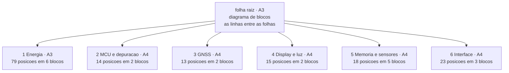
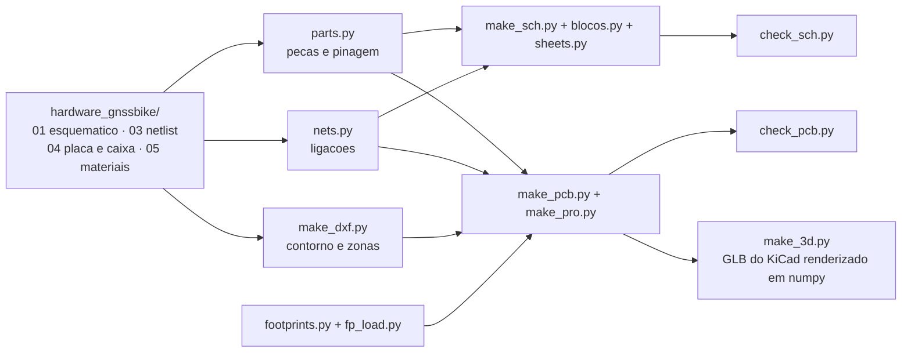

# Projeto KiCad da placa

Este diretório é o projeto de CAD do GNSS Bike Computer: **esquemático
hierárquico em sete folhas** e **placa com as 156 peças posicionadas e
roteadas**, em KiCad 8, gerados a partir dos documentos de
[`hardware_gnssbike/`](../README.md) e conferidos contra eles por programa.

> [!WARNING]
> **Nada aqui foi fabricado, montado ou medido.** Não existe placa, não existe
> protótipo e nenhum número desta página saiu de bancada. O roteamento é
> automático e **não está completo**: as ligações de RF ficam de fora de
> propósito e parte das ligações continua sem trilha.

## O que abrir

| Arquivo | O que é |
|---|---|
| `gnssbike.kicad_pro` | o projeto; **abra este** no KiCad |
| `gnssbike.kicad_sch` | folha raiz: o diagrama de blocos |
| `folha1-energia.kicad_sch` … `folha6-interface.kicad_sch` | as seis folhas |
| `gnssbike.kicad_pcb` | a placa |
| `gnssbike.kicad_dru` | as duas regras locais de folga |
| `zonas.dxf`, `contorno-r3.dxf`, `contorno-r4.dxf` | as zonas e o contorno da placa em DXF, gerados pelo `make_dxf.py` (entradas da placa, não saídas) |

O que se **lê** sai daqui para as pastas do assunto (reorganização de 2026-09-26): o esquemático em PDF para [`../esquematico/`](../esquematico/), a placa em PDF e SVG e o desenho de montagem para [`../placa/`](../placa/), a proposta de caixa (PDF, STL e os dois scripts dela) para [`../caixa/`](../caixa/README.md), e as vistas 3D da placa e da caixa para [`../../docs/img/hardware/`](../../docs/img/hardware/). A tabela de [`../README.md`](../README.md#o-cad-e-o-que-sai-dele) lista cada arquivo. O `gnssbike.glb` que o `kicad-cli` exporta fica aqui e fora do git (45 MB, regenerado quando a placa muda).

## O esquemático



### Desenhado por bloco funcional, desde 2026-09-26

Até esse dia cada folha era a lista de nós desenhada em fios: as peças numa
grade por ordem de ligação e o roteador de labirinto puxando um fio de cada
pino até o outro extremo, fosse ele do outro lado da página. O dono pediu o
padrão industrial — ligações e rótulos, A4 ou A3, peças certas, fácil de
ler, os circuitos subdivididos em caixas tracejadas —, e o `blocos.py` é
isso:

| Regra | Como | De onde vem |
|---|---|---|
| Cada folha é uma fila de **blocos funcionais**, na ordem em que o sinal flui, cada um numa **caixa tracejada com título** | a tabela `BLOCOS` de `blocos.py` diz as âncoras de cada bloco (o CI ou o conector); os passivos seguem `make_pcb.DECOPLA` e `JUNTO` (as tabelas que já dizem de quem é cada capacitor na placa), depois `sheets.SEGUE`, depois a lista de nós sem os trilhos (o vizinho mais próximo por saltos) | SparkFun, "How to read a schematic": "truly expansive schematics should be split into functional blocks", "following the flow of circuit from input to output" |
| Dentro do bloco, o passivo fica **ao lado do pino que serve**, do lado para onde o pino aponta; o desacoplamento vai numa **prateleira** sob o CI | `_colocar_bloco()`: a âncora no meio, cada membro a dois passos da ponta do pino que compartilha com ela, empurrado para fora até caber sem sobrepor nem encostar ponta de outra rede; o que só toca trilho vai para a prateleira, que quebra linha na largura da âncora | prática corrente; a razão é o roteador: um fio curto sempre passa |
| Um passivo de dois terminais é **espelhado** quando o pino que serve ao CI é o de trás, e **posto em pé** (90° ou 270°) na prateleira e quando é pull-up ou pull-down de uma linha rotulada | `Part.espelho` e `Part.rotacao`. A **biblioteca** guarda sempre o desenho base (`pin_base()`); a instância leva o giro e o espelho, e `pin_local()` diz onde as pontas ficam depois deles. **Medido** no KiCad 8 em 2026-09-26, com treze resistores de biblioteca base e um rótulo colado em cada ponta (`kicad-cli sch export netlist`): `(mirror y)` troca esquerda por direita, `(mirror x)` troca cima por baixo; `(at x y 90)` manda o pino da esquerda para **baixo**, `270` para cima; a rotação vem antes do espelho. E, pelo `sch export pdf`: a justificação do campo de texto também é transformada (sob `(mirror y)` "left" imprime como "right"; a 90° trocam os dois eixos; a 270° nada), e `instance()` escreve a justificação que **renderiza** como a pedida | a primeira "medição" saiu invertida porque foi feita através do gerador, que escrevia a biblioteca já espelhada e ainda punha o `(mirror ...)` na instância: transformação duas vezes. Foi assim que todos os capacitores em pé saíram com as duas pontas no ar em 2026-09-26 |
| Alimentação e terra por **símbolo**, apontando **para longe do pino**: deitado ao longo da linha num pino lateral (seta ou barras para fora, o nome na linha, depois delas), em pé num pino de cima ou de baixo; pinos vizinhos do mesmo trilho no mesmo lado, ou os topos de uma fileira de capacitores em pé, ganham **um fio pela ponta deles e um símbolo só** | `PowerPort.sentido` (U, D, L, R); o nome fica a 3,3 mm do ponto, entre duas linhas de pino. Em pé num pino lateral, o símbolo punha a seta na linha de cima e o nome na seguinte. O fio da corrida é um por par de vizinhos: "wires connect with other wires or pins only if their ends coincide exactly" — um pino no meio de um fio comprido **não** está nele; e cada célula do fio é marcada no roteador (só as pontas e o meio deixavam um rótulo de outra rede pousar no meio dele) | manual do Eeschema 8; prática corrente nos esquemáticos densos |
| A **prateleira** é uma fileira de capacitores em pé, agrupados por trilho, com passo de 12,7 mm; o trilho corre pelos topos e o terra pelos pés, um símbolo por fileira; os pontos de teste ficam em pé com o pad pendurado da linha | `_colocar_bloco()` (prateleira), `PASSO_PRATELEIRA`, `ENTRE_LINHAS_PRATELEIRA`, `LARGURA_PRATELEIRA`; a referência e o valor à direita da peça, escritos a 90° (o KiCad soma o giro da instância ao ângulo do campo) | é como toda folha de desacoplamento é desenhada |
| Pull-up ou pull-down de uma linha que **sai do bloco** fica **em pé, depois do rótulo**; quando a linha segue para outra âncora (os contatos do FPC ao painel), fica **fora do corredor** das linhas, acima (trilho) ou abaixo (terra), e o roteador desce um fio até a linha cruzando as outras em ângulo reto | `_colocar_bloco()`: `em_pe`, distância pelo comprimento do maior rótulo vizinho (`GAP_ROTULO` no mínimo). Deitado na linha, ficava debaixo do texto do rótulo; em pé sobre a linha, era um muro para as linhas ao lado | é como uma fileira de pull-ups é desenhada |
| Os **rótulos têm o lugar reservado antes** das peças: cada pino de âncora cuja rede sai do bloco ganha um retângulo (toco de dois passos, texto, pentágono) que nenhum corpo nem texto de membro toma; e o que cada peça ocupa é testado como retângulos **separados** (corpo com pinos, cada texto), nunca uma caixa envolvente só | `retangulos` em `_colocar_bloco()`; `Part.caixas_de_texto()`. Uma caixa só em volta do conector FPC e do seu valor de 26 mm murava todas as linhas à direita dele | — |
| Sinal que sai do bloco vira **rótulo local**; sinal que sai da folha vira **rótulo hierárquico**, os dois num toco curto saído do pino; o texto do rótulo não pousa sobre peça, valor nem nome de símbolo | `_rotulo()`: toco reto de 2 a 12 passos se o caminho está livre **e** o texto cabe, senão o labirinto leva o toco à célula livre mais próxima onde o texto caiba (e, em último caso, a qualquer célula livre, para o pino nunca ficar aberto). As duas células em frente de todo pino são da rede dele (`dono_da_celula`): nenhuma outra rede passa ali. Num conector **de passagem** (`nets.PASSA_DIRETO`: o pino está em duas redes que são um nó só) o fio do painel continua do ponto do rótulo, e as duas redes podem partilhar células no roteador (`Router.irmas`) | manual do Eeschema 8: "local labels connect items located in the same sheet"; SparkFun: "give a net a name and label it, rather than routing a wire all over the schematic" |
| Um conector de biblioteca do KiCad com os pinos todos de um lado é **espelhado** para encarar a âncora com quem fala, e **alinhado** com ela pela mediana das linhas dos pares de pinos ligados, para as linhas correrem retas | `_colocar_bloco()` (âncoras); `Part.espelho_token()` devolve `y` para símbolo do KiCad. Com os pinos virados para fora, as dez linhas do FPC davam a volta por cima | — |
| Um pino de trilho sem lugar para o símbolo ganha o símbolo no fim de um toco roteado — **nunca um rótulo local com o nome do trilho** | **medido** na lista de nós do KiCad: um rótulo local `3V0` é a rede `/folha/3V0`, outra rede, e não se junta ao `3V0` dos símbolos de alimentação | medida de 2026-09-26 |
| Tudo na **grade de 50 mil** (1,27 mm) | `snap()` em toda coordenada | manual do Eeschema 8: "always use a 50 mil grid" |
| O tamanho da folha continua **medido**: a menor de A4, A3, A2 em que os blocos cabem | `escolher_papel()` coloca os blocos na candidata e aceita quando a última prateleira termina acima da margem | ver abaixo |

O `check_sch.py` é quem diz se deu certo: a lista de nós que o KiCad extrai
tem de bater com a de `nets.py` pino a pino, o ERC não pode acusar erro novo,
nenhum fio pode cruzar componente e nada pode sair da folha. Em 2026-09-26,
depois da passada de legibilidade que o dono pediu (símbolos de alimentação
deitados nos pinos laterais, nome e número do pino escondidos neles, texto
horizontal nas peças em pé, prateleira por trilho, pull-ups em pé depois
dos rótulos, lugar dos rótulos reservado, conector do FPC espelhado e
alinhado com o painel), ele passa com a folha 1 em **A3** e as outras em
A4; oito redes fecham por rótulo em vez de fio porque o labirinto não achou
caminho dentro do bloco (sete na folha 1, uma na 6: o gerador lista quais),
e dois símbolos ficaram onde couberam, com o nome encostado em alguma coisa
(`VBAT_SYS` no `SYS` do medidor, `3V0_GNSS` no ferrite). O que ainda não está
bom: o bloco da colheita solar (os seis módulos em série e paralelo, com
três laços de 0 R, e o lado esquerdo do ADP5091, com os divisores) e a
esquerda do medidor de bateria, que continuam apertados. `SCH_DEBUG=1
python make_sch.py` imprime por que cada símbolo ou rótulo não achou lugar
reto e onde um fio não achou caminho.

### O tamanho da folha é medido, não escolhido

**Cinco das sete folhas são A4 e as outras duas A3.** Antes eram A0, A2 e
cinco A3, e a causa era a mesma do contorno da placa: o desenho era espalhado
para encher o papel em vez de o papel ser escolhido para caber o desenho.

| O que fazia | O que faz agora |
|---|---|
| Orçava **54 × 48 mm por peça**, fosse um 0402 ou um módulo de 80 pads | **desenha** na folha candidata e pergunta se a última linha terminou acima da margem — é o mesmo código que desenha, então a resposta não pode divergir do desenho |
| Nunca considerava A4: a busca começava em A3 | começa em **A4** |
| Corredores de 24 e 30 mm entre peças, mais largos que os próprios símbolos | **16 e 22 mm**, e quem prova que ainda cabe fio é o `check_sch.py`, que falha se um fio cruzar componente |
| Raiz em **A0 fixo**, blocos de 190 × 240 mm num passo de 370 × 350 | blocos dimensionados pelo que contêm (o do MCU tem 33 sinais atravessando), **A3** medido |

Um pino de folha ganhava um espaço de 5,08 mm para um rótulo de 1,27. A dois
passos de grade — o padrão do KiCad — o bloco do MCU caiu de 116 para 73 mm de
altura, e foi isso que tirou o diagrama de A2.

### Bloco é só para circuito integrado

Um retângulo com nomes de pino nas laterais é como se desenha um **CI**, e só
um CI. Este gerador desenhava **tudo** assim — 127 peças, todas retângulos:
resistores, capacitores cerâmicos, diodos, o TVS. Uma folha de blocos ligados
por linhas não mostra circuito nenhum.

Cada classe passou a ter o símbolo dela, no padrão, com o eixo dos terminais
em x e o corpo entre −1,27 e +1,27 mm:

| Classe | Símbolo | Quantas |
|---|---|---|
| `R`, `JP` | ziguezague | 42 |
| `C` | duas placas paralelas (cerâmico); placa curva e `+` quando for eletrolítico | 31 |
| `L` | quatro arcos | 4 |
| `FB` | quatro arcos dentro do retângulo, que é o que distingue a ferrite do indutor | 1 |
| `RT` | ziguezague com a seta na diagonal | 1 |
| `D` | triângulo e barra; com setas para fora se for LED | 2 |
| `SW` | dois contatos, a barra e o êmbolo | 3 |
| `LS` | círculo com a diagonal | 1 |
| `TP` | círculo na ponta do terminal | 14 |
| `U`, `J`, `DS` | **retângulo**, que é o certo para eles | 36 |

Peça de dois terminais não mostra **número nem nome de pino**: "1" e "2" num
resistor é ruído, e o símbolo já diz onde é o quê onde importa — a barra do
catodo, a placa curva.

Três tipos de nó, cada um desenhado do jeito que se faz:

| Tipo | Como aparece | Quantos |
|---|---|---|
| **Trilho** (alimentação e terra) | símbolo de alimentação junto do pino que ele alimenta; o KiCad junta todos os de mesmo nome | 18 |
| **Entre folhas** | rótulo hierárquico na margem, pino no bloco da raiz, e a linha entre os blocos | 36 |
| **Dentro da folha** | só fio | 57 |

Dentro de cada folha as peças são colocadas na ordem em que se ligam, não por
tamanho: o capacitor de desacoplamento cai ao lado do CI que ele desacopla.

## A placa

| Item | Valor |
|---|---|
| Contorno | **34 × 95 mm**, canto de 3 mm, 0,8 mm de espessura — **derivado das regras**, não escrito à mão; os 5 mm além dos 90 de 2026-09-24 são das três teclas no passo de 13,4 (a área da antena do módulo desce com ele; `GNSSBIKE_H` troca a altura) |
| Camadas | **4**: `F.Cu`, `In1.Cu` (terra), `In2.Cu` (alimentação), `B.Cu` |
| Por que esse tamanho | a 7.2 do ME54BS13 pede **50 mm entre dois módulos de rádio**, e esta placa tem dois. Varrendo cada milímetro que cumpre isso e ainda cabe a fila de teclas, 34 × 90 é o menor contorno com folga — **3.060 mm² contra os 5.335 do 55 × 97, 43 % menos** |
| Relação com a caixa | **nenhuma.** A placa sai do circuito; a caixa sai do display, da bateria e da mão. Encolher uma não encolhe a outra |
| Peças na placa | **156**, com rotação (2026-09-26); as de trás (`U502`, `RT101`, `LS601`, `J103`) estão em `make_pcb.ATRAS`. Desde 2026-10-18 são **167** com footprint, com as onze peças das duas telas que vão soldadas, e o `D105` e o `J403` também vão atrás |
| Fora da placa | **8** desde 2026-10-18 (`footprints.FORA_DA_PLACA`): as duas telas, `DS401` e `DS402`, que vão no `J401` uma de cada vez, e os seis módulos solares, que moram na caixa. A célula não é peça do CAD, e a antena GNSS passou a morar na placa |
| Redes | **114** |
| Furos de fixação | **2**, M2, em (3,2; 7,0) e (14,4; 91,7) — decisão do dono em 2026-09-25 (dois furos), depois da conta de [02](../02-calculos.md#quantos-parafusos-a-placa-precisa); as posições são do dry run da caixa de 2026-09-26: nenhum sobre a célula, o segundo entre o USB-C (que andou 0,4 para a esquerda por ele) e o módulo, fora do lugar do sensor de luz e da faixa do verso que segura o `J103` |
| Planos de terra | **3**, em `In1.Cu` e nas duas faces, preenchidos pelo `fill_zones.py` (com o Python do KiCad) |
| Roteamento | **196 ligações**, 1.417 segmentos, 549 vias (2026-09-26, à tarde, na placa de 95 mm); o par USB à mão, num corredor reservado de `D102` a `J101`; `RF_IN`, `RF_ANT`, `RF_CHIP` e `RF_UFL` ficam de fora de propósito |
| Ligações sem trilha | **75**, em 33 redes, pelo roteador; **58 itens desconectados** em 37 redes pelo DRC completo (`--severity-all`) com as malhas preenchidas — a regra `RT1` do `dry_run_pcb.py` |
| Erros de DRC | **0** (20 avisos, todos de biblioteca de footprint); os 3 do par USB contra o ponto de teste `TP101`, que o furo M2 novo empurrou para o caminho do par, saíram com o corredor |

### O que decide a posição de cada peça

1. **A borda**, para quem tem de alcançá-la: o USB-C com a boca para fora, os
   fitas das telas chegando pela esquerda, o `J103` do chicote solar e
   o módulo de rádio deitado no canto de baixo à direita, com a antena sobre o
   recorte — que é o arranjo que a figura 1 da seção 7.5 da ficha dele chama
   de "Best". Nada disso é a caixa mandando no tamanho da placa: é o circuito
   dizendo de que lado cada coisa sai.
2. **A zona** de [`04-pcb-e-caixa.md`](../04-pcb-e-caixa.md), para quem tem
   uma. As zonas são **derivadas de `W` e `H`**, não retângulos fixos.
3. **A ligação**, para todo o resto: cada peça vai ao centro de gravidade das
   peças a que se liga.
4. **A rotação**: peça de dois terminais deita ao longo da linha entre as duas
   peças que ela junta, para a trilha sair reta.

### O que a regra dos 50 mm impôs ao arranjo

Com 34 mm de largura, três decisões deixaram de ser gosto:

| O que | Por quê |
|---|---|
| A fila de teclas **não** fica na borda de baixo | o módulo ocupa 17,0 mm dela e a fila pede 30,6; e os 5 mm que a 7.4 pede em volta da antena comem mais. A fila subiu para acima do módulo |
| O buzzer vai na **face de trás** | 10,5 × 9,5 mm não cabem na faixa de 9,25 mm que sobra na frente entre as teclas e o módulo. Empurrado, ele parava a 0,84 mm do TPS7A02 e tomava o anel que o desacoplamento dele precisa |
| O receptor GNSS fica a **180°** | a 0 o pino `RF_IN` saía do lado da borda, a 1,2 mm dela, e a rede π não tinha para onde ir — ficava a 10,5 mm de um pino que a 4.4 quer "as short as possible". Virado, o pino olha para dentro e a rede cabe em linha |

## Verificação

```sh
python hardware_gnssbike/cad/check_sch.py                 # regera e confere o esquematico
"D:/KiCAD/bin/kicad-cli.exe" sch export pdf --output hardware_gnssbike/esquematico/gnssbike-esquematico.pdf hardware_gnssbike/cad/gnssbike.kicad_sch
python hardware_gnssbike/cad/make_pcb.py                  # 1. coloca as pecas
python hardware_gnssbike/cad/route.py                     # 2. roteia o que consegue
"D:/KiCAD/bin/python.exe" hardware_gnssbike/cad/fill_zones.py   # 3. preenche as malhas de terra
python hardware_gnssbike/cad/check_pcb.py --como-esta      # 4. confere o arquivo como esta
python hardware_gnssbike/cad/dry_run_pcb.py               # 5. as regras das fichas
```

O `route.py` é um labirinto A\* sem *rip-up*: faz bem o que pede regra
própria (as linhas de 50 Ω do GNSS, o par USB pelo diodo, a costura da
borda) e sempre deixou dezenas de ligações sem cobre. O `autoroute.py`, de
2026-10-18, tenta fechar o resto com o Freerouting (fora do repositório, em
`~/tools/freerouting`, como no projeto irmão do medidor de potência): trava o
cobre de RF e USB e as vias de terra, exporta o DSN pelo `pcbnew` e importa o
SES. **Medido em 2026-10-18, ele não fechou**: em 20 minutos, 55 itens
desconectados contra os 64 do `route.py` sozinho, e erros novos de DRC. Ele
fica fora da cadeia.

Em 2026-10-19 o `route.py` mesmo foi atrás das causas, e várias não eram
falta de espaço:

| Causa | O que fazia | Correção |
|---|---|---|
| UUIDs repetidos no arquivo | o DRC dava cada ligação faltando na peça errada | `make_pcb.py` dá UUIDs próprios a cada footprint; o `check_pcb.py` acusa repetição |
| keep-out da antena de chip pintado sobre os pads dela | nem a ligação de 1,7 mm do `E301` ao `C305` saía | o keep-out aceita, na frente, só as redes da própria antena |
| `JP301` a 0° | as linhas do U.FL e da antena de chip tinham de se cruzar na frente | girado 180° |
| vias de terra na primeira direção livre, começando por "para baixo" | as vias dos capacitores do nPM1300 cercavam o chip, e metade dos pinos não saía | a via vai para o lado de fora do CI denso mais perto |
| pad de terra sem lugar para via reta | ficava solto | saída dobrada até onde uma via cabe |
| grade de 0,15 mm num passo de 0,4 | duas saídas de terra a 0,11 mm de uma esfera do TPS610997 | toda saída de terra passa por uma conferência geométrica contra os pads reais |
| trilhos roteados por último | os trilhos largos achavam a placa cheia | uma segunda passagem roteia os trilhos primeiro, e fica a melhor |
| um passe em ordem não volta atrás | quem vinha tarde não achava caminho | *rip-up and reroute*: a rede que falhou é procurada de novo por cima do cobre que pode ser desfeito; se até 6 redes estão no caminho, elas saem, a que falhou passa primeiro, elas voltam depois, e a troca só fica se as falhas de todas juntas caírem |

O DRC não acusa erro nenhum. Com as causas acima corrigidas e com os
trilhos primeiro, eram 60 itens desconectados; o *rip-up and reroute* leva
a **48** (61 tentativas, 9 aceitas, uns 23 minutos) e para sozinho quando
uma rodada inteira não melhora nada. Passagens extras com as redes que
falharam na frente pioraram o resultado (`PASSAGENS_EXTRA = 0`). Terra, o
par USB e as linhas de RF nunca são desfeitos.

O que sobra são trilhos de alimentação (`VBAT_SYS`, `VSYS`, `3V0`,
`3V0_SENS`) e sinais que atravessam a zona de energia (os I²C, o SPI da
tela, os do GNSS). A zona ocupa a largura toda da placa no meio dela, e
todo sinal do módulo, embaixo, para o receptor, os sensores e a tela, em
cima, passa por ela. Fechar o resto pede mexer na colocação ali (abrir um
corredor de sinais ao lado dela) ou terminar à mão no roteador interativo
do KiCad, a partir deste arquivo.

A ordem importa por dois motivos. Sem `--como-esta`, o passo 4 **regera a
placa** e apaga as trilhas. E **sem o passo 3 o DRC mente**: os geradores
escrevem a zona de terra como contorno e mais nada, que é arquivo legal — o
KiCad preenche ao abrir —, mas o `kicad-cli pcb drc` **não preenche**. Numa
placa sem preenchimento todo pad que só chega ao plano aparece como
desligado e toda via de costura como solta, e nenhuma folga é medida contra
o cobre despejado, que é justamente a mais importante numa placa coberta de
terra. O `fill_zones.py` chama o preenchedor do próprio KiCad, pelo `pcbnew`,
e por isso roda com o Python do KiCad. O que isso mudou nos números, medido:
**296 ligações sem trilha caíram para 100**, e apareceram **11 erros reais**
de haste térmica insuficiente que a placa vazia escondia.

Depois, as vistas:

```sh
python hardware_gnssbike/cad/make_dxf.py     # contorno e zonas em DXF
"D:/KiCAD/bin/kicad-cli.exe" pcb export glb --output hardware_gnssbike/cad/gnssbike.glb     --include-tracks --include-zones --subst-models hardware_gnssbike/cad/gnssbike.kicad_pcb
python hardware_gnssbike/cad/make_3d.py      # as quatro vistas 3D em PNG, em docs/img/hardware/
python hardware_gnssbike/caixa/dry_run_caixa.py   # a caixa medida contra a placa: 13 regras (falha = codigo 1)
python hardware_gnssbike/caixa/make_caixa.py   # a caixa: PDF e STL em caixa/, tres vistas em docs/img/hardware/
"D:/KiCAD/bin/kicad-cli.exe" pcb export svg --output hardware_gnssbike/placa/gnssbike-2d.svg     --layers "F.Cu,In1.Cu,In2.Cu,B.Cu,F.SilkS,Edge.Cuts,F.Fab"     --page-size-mode 2 --exclude-drawing-sheet hardware_gnssbike/cad/gnssbike.kicad_pcb
python hardware_gnssbike/cad/make_2d.py      # o PDF em placa/, uma pagina por camada
```

O `make_2d.py` existe por causa do preenchimento. As quatro camadas numa
folha só eram legíveis enquanto as malhas estavam vazias; cheias, o despejo é
área sólida e **cobre as trilhas de baixo**, e a folha passa a mostrar o
contorno do cobre e quase nada mais. Quem lê uma placa lê **uma camada de
cada vez**, e é o que ele gera: quatro páginas com uma camada cada sobre o
contorno e a serigrafia, mais a quinta de conjunto.

### Por que o 3D não sai do KiCad sozinho

O `kicad-cli pcb export glb` só lê modelos **STEP**. Os corpos desenhados
aqui são VRML, então eles não entram no GLB — e o `make_3d.py` desenha esses
por conta própria, lendo o `.wrl` de cada um: a forma e a **cor** que o
arquivo traz, não uma caixa. A diferença não é estética. Enquanto ele
desenhava um paralelepípedo preto de contorno de footprint para os 23 corpos
próprios, o módulo de rádio, o receptor GNSS, as três teclas, o buzzer e o
receptáculo USB-C eram **tijolos pretos iguais** numa vista que existe
justamente para conferir se a peça é a que se pensa.

**Esquemático** — os 7 arquivos abrem; o **próprio KiCad** percorre a
hierarquia e exporta o netlist; os **100 nós elétricos saem iguais** aos da
lista de nós, pino a pino; nenhum nó a mais; os 37 pinos sem ligação são
exatamente os que a lista deixa soltos; **nenhum fio passa por cima de
componente** em folha nenhuma; nada fora da folha; nenhuma peça sobre outra;
e todo rótulo hierárquico tem o pino de folha que responde por ele.

**Placa** — o KiCad abre e roda o **DRC, que fecha em zero erro**, com as
malhas preenchidas e 58 itens ainda sem trilha (2026-09-26); as **156 peças** estão lá,
uma vez cada; **todo pad leva a rede da lista de nós** e nenhuma ligação ficou
sem pad; nenhum contorno sobre outro; nada passa da borda; nada dentro das
áreas de antena; a placa cabe na caixa; os três planos de terra existem.

**Regras das fichas** ([09](../09-dry-run-da-pcb.md)) — **17 cumpridas, 0
violadas, 5 que só bancada ou fabricante decidem**. As duas que falhavam na
placa de 55 × 97 caíram sozinhas quando a placa passou a ser dimensionada
pelo circuito:

| Regra | Na placa de 55 × 97 | Na de 34 × 90 |
|---|---|---|
| `RF9`, os 25 mm do display | falhava: a sombra do display chegava a **11,3 mm** do módulo | **passa**: o display é mais largo que a placa e não fica mais sobre ela; o pior agora é o cabo plano `J402`, a 31,3 mm |
| `AL1`, desacoplamento | falhava: `C114` a 3,3 mm do `U104` contra 2 | **passa**: o buzzer saiu de cima do regulador e o anel dele ficou livre |

### As duas regras locais de folga

`gnssbike.kicad_dru` abre exceção em dois footprints, e só neles:

| Regra | Por quê |
|---|---|
| `J101`, furo a cobre ≥ **0,175 mm** | os furos da blindagem do receptáculo USB-C ficam a **0,1801 mm** dos próprios pads |
| `U104`, folga ≥ **0,115 mm** | o pad térmico do TPS7A02 em X2SON de 1 × 1 mm fica a **0,1196 mm** dos próprios pinos |

Os dois são land patterns de fabricante, não desenho nosso. O resto da placa
segue **0,127 mm** de folga e **0,2 mm** de furo a cobre, que é o que uma
fábrica de quatro camadas faz sem custo extra. **Nenhuma fábrica foi
consultada** — e a pilha de camadas, a largura de 50 Ω e a de 90 Ω
diferencial esperam a mesma resposta.

## Serigrafia e pontos de teste

**Os dezesseis pontos de teste de [06](../06-conectores-e-pontos-de-teste.md)
estão na placa**, menos dois: o `TP111` media o `ST_STO` do AEM10900, que
saiu em 2026-09-24 (o ADP5091 não tem esse sinal), e o `TP401` mediria o
`5V0`, que até 2026-10-18 não existia com a JDI e desde então sai do boost
da Sharp (`U402`), montado em toda placa: o ponto ainda não foi criado. A
lista mora em `parts.TESTE` e o `nets.py` **recusa** um ponto que aponte
para um nó inexistente.

**As referências estão em serigrafia nas duas faces**, cada peça na sua, no
mínimo que a fábrica imprime — **0,8 mm de altura com traço de 0,15** — e
**nenhuma cai sobre outra**. Não é automático: com todas no mesmo deslocamento
de 1,8 mm acima da peça, **37 pares ficavam sobrepostos**. O `rotulos()` de
[`make_pcb.py`](make_pcb.py) procura, para cada rótulo, o lugar livre mais
perto do contorno da própria peça, com duas regras em ordem — nunca sobre
outro rótulo, de preferência fora do contorno de outra peça.

| Medida | Antes | Agora |
|---|---|---|
| Altura do texto | 0,7 mm, traço 0,1 | **0,8 mm, traço 0,15** (mínimo de fábrica) |
| Pares sobrepostos | **37** | **0**, medidos no export do KiCad |
| Referências visíveis | 128, uma delas `REF**` | **127** (o `REF**` do furo foi escondido) |

### O desenho de montagem não sai de camada nenhuma do KiCad

Nem a serigrafia nem o `F.Fab` dão um desenho de montagem legível desta placa,
e as duas razões são diferentes.

A **serigrafia** é serigrafia: obedece à fabricação, 0,6 mm de texto, e 127
designadores numa placa de 34 × 90 mm a 48 % de ocupação não cabem em volta
das peças sem cair um sobre o outro ou se afastar tanto da peça que deixam de
nomear alguma coisa.

O **`F.Fab`** carrega o que cada footprint da biblioteca resolveu pôr lá, no
tamanho que o autor daquele footprint escolheu, mais o valor — então imprime
`TP110` a 1,0 mm ao lado de `100 nF` a 0,5 e os dois por cima do contorno.

Desenho de montagem não é camada de cobre. É desenho, e pode fazer a única
coisa que a serigrafia não pode: pôr o rótulo onde se lê e traçar uma **linha
de chamada** até a peça. É o que o [`montagem.py`](montagem.py) faz — rótulo
dentro do contorno quando cabe, e fora com ponto e linha quando não cabe.
Das 127 peças, **92 usam chamada**.

### Por que a conferência é feita no export, e não aqui

O `make_pcb.py` tem um modelo de quanto espaço um rótulo ocupa, e ele estava
**30 % estreito**: 0,75 do tamanho do texto por caractere, contra os **1,06**
que o `textLength` do próprio KiCad mede. Com isso ele reportava **zero**
sobreposições enquanto a serigrafia exportada tinha **35 pares** um sobre o
outro. Havia um segundo erro por trás: o deslocamento era escolhido no
referencial da **placa**, e o KiCad gira uma propriedade de footprint pelo
ângulo do próprio footprint — um rótulo posto "acima" de uma peça girada 90°
saía ao lado dela.

Por isso o `check_pcb.py` **exporta as duas camadas de serigrafia em SVG** e
conta as sobreposições nos retângulos que o KiCad escreve, com o `textLength`
e o tamanho de fonte de cada texto. Modelo interno não confere modelo interno.

## Três footprints eram de outra peça

A conferência `ME3` compara o **corpo que a ficha de cada peça cota** com o
contorno do footprint desenhado para ela. Ao ganhar as cotas dos conectores,
ela pegou três casos em que o land pattern na placa é de uma peça **diferente
da que está na lista de compras** — e um land pattern errado não é detalhe:
a peça não solda.

| Peça da lista | Footprint que estava em uso | O que a ficha diz | Diferença |
|---|---|---|---|
| **Same Sky CPT-1117-83-SMT** (buzzer) | `Buzzer_CUI_CPT-9019S-SMT`, **redondo de 9 mm** | corpo **retangular de 11,0 × 9,0 × 1,7**, preso por duas abas de 2,0 × 0,2 mm, uma em cada ponta e em lados opostos, com furo de 0,8; padrão de solda de **duas ilhas de 2,5 × 2,5 a 10,5 mm** | **corrigido**: footprint desenhado aqui |
| **Molex 2036150003** (USB-C IPX8) | `USB_C_Receptacle_Palconn_UTC16-G` | corpo **9,99 × 8,58 × 4,21** | o footprint desenha **8,94 × 7,32**: falta **1,05 × 1,26 mm**. **Superado em 2026-09-24**: a peça virou o HRO TYPE-C-31-M-12, que tem footprint com o nome dela na biblioteca do KiCad (**EXATO**) |
| **Hirose FH28-10S-0.5SH(05)** (FPC do display) | `Hirose_FH12-10S-0.5SH`, outra série | corpo **9,90 × 5,70 × 2,55** | o footprint desenha **8,10** de largura: falta **1,80 mm**. **Superado**: a peça virou o FH12 em 2026-09-24 e o **Molex 503480-1000** em 2026-10-18, com footprint gerado aqui do desenho SD-503480-001 |

> [!CAUTION]
> **Os dois em aberto não foram consertados de propósito.** Reconstruir um
> land pattern de USB-C ou de conector FPC a partir de um desenho
> **renderizado** é exatamente o tipo de palpite que essa conferência existe
> para pegar, e errar o padrão de solda de um USB-C mata a placa. Nem a
> Molex 2036150003 nem a Hirose FH28 existem na biblioteca do KiCad 8. O que
> resolve é o arquivo de land pattern do fabricante, ou ler o desenho com
> confiança maior do que uma imagem dá. Enquanto isso, o `ME3` **falha**, e é
> para falhar.

A altura do USB-C também estava errada e foi corrigida: **4,21 mm** acima da
superfície de montagem, não os 3,26 que estavam escritos como "conferir".

> [!NOTE]
> **As três peças da tabela saíram do desenho depois**, e com elas os casos.
> O buzzer passou ao Murata PKLCS1212E4001-R1 em 2026-09-24 e ao Same Sky
> CPT-12123-81-SMT-TR em 2026-10-18, no land de 12 × 12 da ficha
> (`Buzzer_CPT-12123-81-SMT_12x12mm`). O USB-C passou ao HRO. E o conector
> do display passou ao Molex 503480-1000, de contato dos dois lados, junto
> com o `J402` (Molex 503480-0540) e o `J403` (Molex 503480-0440), os três
> gerados em `footprints.py` com a frente do lado dos pregos de fixação e o
> land na posição do contorno do desenho da Molex
> ([11](../11-revisao-do-esquematico.md#correções-aplicadas)).

## Footprints

| Origem | Quantos | O que significa |
|---|---|---|
| **EXATO** | 24 | o footprint da KiCad é desta peça |
| **ENCAPSULAMENTO** | 125 | mesmo encapsulamento, desenhado para outra peça. Cabe, e **ainda tem de ser conferido contra a ficha** |
| **GERADO** | 18 | não existe na KiCad; gerado aqui a partir das dimensões, com o land pattern **aproximado** |

São 167 peças com footprint em 2026-10-19 (`python footprints.py`); a tabela
dava 10, 92 e 10 antes das trocas de peça de 2026-09-24 e das duas telas.

O **módulo de rádio** é o `MinewSemi ME54BS13` (nRF54LM20A), 16,5 × 12,0 ×
2,4 mm, **80 pads**: 20 castelados nas laterais e uma matriz LGA de 60 no
miolo, 64 GPIO. O footprint foi gerado das cotas do desenho mecânico da ficha
V1.0.0, porque **a Minew não publica land pattern** — a ficha diz para pedir o
dela.

> [!CAUTION]
> **Os dois desenhos da Minew discordam do espelhamento.** O da ficha V1.0.0
> põe os pinos 1–10 (RF, SWD, USB) na lateral **esquerda**; o da V0.5.0 e o da
> página do produto põem na **direita**. Este projeto seguiu a V1.0.0, que é a
> mais nova e a única com números de pino. **Confira num módulo real antes de
> fabricar**: pelo desenho adotado, os três GND da primeira linha da matriz
> (D0, E0, F0) ficam do **mesmo lado do VCC (pino 19)**. Se estiverem do lado
> do SWD, o footprint está espelhado.

Oito peças **não estão na placa**: as duas telas, `DS401` e `DS402`, que
vão no `J401` uma de cada vez, e os seis módulos solares `PV101` a `PV106`,
que moram na caixa e chegam pelo `J103`, um JST ZH de 4 vias. Até 2026-09-24
a antena `E301` também morava fora, e os módulos chegavam por três pares de
pads de mola (`J103` a `J105`); desde então a antena é de chip, soldada na
borda, o `J302` é um u.FL para uma antena externa, e não há mais mola a
escolher.

## De onde vem cada coisa



Nenhum arquivo do KiCad é editado à mão: tudo sai dos geradores, e os
geradores leem os documentos. Editar no KiCad e regerar apaga a edição — o
lugar de mudar é o gerador.

## O que falta

- [ ] **Terminar o roteamento.** 127 ligações têm trilha e **101 não**; as duas
      de RF (`RF_IN`, `RF_ANT`) ficam de fora de propósito, porque impedância
      e caminho delas não são negociáveis e o roteador automático não sabe
      disso.
- [ ] **Os 25 mm entre o módulo de rádio e o display** (`RF9`): decidir entre
      blindagem, camada ou aceitar e medir na bancada.
- [x] **O desenho cotado do conector do display.** O Hirose FH28 saiu; os
      três conectores do display são Molex 503480 desde 2026-10-18, com o
      land do desenho SD-503480-001. O que fica em aberto é a dobra das fitas
      até a boca deles, que só a tela na mão confirma.
- [ ] Conferir cada footprint **ENCAPSULAMENTO** contra a ficha da peça; onze
      já estão conferidos, com a cota do desenho mecânico em
      `footprints.PACOTE` e a conferência automática em `ME3`.
- [ ] Pedir à Minew o land pattern oficial do ME54BS13. Os footprints do
      Molex 2036150003, do Hirose FH28 e do Molex 503480-0500 deixaram de
      ser necessários: as peças saíram do desenho.
- [x] ~~Escolher a mola dos contatos do painel solar e da antena~~: o painel
      chega pelo `J103`, um JST ZH, e a antena é a de chip ou o u.FL `J302`.
- [ ] A pilha de camadas do fabricante, e com ela as larguras de 50 Ω e 90 Ω.
- [ ] As pendências que os documentos já carregam: o lado do sensor do
      MAX17262, a polaridade do LED do Azumo (jumpers `JP402` a `JP405`) e a
      dobra das fitas das telas. A ordem das cinco vias da luz da JDI saiu da
      spec 1.4.2, e as pendências do AEM10900 e da tecla central caíram com
      as decisões de 2026-09-24 e de 2026-09-26.
